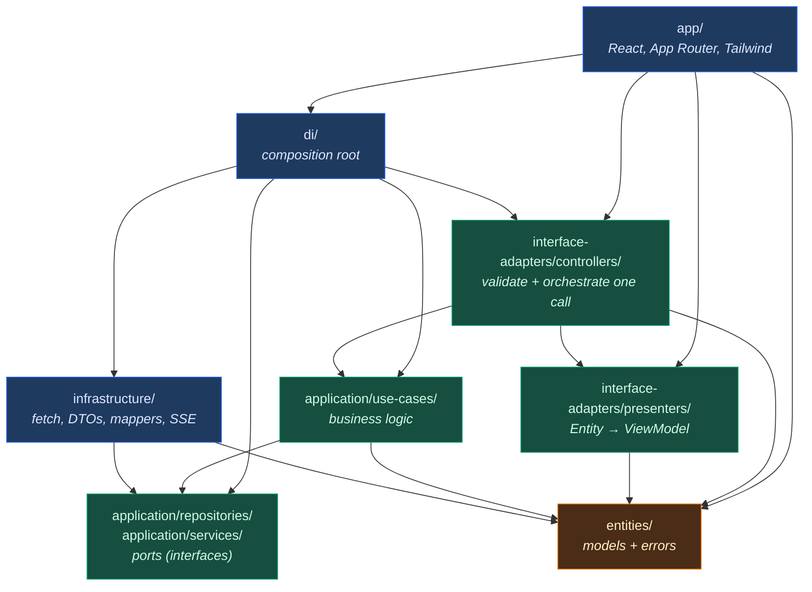
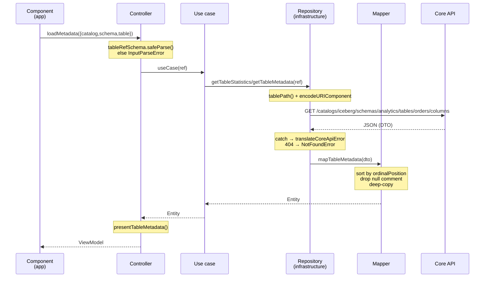

# celesnity-web

The Next.js front end of the Celesnity data platform: a workspace for browsing an
Iceberg/Trino catalog, running read-only SQL, managing DBMS connections, and
publishing and executing PySpark scripts.

It talks to exactly one backend — `celesnity-core`, referred to throughout as the
**Core API** — and is organized by **Clean Architecture layers**, not by feature
folders. That choice is the single most important thing to understand before
editing, so most of this document explains the structure and the reasoning behind
it.

- **Stack:** Next.js 16 (App Router) · React 19 · TypeScript 5.9 strict ·
  Tailwind v4 · Zustand · Zod · ioctopus (DI) · Vitest · Playwright
- **Node:** >= 22
- **No HTTP library.** All network access is native `fetch`, wrapped once in
  `CoreApiClient`. There is no axios, no react-query, no SWR, no generated API
  client.

---

## Organization MFA

New organizations start with MFA off. An organization owner or administrator can enable
authenticator-app MFA under **Administration → Overview → Enable MFA**. This is an enable-only
control: every human member, including the administrator, must then enroll TOTP and sign in with
MFA. The administrator is redirected to login after confirming. Already-enrolled members complete
their normal MFA challenge. Organization switching remains unsupported.

Core resolves `Organization.mfaRequired` for each authenticated request; Web also fetches the
configured tenant's policy without caching before creating sessions or forwarding Agent access.
Existing password-only sessions are denied on their next protected request after enablement;
already-running operations are not retroactively cancelled. An unavailable policy fails closed.
Machine identities continue using their separate service authentication flow.

Deployment order: apply Core migration `20260831183000_organization_mfa_policy`, deploy Core,
apply the Core API IAM permission `identitytoolkit.tenants.update`, then deploy Web and the
control-plane Web. Existing organizations keep MFA required; only new rows default to off.
Tenant TOTP capability is enabled before the database requirement is persisted. A provider failure
leaves the organization policy unchanged, and a database failure can be safely retried.

## Quick start

```bash
npm install
cp .env.example .env.local
npm run local:env      # synchronize local auth mode/key with ../celesnity-core/.env
npm run dev            # http://localhost:3000 — expects the Core API
```

`npm run dev` runs a non-secret preflight before Next.js starts. It rejects
different Web/Core auth modes, missing or different local signing keys, and a
missing `AGENT_API_URL`, preventing these configuration errors from appearing
later as unrelated 401/500 responses in the browser.

The browser uses the same-origin `/api/core` gateway. Its private upstream comes
from runtime-only `CORE_API_URL`; Identity Platform configuration is served at
runtime and bearer/session credentials are never compiled into the browser bundle.

### Commands

| Command                | Purpose                                                 |
| ---------------------- | ------------------------------------------------------- |
| `npm run dev`          | Dev server                                              |
| `npm test`             | 310 unit tests across 37 files, ~2s                     |
| `npm run test:visual`  | Playwright screenshot comparisons                       |
| `npm run typecheck`    | `tsc --noEmit`                                          |
| `npm run lint`         | ESLint **including architecture boundaries**            |
| `npm run format:check` | Prettier                                                |
| `npm run build`        | Standalone output                                       |
| `npm run api:generate` | Regenerate OpenAPI types — **Core API must be running** |

**Quality gate before claiming done:** `npm test && npm run typecheck && npm run
lint && npm run format:check && npm run build`, plus `npm run test:visual` for
anything that can move pixels.

---

## Directory map

```text
app/                          Frameworks & drivers — ALL React lives here
  _components/ui/             App-wide primitives: button, panel, badge, field, feedback, modal
  _components/shared/         Non-visual helpers: error-message, request-token, monitor-lifecycle
  _components/layout/         App shell: workspace-shell, navigation, language-switcher
  _i18n/                      Dictionaries (en/vi), translate(), useTranslation()
  _stores/                    Zustand — client interaction state only
  (workspace)/<page>/         Route + page-local _components/ for that page only
  api/client-logs/, health/   Route handlers

di/                           Composition root — the ONLY place naming concrete classes
  types.ts                    DI_RETURN_TYPES (token -> type) + DI_SYMBOLS (token -> symbol)
  typed-ioctopus.ts           Typed bind/resolve wrapper
  container.ts                Loads modules, exports getInjection('Token')
  modules/*.module.ts         One per feature + platform.module.ts for shared infra

src/entities/                 Domain models + application errors. Depends on nothing.
src/application/
  repositories/*.interface.ts Ports — what the app needs from the outside world
  services/*.interface.ts     Ports for progress streams and timers
  use-cases/<feature>/        One operation per file
src/interface-adapters/
  controllers/<feature>/      Validate input (Zod) -> call ONE use case -> present
  presenters/                 Entity -> ViewModel
src/infrastructure/
  api/core-api-client.ts      fetch wrapper: baseUrl, headers, telemetry, CoreApiError
  api/generated/schema.d.ts   GENERATED by openapi-typescript — never hand-edit
  api/translate-core-api-error.ts  HTTP status -> domain error
  repositories/               Port implementations + DTO<->Entity mappers
  services/                   EventSource (SSE), browser scheduler
  configuration/              Public environment
  observability/              Client telemetry

tests/unit/<layer>/           Tests mirror the layers
tests/visual/                 Playwright screenshots
skills/                       Working procedures — read the matching SKILL.md before editing
```

Two things that surprise newcomers:

- **`src/` contains no React.** Searching `src/` for a component will not find it.
- **Layers, not features.** One feature is a _vertical slice_ across seven
  directories. `connections` is the cleanest example to read end to end.

---

## Dependency graph

Arrows mean "may import". Anything not drawn is a lint error, not a style
preference.



Read it as concentric rings: **`entities` is the center and imports nothing.**
`app`, `di`, and `infrastructure` are the outermost ring. Dependencies only ever
point inward.

The critical edge is the one that is **missing**: `use-cases` never points at
`infrastructure`. Instead both point at `ports`. The application declares the
interface it needs; infrastructure implements it. This is dependency inversion,
and it is why business logic can be tested without a network, a DOM, or a
running backend.

Enforced by `eslint-plugin-boundaries` in `eslint.config.mjs` (`default:
'disallow'` — every allowed edge is explicit), plus
`tests/unit/tooling/architecture-boundaries.test.ts` and
`tests/unit/app/frameworks-layer.test.ts`.

### Consequences worth memorizing

| Rule                                                                     | Why                                                                                |
| ------------------------------------------------------------------------ | ---------------------------------------------------------------------------------- |
| React never calls the API                                                | `app` cannot import `infrastructure`. UI talks to controllers resolved through DI. |
| No DTO type outside `infrastructure`                                     | Backend field names must not leak into 12 components.                              |
| Repositories return Entities, never DTOs or `Response`                   | The port signature is written in domain types.                                     |
| Only feature roots call `getInjection`, and only for controllers         | One place per page knows the container exists; screens take props.                 |
| No `setInterval`, `EventSource`, or `subscribeToProgress` in a component | Transport belongs to infrastructure, orchestration to an Application monitor.      |

---

## Data flow, end to end

Concrete trace: the user clicks table `orders` in the catalog explorer and the
Columns panel renders.



The same data is named four times on the way through, and each name exists to
block something specific:

| Type            | Defined by           | Prevents                                                                                         |
| --------------- | -------------------- | ------------------------------------------------------------------------------------------------ |
| **DTO**         | Backend, via OpenAPI | Backend vocabulary escaping `infrastructure`                                                     |
| **Entity**      | `src/entities/`      | Anyone downstream knowing the API's shape; carries invariants like `sanitizeVerificationMessage` |
| **ViewModel**   | `presenters/`        | Credentials and raw error text reaching the UI                                                   |
| **Store state** | `app/_stores/`       | Server data being confused with interaction state                                                |

---

## Why this structure

The layers are not ceremony — each one is a response to a failure mode that a
single-component `fetch` cannot handle.

### 1. Generated types, never hand-written

`npm run api:generate` runs `openapi-typescript` against the Core API's
`/api/docs-json` and overwrites `src/infrastructure/api/generated/schema.d.ts`.
It is a `.d.ts`: **types only, zero bytes in the bundle, no runtime client.**
`openapi-typescript` is a devDependency for exactly this reason.

The payoff: when the backend changes a field's type, `npm run typecheck` fails at
the mapper — the one place that reads it. Hand-written types fail silently at
runtime instead. The file's git diff doubles as a changelog of backend contract
changes, which is why it is committed rather than ignored.

Only `components` and `paths` are imported anywhere; `operations` is unused.

### 2. Mappers isolate backend renames

`dataType` → `type` on the backend is a one-line change in `mapColumn`, not a
grep across every `.tsx`. **DTO field names belong to the backend; Entity field
names belong to us.** The mapper is the only code that knows both.

Mappers are also where domain rules that the API does not guarantee get applied:
`mapTableMetadata` sorts columns by `ordinalPosition` because the API does not
promise order; `copyPreviewCell` deep-copies every cell so no two callers share a
mutable reference; optional-and-nullable DTO fields collapse to plain optional
Entity fields.

Because they are pure functions, testing "are columns sorted correctly" needs an
object literal — not a rendered DOM and a mocked `fetch`.

Mappers live inline at the bottom of the repository when they are simple
(`core-api-catalog.repository.ts`) and in a separate file when they are
bidirectional or complex enough to test on their own
(`connection-api.mapper.ts`).

### 3. Entities are the enforcement point for invariants

The strongest example is credential leakage. A failing PostgreSQL connection test
returns messages containing full connection URLs with passwords.
`sanitizeVerificationMessage` in `src/entities/models/connection.ts` redacts URLs,
URI credentials, and secret assignments, and it runs _inside the mapper_ — before
the data leaves `infrastructure`. The connection mapper also simply never copies
`password` into the Entity: it flows one way, form → DTO → HTTP, and never back.

The point is not that components should be careful. It is that a component
**cannot** obtain a password even deliberately. That is the difference between a
convention and an architecture.

### 4. Ports invert the dependency

A port is an interface in `src/application/` that the application defines and
infrastructure must satisfy. It buys three things:

- **The compiler writes your to-do list.** Add a method to the port and
  `CoreApiCatalogRepository` immediately fails to compile. Building inside out
  means each step points at the next.
- **Tests need no backend.** A use case takes the interface, so a plain object
  satisfies it. No MSW, no `fetch` mocking, no docker-compose.
- **Implementations are swappable.** `src/application/services/scheduler.service.interface.ts`
  looks like over-engineering around `setInterval` until you need to test polling
  without waiting three real seconds.

### 5. Use cases are a seam, deliberately kept thin

Many read use cases are a single delegating line today:

```ts
export const createLoadTableMetadataUseCase = (repository: CatalogRepository) => (ref: TableRef) =>
  repository.getTableMetadata(ref);
```

That is intentional. Caching, retries, audit logging, or combining two calls has
a home that is not a `useEffect`, and adding it later requires no cross-layer
refactor. Where the need already exists the layer is not thin at all — see
`monitor-execution.use-case.ts`: SSE with a polling fallback, coalesced
refreshes, a final snapshot on terminal status, and full teardown in `close()`.
If that logic lived in a component it would be untestable without a DOM.

### 6. Controllers are the single validated entrance

`getInjection` exposes controllers only, so **every** piece of data entering the
system from the UI passes through one. That gives exactly one place for boundary
validation, with no way around it.

Zod schemas live in each controller folder's `<feature>.schemas.ts`. Their
thickness tracks real risk: `catalog.schemas.ts` is near-trivial because a
`TableRef` comes from an already-typed clicked object, while
`connection.schemas.ts` uses a `discriminatedUnion` and
`z.enum(SSL_MODES)` imported from the entity — so adding an SSL mode to the
domain updates validation automatically instead of drifting from it.

Controllers throw domain errors from `src/entities/errors/application-errors.ts`,
so the UI distinguishes "you sent something invalid" from "the server failed"
without knowing HTTP status codes. `RemoteServiceError.exposeMessage` is set by
infrastructure during error translation: `true` for backend Problem Details,
`false` for unknown/network failures. The UI is told which messages are safe to
display rather than guessing.

### 7. Presenters are a one-way gate

For `catalog` the ViewModel is nearly a copy of the Entity, and the value looks
theoretical. It is not: adding an internal field to an Entity does **not** make
it available to the UI. Someone must widen the ViewModel on purpose. Presenters
are also where reader-facing formatting belongs, so it stays testable as a pure
function instead of hiding in JSX.

### 8. DI keeps one line in charge

```ts
catalogModule
  .bind(DI_SYMBOLS.CatalogRepository)
  .toClass(CoreApiCatalogRepository, [DI_SYMBOLS.CoreApiClient]);
```

That is the only statement in the codebase asserting that `CatalogRepository`
means HTTP. `CoreApiClient` is bound once in `platform.module.ts` and shared by
all six repositories, so adding an auth header or an interceptor is one change
rather than six with drift.

Dependency arrays are **positional** — order must match the factory's parameters,
which is what `tests/unit/di/typed-wiring.compile.ts` exists to catch. And since
a missing binding only explodes at runtime on the page that needs it,
`tests/unit/di/container.test.ts` resolves every token, turning that into a CI
failure.

### 9. Uniformity is the feature

The honest cost: adding one read operation touches **eight files, ~60 lines**, and
three of them (use case, presenter, thin schema) do close to nothing on day one.

The honest benefit: every operation looks the same, so the workflow is "open the
neighbouring operation, copy eight files, rename." Mixing patterns — dropping
presenters here, skipping Zod there — would trade a one-time cost for a
per-read-of-every-file cost. Uniformity is what makes copying work.

---

## Adding an operation

Build **inside out**. Starting at the component guarantees the skipped layer ends
up inside React and the boundary lint rejects it.

Worked example: `load-table-statistics` on the catalog feature.

| Step | File                                                                                          | Content                                                                                                           |
| ---- | --------------------------------------------------------------------------------------------- | ----------------------------------------------------------------------------------------------------------------- |
| 0    | —                                                                                             | `npm run api:generate`; confirm the DTO exists. If it does not, the backend is missing `@ApiProperty`.            |
| 1    | `src/entities/models/catalog.ts`                                                              | `interface TableStatistics` — stable domain concepts only                                                         |
| 2    | `src/application/repositories/catalog.repository.interface.ts`                                | `getTableStatistics(ref: TableRef): Promise<TableStatistics>`                                                     |
| 3    | `src/application/use-cases/catalog/load-table-statistics.use-case.ts`                         | `createXUseCase = (deps) => (input) => …`; test first with a faked port                                           |
| 4    | `presenters/catalog.presenter.ts` + `controllers/catalog/load-table-statistics.controller.ts` | Fresh immutable ViewModel; parse with the existing `tableRefSchema`                                               |
| 5    | `src/infrastructure/repositories/core-api-catalog.repository.ts`                              | DTO alias, method reusing `tablePath()` and the private `request()`, mapper                                       |
| 6    | `di/types.ts`, `di/modules/catalog.module.ts`, `tests/unit/di/container.test.ts`              | Token in `DI_RETURN_TYPES` + `DI_SYMBOLS` (identical names), bind repo → use case → controller, assert resolution |
| 7    | `app/(workspace)/catalog/_components/*`                                                       | `getInjection` in the feature root only; screen takes a frozen controller object via props                        |
| 8    | `app/_i18n/{en,vi}.ts`                                                                        | Every user-visible string                                                                                         |

Then the quality gate. In practice: open the adjacent operation
(`load-table-metadata` spans the same eight files), copy, rename, and let
`npm run typecheck` walk you to whatever is left.

Full checklist in `skills/feature-development/SKILL.md`; DI details in
`skills/dependency-injection/SKILL.md`; HTTP and SSE details in
`skills/api-integration/SKILL.md`.

---

## Streaming and polling

Transport is infrastructure, orchestration is application, React only subscribes
and releases.

- `event-source-*-progress.service.ts` own `EventSource`.
- `browser-scheduler.service.ts` owns timers.
- `monitor-execution.use-case.ts` / `monitor-query.use-case.ts` prefer SSE, fall
  back to polling (3000 ms executions, 1500 ms queries), coalesce refreshes,
  report channel `streaming | polling`, load a final snapshot on terminal status,
  and release everything in `close()`.
- Components keep the handle in a ref and release it via `releaseMonitor` from
  `app/_components/shared/monitor-lifecycle.ts`.

`tests/unit/app/frameworks-layer.test.ts` fails the build if a component reaches
for a timer or `EventSource` directly. Concurrent-request staleness is handled by
`app/_components/shared/request-token.ts`, not by repository state.

---

## Where behavior lives

| Question                               | Answer                                                             |
| -------------------------------------- | ------------------------------------------------------------------ |
| Which endpoint is called?              | `src/infrastructure/repositories/core-api-*.repository.ts`         |
| What does an operation do?             | `src/application/use-cases/<feature>/*.use-case.ts`                |
| What can the UI see?                   | `src/interface-adapters/presenters/*`                              |
| How does the UI call it?               | Feature root in `app/(workspace)/<page>/_components/*-feature.tsx` |
| What is bound to what?                 | `di/modules/*.module.ts` and `di/types.ts`                         |
| Why is my import rejected?             | `eslint.config.mjs` → `boundaries/dependencies`                    |
| What is the contract I must not break? | The matching test under `tests/unit/`                              |

---

## Gotchas

- **Do not hand-edit `generated/schema.d.ts`.** Run `npm run api:generate` with
  the Core API running. Manual edits vanish on the next regeneration.
- **`CoreApiPath` currently constrains nothing.** `request(path: CoreApiPath |
string)` — the `| string` erases it, and `paths` keys carry the `/api/v1`
  prefix while repositories pass paths below the same-origin `/api/core`
  gateway, so the two string sets never intersect. Path + method + response type are effectively hand-written:
  types are safe at the DTO level, not at the route level. Renaming an endpoint
  backend-side still typechecks and fails at runtime. `openapi-fetch` would close
  this gap.
- **Styling is Tailwind v4 only.** No CSS Modules, no new global classes.
  Mobile-first `min-[...]` breakpoints — a `max-[...]` variant loses to the base
  utility. `app/globals.css` holds tokens and base rules, nothing else.
- **TypeScript strict:** no `any`, no non-null assertions.
- **PostgreSQL only for now.** `fromConnectionResponse` throws on any other
  `dbmsType`, and `postgresConfig` validates the untyped `config` object at
  runtime because the multi-DBMS OpenAPI schema types it as
  `Record<string, unknown>`.
- **Page-specific components live in `app/(workspace)/<page>/_components/`**, not
  in `app/_components/<feature>/`.
- **Never commit or push unless asked.**

---

## Agent instructions

`CLAUDE.md` routes to the procedures in `skills/`, one per task type
(architecture, feature development, API integration, DI, components, routing,
state, i18n, testing, debugging, refactoring, review, delivery, accessibility).
Read the matching `SKILL.md` before editing rather than reconstructing a
convention from memory.
