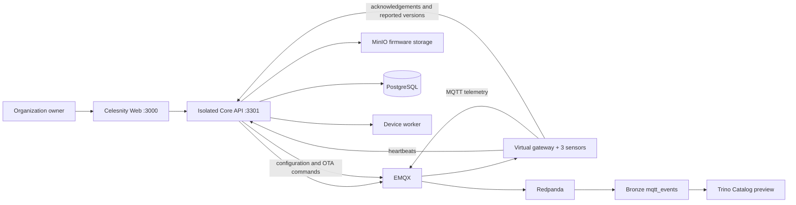

# Device Management end-to-end guide

This guide exercises the current local Device Management implementation from an
MQTT streaming adapter through gateway and sensor management, telemetry,
configuration, health monitoring, firmware OTA, and lifecycle operations.

It uses the isolated Device Management Core stack on port `3301`. That stack
shares the `celesnity-poc` PostgreSQL, EMQX, Redpanda, MinIO, Iceberg, and Trino
infrastructure, but it does not replace the regular Core API on port `3001`.

> This is a local-development workflow. The included identity signing key,
> firmware signing key, credentials, simulator binary, MinIO endpoint, and HTTP
> artifact downloads must not be used in production.

## What the workflow proves



At the end, you should be able to prove:

- an organization-owned MQTT adapter reaches `ACTIVE`;
- one gateway and its bound sensors are registered and reporting;
- sensor telemetry continuously appears in the Bronze `mqtt_events` table;
- loss of contact is detected and cleared after reporting resumes;
- a configuration advances through desired, applied, and reported versions;
- a signed firmware artifact is stored privately and deployed through OTA;
- device alerts, diagnostic logs, credentials, physical lifecycle, replacement,
  and staged firmware campaigns can be inspected from the UI.

## 1. Start the isolated local environment

First start or verify the shared infrastructure:

```sh
cd /Users/datpham/celesnity/celesnity-poc2/celesnity-infra
cp -n local/.env.example local/.env
make up
make ps
```

Start the isolated Core API and worker:

```sh
cd /Users/datpham/celesnity/celesnity-poc2/celesnity-core
docker compose -f compose.device-management.yaml up -d --build --wait
```

Configure Web to use the isolated API. These settings belong in
`celesnity-web/.env.local`; use the same 32-or-more-character development signing
key configured by the isolated Core stack:

```dotenv
CORE_API_URL=http://localhost:3301/api/v1
WEB_ORIGIN=http://localhost:3000
CELESNITY_AUTH_MODE=local-development
LOCAL_DEV_AUTH_SIGNING_KEY=<same local development key as Core>
```

Then start Web:

```sh
cd /Users/datpham/celesnity/celesnity-poc2/celesnity-web
npm install
npm run dev
```

Open <http://localhost:3000/login> and select **Organization owner**. Device
registration, credential rotation, configuration, and OTA are owner/operator
actions; a read-only persona is intentionally insufficient.

Quick health checks:

```sh
curl --fail http://127.0.0.1:3301/api/v1/health/live
docker compose -f /Users/datpham/celesnity/celesnity-poc2/celesnity-core/compose.device-management.yaml ps
```

## 2. Register an MQTT streaming adapter

Open **Data connectors > Streaming** and enter:

| Field | Sample value |
|---|---|
| Tenant storage key | `tnt_factorydemo01` |
| Tenant name | `Factory Demo 01` |
| Adapter name | `Factory Demo MQTT` |

Select **Register adapter**. The managed broker endpoint, topic filter,
username, and password appear once. Save the password before dismissing the
credential panel.

Expected result:

1. The adapter initially reports `PROVISIONING`.
2. The streaming reconciler provisions its EMQX principal and authorization.
3. Retry/refresh until the adapter reports `ACTIVE`.
4. The topic filter has this shape:
   `tenants/tnt_factorydemo01/adapters/adp_<id>/devices/+/telemetry`.
5. The Catalog namespace is `tnt_factorydemo01_bronze`.

The **Pause**, **Resume**, **Rotate credential**, and **Archive** actions test
adapter lifecycle. Rotating invalidates the previous password; archiving is not
reversible through the current UI.

## 3. Register a gateway manually

Open **Devices**, select the active adapter, and open **Provisioning**. Use:

| Field | Sample value |
|---|---|
| Provisioning operation | Register a new device |
| Device type | Gateway |
| Device identifier | `gw-factory-demo-01` |
| Device name | `Factory Demo Gateway` |
| Model | `CEL-GW-SIM` |
| Hardware revision | `sim-a` |
| Current firmware version | `1.0.0` |
| Deployment site | `Factory Demo 01` |
| Physical location | `Control cabinet A` |

Select **Register device**. Copy the broker URL, username, password, and exact
topics from the one-time credential panel.

The gateway owns the cloud MQTT identity. A LoRa-like sensor bound to it does
not receive an independent cloud principal; the gateway authenticates and
publishes to the sensor's exact authorized topic.

Expected state progression has two independent dimensions:

- MQTT/operational state: `PROVISIONING` to `ACTIVE`;
- physical lifecycle: `MANUFACTURED` to `PROVISIONED` to `COMMISSIONED` to
  `ACTIVE`.

Advance physical lifecycle from **Device registry** using **Confirm
provisioned**, **Mark commissioned**, and **Mark active**. Inspect **Lifecycle
history** after each transition.

## 4. Register a sensor manually

Return to **Provisioning** and use:

| Field | Sample value |
|---|---|
| Device type | Sensor |
| Bound gateway | Factory Demo Gateway |
| Device identifier | `sensor-temp-demo-01` |
| Device name | `Factory Demo temperature sensor` |
| Model | `CEL-TEMP-SIM` |
| Hardware revision | `sim-a` |
| Current firmware version | `1.0.0` |
| Deployment site | `Factory Demo 01` |
| Physical location | `Line A / Oven 1` |
| Measurement point key | `line-a.oven-1.temperature` |
| Measurement point name | `Oven 1 temperature` |

Register it and advance its physical lifecycle in the same order as the
gateway.

Important: registration creates the platform identity and authorization; it
does not manufacture a heartbeat. A manually registered gateway remains
**Never seen** until hardware connects with its issued credential. Its sensor
also remains **Never seen** until that gateway relays a sensor heartbeat and
telemetry using the sensor UUID in the authorized topic.

## 5. Start the working virtual factory

For a complete hardware-like test, start the checked-in simulator:

```sh
cd /Users/datpham/celesnity/celesnity-poc2/celesnity-infra
docker compose -f compose.device-simulator.yaml up -d --build virtual-factory
docker compose -f compose.device-simulator.yaml logs -f virtual-factory
```

The simulator chooses an active adapter and registers:

- `Virtual Factory Gateway`;
- `Virtual temperature sensor 1`;
- `Virtual temperature sensor 2`;
- `Virtual temperature sensor 3`.

Use these simulator-created records for the rest of the working walkthrough.
They are wired to the running simulator's credentials and command
subscriptions. Rebuilding/restarting the simulator registers another sample
set; old records remain as lifecycle and contact-history evidence unless they
are explicitly retired or the isolated database is reset.

## 6. Verify overview, registry, and telemetry

In **Devices**, select the simulator's adapter.

### Overview

Confirm the totals for gateways, sensors, and devices needing attention. This
tab is the fleet summary for the selected adapter.

### Device registry

Search and filter by type or lifecycle. Inspect:

- backend UUID and factory-facing identifier;
- gateway binding and measurement point;
- MQTT state and physical lifecycle;
- current firmware version;
- telemetry and firmware command topics;
- suspend/resume, credential rotation, retirement, and sensor replacement.

Use **Replace sensor** only for an `ACTIVE` or `FAULTY` sensor. Replacement
creates a new physical identity but preserves the measurement point and its
historical series.

### Continuous telemetry in Catalog

Open **Health & monitoring** and click **Virtual temperature sensor 1**. The UI
opens its device-scoped Catalog view:

- database: `tnt_virtualfactory01_bronze`;
- table: `mqtt_events`;
- filter: the selected backend `device_id`;
- order: newest `received_at` first;
- refresh: every three seconds;
- preview: newest 100 rows.

Confirm that event IDs, timestamps, sequence, temperature, battery, RSSI/SNR,
MQTT topic, and ingestion metadata continue changing. Clicking a different
device applies that device's UUID filter. The gateway feed contains gateway
CPU, memory, uplink, and connected-sensor measurements instead of temperature.

## 7. Verify health, offline recovery, alerts, and logs

Open **Health & monitoring**.

During the default cycle:

1. All current simulator devices show **Reporting**.
2. After 60 healthy seconds, sensor 1 stops reporting for 30 seconds.
3. Core marks only that sensor **Contact lost** and raises a critical
   loss-of-contact alert.
4. When heartbeats resume, the sensor returns to **Reporting** and the active
   loss-of-contact alert is automatically cleared.

Use **Refresh health** to reload immediately. The simulator also provides a
radio-degradation alert and diagnostic/fault logs. Select a device under
**Device diagnostics** to inspect timestamps, level, kind, message, and fault
context. Test **Acknowledge** and **Clear** on a raised alert.

Useful simulator controls in `compose.device-simulator.yaml`:

```yaml
DEVICE_SIM_HEARTBEAT_INTERVAL_SECONDS: "3"
DEVICE_SIM_HEALTHY_DURATION_SECONDS: "60"
DEVICE_SIM_OFFLINE_DURATION_SECONDS: "30"
DEVICE_SIM_OFFLINE_CYCLE_ENABLED: "true"
```

Set `DEVICE_SIM_OFFLINE_CYCLE_ENABLED=false` and recreate the simulator when all
devices should remain continuously healthy.

## 8. Push remote configuration

Open **Remote configuration**, select **Virtual temperature sensor 1**, and use:

| Field | Sample value |
|---|---|
| Sampling rate | `1` Hz |
| Reporting interval | `10` seconds |
| Temperature channel | Enabled |
| Diagnostic logging | Battery, radio, and uptime |
| Runtime log level | Warnings and errors |
| Low-battery threshold | `15` percent |
| Restore factory defaults | Disabled |

Select **Push configuration**.

Expected sequence:

1. `desired` increments when Core creates the immutable version.
2. Status moves from `QUEUED` to `DISPATCHED`.
3. The simulator atomically applies the retained MQTT command and acknowledges
   it; status becomes `APPLIED`.
4. `applied` matches `desired`.
5. The next authenticated heartbeat reports the running version, so `reported`
   matches both.

For a few seconds, the UI may show `3 / 3 / 2` and warn that the device is not
yet reporting the desired version. This is expected between command
acknowledgement and the following heartbeat. Select **Refresh status**; the
settled state is `3 / 3 / 3`.

### Configuration templates

Use **Configuration templates** to save the current parameters as an immutable
template version. Select a deployment site such as `Virtual Factory 1` and
device type `Sensor`, then **Push to matching devices**. The result reports the
snapshotted target count, successful dispatches, and failures.

## 9. Upload and deploy firmware OTA

The ready-to-use local artifact is in
`device-simulator/samples/cel-gw-sim-2.0.0-manual.bin`.

Open **Firmware & OTA > Upload firmware release** and enter:

| Field | Sample value |
|---|---|
| Target version | `2.0.0-manual` |
| Device model | `CEL-GW-SIM` |
| Hardware revision | `sim-a` |
| Firmware file | `cel-gw-sim-2.0.0-manual.bin` |
| Release notes | `Manual OTA test for the virtual factory gateway.` |

Expected stored metadata:

- size: `174` bytes;
- SHA-256:
  `59c59035ce340405b18b28b7126f85f6de5547c1f72ec1c93c5c0e65b3b9afee`;
- storage provider: MinIO locally, GCS in the configured cloud environment;
- compatibility: model `CEL-GW-SIM`, hardware revision `sim-a`.
- signing: Celesnity automatically signs an immutable manifest containing the
  version, compatibility, artifact size, and SHA-256 digest. The operator does
  not provide a private key or detached signature.

Select **Virtual Factory Gateway**, select the compatible release, and choose
**Deploy firmware**. Confirm the prompt.

The expected OTA progression is:

```text
QUEUED -> DISPATCHED -> ACCEPTED -> DOWNLOADING -> VERIFYING
       -> INSTALLING -> REBOOTING -> SUCCEEDED
```

The simulator first verifies the Celesnity-signed manifest, range-downloads the
private artifact, verifies its size and SHA-256, stages the inactive A/B slot,
simulates a reboot, and reports the target version in a heartbeat. `SUCCEEDED`
is reached only after boot confirmation. Use **Refresh progress** while the
deployment is active.

If `2.0.0-manual` already exists, choose a different version. Celesnity creates
a new signature for the exact uploaded artifact and release metadata.

## 10. Exercise a staged firmware campaign

Still under **Firmware & OTA**:

1. Select a firmware release.
2. Enter a campaign name such as `Virtual factory 2.0.0 rollout`.
3. Set canary devices to `1`.
4. Set progressive batch size to `2`.
5. Select only compatible devices.
6. Create the campaign.
7. Select **Start canary**.
8. Inspect every target result before selecting **Advance batch**.

Campaign controls support pause, resume, and abort. A campaign completes only
after all targets succeed. Aborting cancels pending targets; already delivered
commands may continue on the device.

## 11. Operational and lifecycle checks

Use the remaining controls deliberately:

| Feature | What to verify |
|---|---|
| Suspend | MQTT access is reconciled to `SUSPENDED`; the physical lifecycle is unchanged. |
| Activate | MQTT access returns to `ACTIVE`. |
| Rotate credential | A new password is shown once and the old password stops working. |
| Mark faulty | Physical lifecycle becomes `FAULTY`; operational state remains a separate concern. |
| Replace sensor | New device identity, same measurement point and historical series. |
| Decommission | Terminal physical lifecycle state. |
| Retire | MQTT credential is revoked and the device disappears from active registry results. |
| Pause adapter | Device transport is unavailable even though registrations remain. |
| Resume adapter | EMQX adapter access is restored. |
| Archive adapter | Terminal adapter action; use only for intentional cleanup. |

## 12. Expected evidence checklist

Capture the following when demonstrating the workflow:

- adapter card showing `ACTIVE`, topic filter, and Bronze prefix;
- gateway/sensor registry rows and lifecycle histories;
- one-time credential panels with passwords redacted;
- health table before, during, and after the offline cycle;
- raised and cleared loss-of-contact alert;
- live Catalog events from exactly one selected device;
- configuration history with desired/applied/reported versions equal;
- firmware library row with SHA-256 and signature key ID;
- OTA history ending in `SUCCEEDED` and updated current firmware version;
- campaign canary and progressive-batch results;
- simulator and isolated worker logs with secrets removed.

Never include credential passwords, local signing secrets, one-time event
tokens, or private firmware URLs in screenshots or shared logs.

## Troubleshooting

### Device shows Never seen

Registration alone does not send a heartbeat. Use the simulator-created device,
or connect hardware with the registered gateway credential and exact topic.

### Device shows Contact lost

This is expected for sensor 1 during the default 30-second offline phase. Check
the simulator log for `presencePhase`, then refresh after it returns to
`HEALTHY`.

### Configuration shows desired/applied/reported drift

Wait for the next three-second simulator heartbeat and select **Refresh
status**. Persistent drift means the device did not report the new
`configurationVersion`; inspect simulator and worker logs before retrying.

### Firmware release is not selectable

The release model and optional hardware revision must match the selected
device. The sample binary targets `CEL-GW-SIM` revision `sim-a`.

### OTA stops before SUCCEEDED

Inspect SHA-256/signature verification, artifact reachability, the OTA event
sequence, and the post-reboot heartbeat. `REBOOTING` without the target version
is intentionally not success.

### Catalog has no database or events

Confirm the adapter is active, the simulator is publishing, and the ingestion
stack is healthy. The simulator's default table is
`iceberg.tnt_virtualfactory01_bronze.mqtt_events`. A manually created adapter
uses its own `<tenant-storage-key>_bronze` namespace.

## Stop without deleting shared data

```sh
cd /Users/datpham/celesnity/celesnity-poc2/celesnity-infra
docker compose -f compose.device-simulator.yaml down

cd /Users/datpham/celesnity/celesnity-poc2/celesnity-core
docker compose -f compose.device-management.yaml down
```

These commands stop only the simulator and isolated Device Management stack.
They do not stop the shared `celesnity-poc` infrastructure or delete its
volumes.
