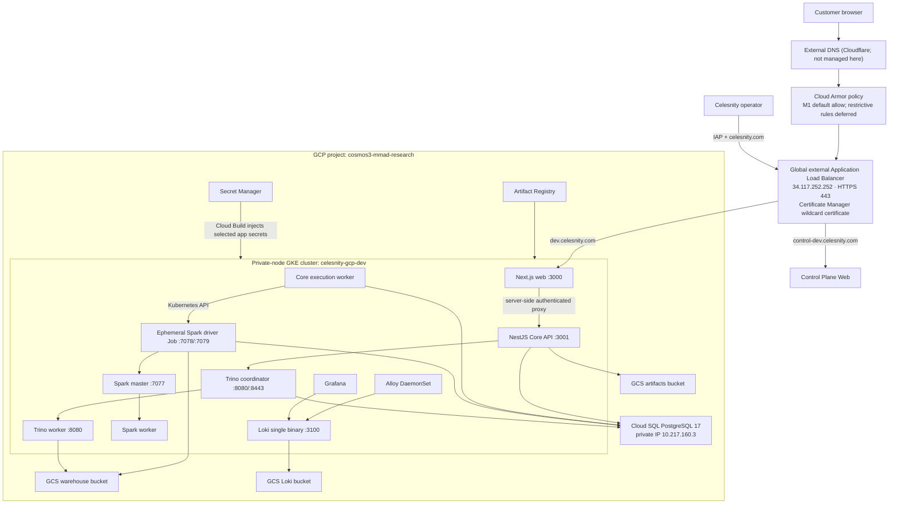
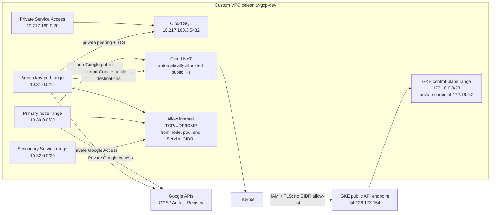
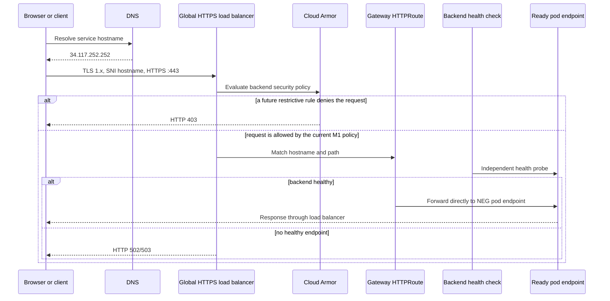
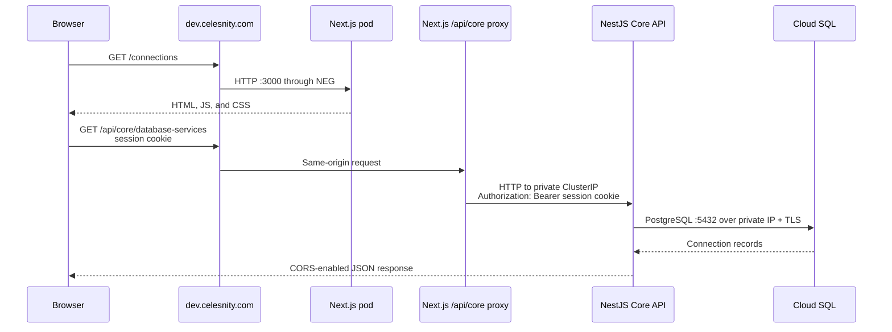
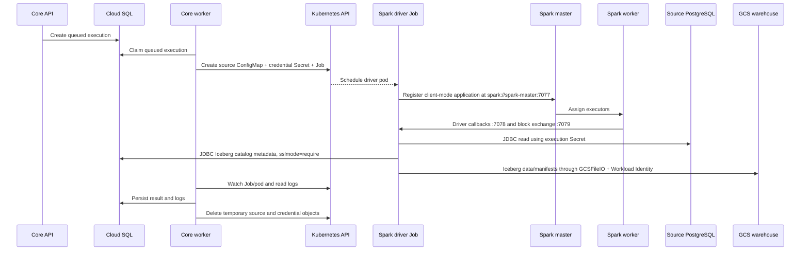
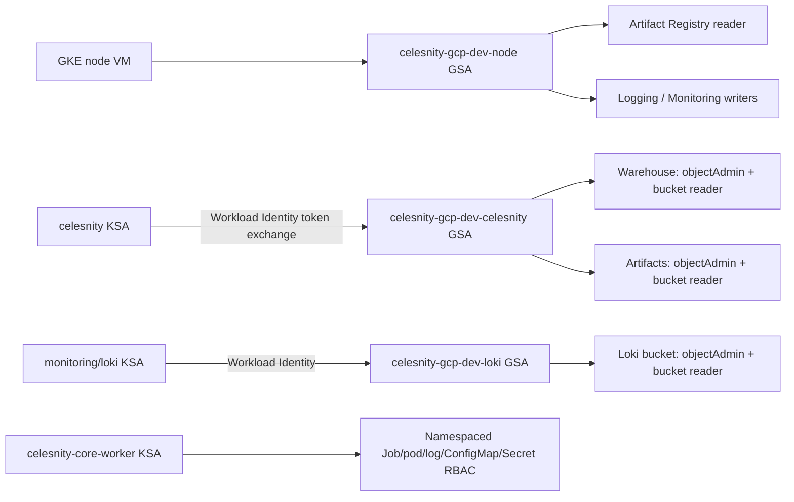
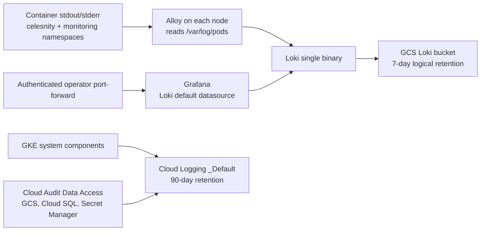
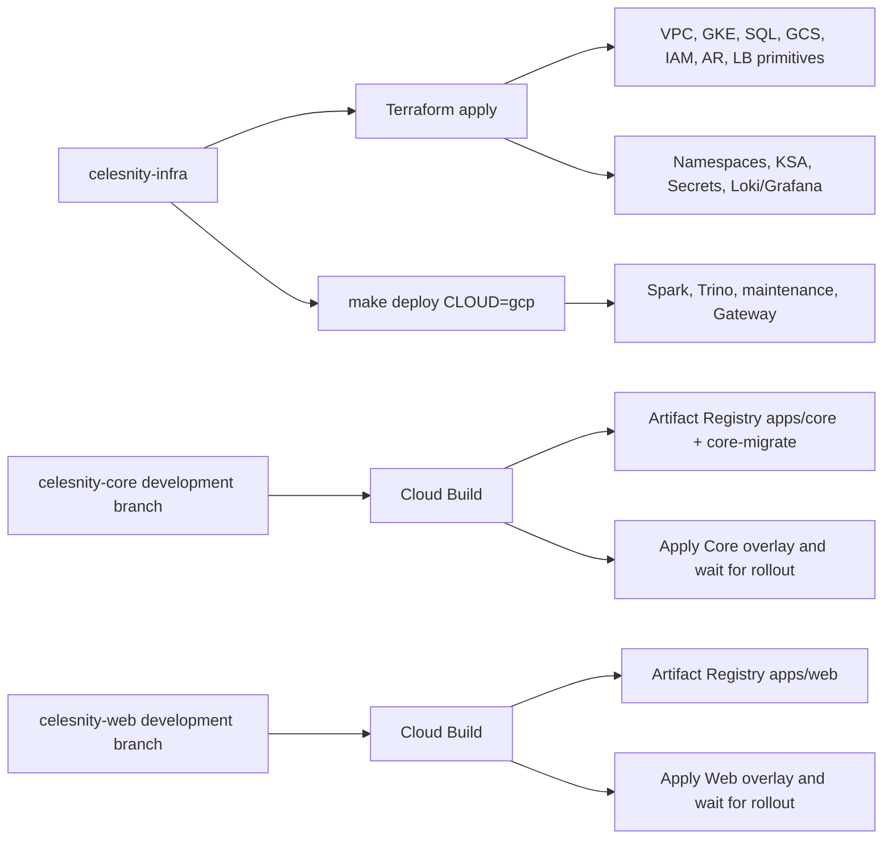

# GCP development architecture

This document describes the current Celesnity development environment in Google Cloud. It covers the cloud foundation, Kubernetes workloads, service-to-service relationships, ingress and east-west networking, identity, storage, deployment, observability, scaling, failure domains, and known gaps.

## Document status and sources

| Field | Value |
|---|---|
| Environment | `gcp-dev` |
| GCP project | `cosmos3-mmad-research` |
| Primary region / zone | `asia-southeast1` / `asia-southeast1-a` |
| Terraform resource prefix | `celesnity-gcp-dev` |
| Last architecture review | 2026-08-10 |
| Terraform state inspected | Yes |
| Fresh Kubernetes API inventory | No; the local `gcloud` CLI login required interactive reauthentication |

The source of truth is split across three repositories:

- `celesnity-infra` owns GCP resources, the shared Gateway, platform credentials, Spark, Trino, Iceberg maintenance, Loki, Alloy, and Grafana.
- `celesnity-core` owns the NestJS API, background execution worker, execution RBAC, and the API route on the shared Gateway.
- `celesnity-web` owns the Next.js frontend and its route on the shared Gateway.

The values in this document were reconciled from Terraform configuration, Terraform state, Kubernetes/Kustomize manifests, application configuration, and Cloud Build definitions. Runtime replica counts can differ temporarily because the node pool and two application Deployments autoscale.

## Executive overview

Celesnity runs on one small, zonal, VPC-native GKE Standard cluster. Nodes have private IP addresses only. A single global external Google Cloud Application Load Balancer, provisioned by GKE Gateway API, exposes two approved HTTPS edges on one static anycast IPv4 address:

| Hostname | Backend | Backend protocol |
|---|---|---|
| `dev.celesnity.com` | Next.js `celesnity-web` | HTTP `3000` |
| `control-dev.celesnity.com` | Next.js control plane protected by IAP and the `celesnity.com` domain check | HTTP `3000` |

TLS terminates at the external load balancer using a Google Certificate Manager wildcard certificate. Core, Agent, Trino, MCP-Trino and Grafana have no HTTPRoute and remain private services. Web proxies authenticated application calls to Core; operators reach Grafana through an authenticated Kubernetes port-forward.

Cloud SQL PostgreSQL stores application records, execution coordination, encrypted connection credentials, and Iceberg JDBC catalog metadata. GCS stores Iceberg data files, script/execution artifacts, and Loki log data. Spark performs ingestion and transformation. Trino queries Iceberg. The Core API is the control-plane boundary used by the browser.



## GCP service inventory

| GCP capability | Current resource/design | Purpose |
|---|---|---|
| VPC | Custom-mode `celesnity-gcp-dev`, regional dynamic routing | Isolated address space for GKE and private service access |
| Subnet | `celesnity-gcp-dev-nodes`, `10.30.0.0/20` | Private GKE node addresses |
| Alias IP ranges | Pods `10.31.0.0/16`; Services `10.32.0.0/20` | VPC-native pod and ClusterIP allocation |
| Private Service Access | Reserved `10.217.160.0/20` peered to Google services | Private Cloud SQL connectivity |
| Cloud Router and NAT | `celesnity-gcp-dev-router` / `celesnity-gcp-dev-nat`, `AUTO_ONLY` | Internet egress for private nodes and pods |
| GKE | Standard, zonal, private nodes, public control-plane endpoint | Runs all application and data-processing workloads |
| Cloud SQL | PostgreSQL 17 Enterprise, `db-g1-small`, zonal | Application DB and Iceberg JDBC catalog |
| Cloud Storage | Warehouse, artifacts, and Loki buckets | Durable data, artifacts, and logs |
| Artifact Registry | Separate Spark repo and shared application repo | Stores immutable workload images |
| Global external Application Load Balancer | GKE `gke-l7-global-external-managed` Gateway | One public HTTPS entry point with host-based routing |
| Certificate Manager | Existing `celesnity-global` wildcard certificate and certificate map | Public TLS and SNI selection |
| Cloud Armor | `celesnity-gcp-dev-trino-lb` | Edge policy attachment; M1 currently uses default allow while restrictive rules are deferred |
| IAM / Workload Identity | Dedicated node, workload, and Loki Google service accounts | Keyless workload access to Google APIs |
| Secret Manager | Database password plus Core credential/HMAC secrets | Durable secret source for Terraform and Cloud Build |
| Cloud Logging | GKE system components and project audit logs | Platform diagnostics and access audit trail |
| Persistent Disk CSI | GKE default `standard-rwo`, backed by `pd-balanced` | Grafana state and Loki write-ahead log |
| Cloud Build | Repository-owned pipelines | Builds immutable images and applies app overlays |

### Resource naming

Most Terraform-managed resources use `${project}-${environment}`, producing `celesnity-gcp-dev`. Globally unique buckets append the GCP project ID:

- Warehouse: `celesnity-gcp-dev-warehouse-cosmos3-mmad-research`
- Artifacts: `celesnity-gcp-dev-artifacts-cosmos3-mmad-research`
- Loki: `celesnity-gcp-dev-loki-cosmos3-mmad-research`
- Spark images: `asia-southeast1-docker.pkg.dev/cosmos3-mmad-research/celesnity-gcp-dev-spark/spark`
- Application images: `asia-southeast1-docker.pkg.dev/cosmos3-mmad-research/celesnity-gcp-dev-apps/{core,core-migrate,web}`

## VPC and IP design



### Address allocation

| Address space | Function | Routing behavior |
|---|---|---|
| `10.30.0.0/20` | GKE nodes | Primary subnet addresses; nodes have no external IP |
| `10.31.0.0/16` | Pods | Alias IPs routable within the VPC; load-balancer NEGs target pod IPs directly |
| `10.32.0.0/20` | Services | Virtual ClusterIP addresses used only inside Kubernetes |
| `172.16.0.0/28` | GKE control plane | Google-managed control-plane peering; private endpoint is enabled but not the only endpoint |
| `10.217.160.0/20` | Private Service Access | Reserved peering range; Cloud SQL currently uses `10.217.160.3` |

The ranges do not overlap. Future VPC peering, VPN, or Interconnect networks must also avoid them because GCP does not translate overlapping RFC1918 ranges.

### Egress

Private Google Access is enabled on the node subnet. Traffic to GCS and Artifact Registry follows Google API routes and does not use Cloud NAT. Cloud NAT is used for non-Google public destinations such as Docker Hub image pulls, operating-system repositories, and public source databases tested or read by Celesnity.

Cloud NAT uses `AUTO_ONLY`; its public source IPs are not stable. A source database that allow-lists clients cannot safely allow-list this environment until NAT uses manually reserved static addresses.

### Firewall and Kubernetes network policy

The explicit VPC firewall rule permits all TCP, UDP, and ICMP traffic sourced from the node, pod, or Service CIDRs. GKE also creates controller-managed rules needed for control-plane, health-check, and load-balancer traffic.

Kubernetes NetworkPolicy enforcement is disabled and the repositories do not define namespace-level NetworkPolicies. Consequently:

- any pod that can resolve a ClusterIP can attempt to connect to it;
- Cloud Armor protects public load-balancer traffic only;
- Cloud Armor does not protect east-west traffic;
- service isolation currently relies on application protocols, secrets, RBAC, and trusted workloads rather than network segmentation.

### Control-plane access

GKE worker nodes are private, but the Kubernetes API endpoint is public at `34.126.173.154`. `enable_private_endpoint` is false and there are no master-authorized CIDRs. Access is therefore gated by Google IAM, GKE authorization/RBAC, and TLS, from any source network. The control-plane private endpoint also exists, but operators currently use the public endpoint.

## GKE cluster design

| Property | Current value |
|---|---|
| Cluster | `celesnity-gcp-dev` |
| Mode | GKE Standard, VPC-native |
| Location | Zonal: `asia-southeast1-a` |
| Release channel | Regular |
| State-observed version | `1.35.6-gke.1250000` |
| Nodes | Desired/state-observed 2; autoscaler 1–4 |
| Node type | `e2-standard-2` — 2 vCPU, 8 GiB |
| Node disk | 50 GiB `pd-balanced` |
| Purchasing model | On-demand, not Spot |
| Node repair/upgrade | Both enabled |
| Upgrade strategy | Surge 1, unavailable 0 |
| Shielded VM | Secure Boot and integrity monitoring enabled |
| Workload identity | `cosmos3-mmad-research.svc.id.goog` |
| Gateway API | Enabled |
| Managed Prometheus | Disabled |
| Cloud Logging components | `SYSTEM_COMPONENTS` only |
| Kubernetes NetworkPolicy | Disabled |
| Cluster deletion protection | Disabled for dev |

This is intentionally a low-cost development topology, not a high-availability topology. All nodes and the Cloud SQL primary are in one zone. A zone outage removes the entire compute and database serving plane. The control plane is Google-managed, but workload availability is still zonal.

### Namespaces

| Namespace | Ownership and contents | May attach public routes? |
|---|---|---|
| `celesnity` | Web, Core, execution worker/Jobs, Spark, Trino, maintenance | Yes; labeled `celesnity.io/gateway-access=true` |
| `monitoring` | Alloy, Loki, Grafana | Yes when Grafana publishing is enabled |
| GKE system namespaces | DNS, networking, metrics and controller components | No application route permission |

The Gateway listener accepts cross-namespace HTTPRoutes only from namespaces with the explicit `celesnity.io/gateway-access=true` label. Creating a route in an arbitrary namespace does not publish it.

## Kubernetes workload inventory

### Application and data workloads

| Workload | Kind / scale | Service and ports | Durable dependencies | Kubernetes identity |
|---|---|---|---|---|
| Celesnity Web | Deployment; HPA 1–2 at 75% requested CPU | `celesnity-web` ClusterIP `3000` | None; Next cache is `emptyDir` | `celesnity` |
| Celesnity Core API | Deployment; HPA 1–2 at 75% requested CPU | `celesnity-core` ClusterIP `3001` | Cloud SQL, Trino, artifacts bucket | `celesnity` |
| Core execution worker | Deployment; exactly 1, `Recreate` | No Service | Cloud SQL and Kubernetes API | restricted `celesnity-core-worker` |
| Spark master | Deployment; exactly 1, `Recreate` | Headless `spark-master`: RPC `7077`, UI `8080` | None | `celesnity` |
| Spark worker | Deployment; default 2, manually scalable | No Service; pod UI `8081` | Spark master; warehouse/data sources during execution | `celesnity` |
| Spark execution driver | One ephemeral Job per execution | Pod ports `7078` driver and `7079` block manager | Cloud SQL, GCS, source DB, Spark master | `celesnity` |
| Trino coordinator | Deployment; exactly 1, `Recreate` | `trino-coordinator`: internal HTTP `8080`, client HTTPS `8443` | Cloud SQL catalog and GCS warehouse | `celesnity` |
| Trino worker | Deployment; default 1, manually scalable | No Service; internal HTTP `8080` | Coordinator and GCS warehouse | `celesnity` |
| Iceberg maintenance | Daily CronJob at `18:17 UTC`; local Spark mode | No Service | Cloud SQL catalog and GCS warehouse | `celesnity` |
| Catalog bootstrap | Terraform-created one-shot Job | No Service | Cloud SQL | default namespace identity; DB password via Secret |

### Observability workloads

| Workload | Kind / scale | Service and storage | Role |
|---|---|---|---|
| Alloy | DaemonSet, one pod per node | Host-mounted `/var/log/pods`; no public Service | Discovers pods on its own node, labels CRI logs, pushes to Loki |
| Loki | Stateful single-binary instance, replica 1 | Cluster service `3100`; 4 GiB PVC for WAL; GCS for chunks/index | Seven-day log store and query API |
| Grafana | Deployment, replica 1 | ClusterIP Service `80` to Grafana `3000`; persistent PVC | UI with Loki configured as the default data source |

### Scheduling and lifecycle behavior

- Trino and Spark workers use preferred pod anti-affinity across `kubernetes.io/hostname`; the preference spreads replicas but does not block scheduling when capacity is tight.
- The Core and Web Deployments use `maxUnavailable: 0` and `maxSurge: 1`.
- The single Core worker, Spark master, and Trino coordinator use `Recreate` where two concurrent instances would cause ambiguous ownership or split coordination.
- Application and data workloads set memory limits but generally omit CPU limits to avoid latency caused by CPU throttling.
- Containers run as non-root with runtime-default seccomp and dropped capabilities where application manifests control the security context.
- Ephemeral execution Jobs have `backoffLimit: 0` and a one-hour TTL after completion. The Core worker records the durable result before cleanup.
- Grafana data and Loki's WAL use zonal Persistent Disks. Rescheduling within the same zone can reattach them; there is no cross-zone workload design.

## Public ingress design

### Shared Gateway and load balancer

The platform-owned `Gateway/celesnity` uses `gke-l7-global-external-managed`, a reserved global address (`34.117.252.252`), and one HTTPS listener on port `443`. There is deliberately no port `80` listener and therefore no HTTP-to-HTTPS redirect: plaintext connections are not accepted.

Certificate Manager map `celesnity-gcp-dev-trino-lb` selects the existing `celesnity-global` certificate by SNI. One wildcard entry covers `*.celesnity.com`. DNS A records are external to this repository and must point each approved hostname at the reserved address.



GKE builds container-native Network Endpoint Groups from the Services, so the load balancer targets pod IP and target port, not a NodePort hop. Service port and container port intentionally match for Web and Core to reduce health-check mismatches.

### Per-backend policies

| Backend | Health check | Request timeout | Drain time | Upstream protocol |
|---|---:|---:|---:|---|
| Web | HTTP `:3000/health` | 30 s | 60 s | HTTP |
| Control Plane Web | HTTP `:3000/health` | 30 s | 60 s | HTTP |

Kubelet readiness and load-balancer health are independent. A pod can be Kubernetes Ready while the external backend is unhealthy if its `HealthCheckPolicy` is wrong. This previously caused misleading 502 responses; the explicit paths above are part of the architecture contract.

### Cloud Armor boundary

The customer Web and IAP-protected control-plane Web are the only approved public Services. Their backend policies can attach Cloud Armor, but the current M1 policy is default allow because restrictive rules were explicitly deferred. Identity Platform/session authorization protects the customer application, and IAP plus the application-level `celesnity.com` domain check protects the operator control plane. Cloud Armor is defense in depth and is not user authentication.

## Browser and application request flow

The current production flow keeps Core private and sends application calls through the authenticated same-origin Next.js gateway:



Next.js is the browser-facing gateway for Core. It validates the Web session boundary and forwards the session credential to the private Core ClusterIP. Consequences:

- The browser never receives or selects a Core base URL.
- Core's ClusterIP is consumed server-side by Web and cannot be reached from outside the cluster.
- The Web session cookie stays same-origin; the server-side proxy supplies the bearer credential expected by Core.
- Public CORS is not an authorization boundary and Core is not published through an HTTPRoute.

## Core API and background worker relationship

Core uses an API/worker split around Cloud SQL rather than an in-memory queue:

1. The API validates a request and writes durable application/execution records to Cloud SQL.
2. The background worker polls the database and claims queued work using database coordination.
3. The worker stages script source into a temporary ConfigMap and execution-specific credentials into a temporary Secret.
4. The worker creates a namespaced Kubernetes Job and watches its pod state/log stream.
5. The worker persists lifecycle transitions, logs, Spark application ID, exit code, and terminal result.
6. Temporary ConfigMap/Secret resources are removed; the finished Job is removed automatically after its TTL.

The API and worker do not call each other over a Service. Cloud SQL is their durable coordination boundary. This allows an API rollout without discarding queued work and keeps the worker off the public request path.

The worker's `celesnity-core-worker` Kubernetes ServiceAccount has a namespace-scoped Role allowing only:

- create/get/list/watch/delete Jobs;
- get/list/watch pods;
- read pod logs;
- create/get/delete execution ConfigMaps and Secrets.

It has no cluster-wide role and no permission to change Deployments, Services, RBAC, or namespaces. Spark Jobs use the separate platform `celesnity` ServiceAccount so cloud-storage permissions are not granted to the orchestrator itself.

## Spark execution flow



The job runs Spark in client deploy mode. The ephemeral Job pod is the driver. It advertises its pod IP and fixed driver/block-manager ports so long-running Spark worker pods can connect back. The headless `spark-master` Service resolves directly to the master pod; `publishNotReadyAddresses` avoids a startup DNS/readiness deadlock.

Default per-execution resource profile:

- driver heap: 1 GiB plus 384 MiB Kubernetes overhead;
- executor memory: 1 GiB;
- executor cores: 1;
- maximum Spark cores: 2;
- execution timeout: 15 minutes;
- maximum attempts at the application layer: 3;
- Kubernetes Job retry count: 0.

The standalone Spark cluster is different from Spark-on-Kubernetes cluster mode: Kubernetes schedules the driver Job, but the existing Spark master schedules executors inside the existing Spark worker pods.

## Trino and Iceberg query flow

Trino consists of one coordinator and one default worker. The coordinator does not execute query splits. Workers register at `http://trino-coordinator:8080`; internal communication is protected by a shared secret. Client traffic uses `https://trino-coordinator:8443` with file-based password authentication.

Core uses the internal HTTPS endpoint, validates the coordinator's self-signed certificate through `NODE_EXTRA_CA_CERTS`, and authenticates as `celesnity`. This traffic does not traverse the Gateway or Cloud Armor. Trino has no public HTTPRoute; authorized operators use a Kubernetes port-forward when direct diagnostic access is required.

The Iceberg catalog has two storage planes:

- Metadata plane: JDBC catalog tables in Cloud SQL, accessed over private IP with `sslmode=require`.
- Data plane: table data, manifests, metadata JSON, and snapshots in the warehouse GCS bucket.

Trino uses native GCS support with `APPLICATION_DEFAULT` credentials from Workload Identity. The `WAREHOUSE_S3_PATH` configuration key contains a `gs://` URI; its name is retained only as a cloud-neutral manifest contract.

Scaling Trino workers requires coordinated memory configuration. `query.max-memory` is cluster-wide and currently equals one worker × `600MB`; increasing replicas without increasing the aggregate value underuses the added capacity.

## Cloud SQL design

| Property | Current value |
|---|---|
| Instance | `celesnity-gcp-dev-postgres` |
| Engine | PostgreSQL 17, Enterprise edition |
| Tier | `db-g1-small` shared core |
| Placement | Zonal in `asia-southeast1` |
| Address | Private only: `10.217.160.3`; Terraform state has no public IP |
| Connectivity | Private Service Access peering |
| TLS | `ENCRYPTED_ONLY`; clients use `sslmode=require` |
| Disk | 20 GiB SSD, automatic growth disabled |
| Backups | Enabled, daily start at 17:00 UTC, retain 7 |
| PITR | Disabled |
| Maintenance | Sunday 18:00 UTC, stable track |
| Query Insights | Disabled |
| Deletion protection | Disabled for dev |

Cloud SQL serves multiple logical purposes in one inexpensive instance:

- the `celesnity_app` schema for connections, scripts, executions, outbox, and application state;
- the Iceberg JDBC catalog tables used by Spark and Trino;
- durable coordination between the API and background worker.

Database credentials are generated by Terraform, stored in Secret Manager, and copied into Kubernetes Secret `celesnity-database`. The Secret exposes separate `POSTGRES_*` fields plus a JDBC URL. Core composes its Prisma `DATABASE_URL` in the pod; the GCP overlay appends `sslmode=require`. Environment variable order is significant because Kubernetes expands only variables declared earlier in the same `env` list.

`sslmode=require` encrypts the connection but does not provide the same hostname/CA verification semantics as `verify-full`. Network reachability is limited to the peered VPC, but stronger database server identity validation remains a hardening opportunity.

## Object storage design

| Bucket | Versioning / retention | Writers and readers | Contents |
|---|---|---|---|
| Warehouse | Versioning off; incomplete multipart uploads aborted after 7 days | Spark and Trino workload GSA | Iceberg data, manifests, metadata, snapshots |
| Artifacts | Versioning on; noncurrent versions deleted after 30 days | Core through GCS XML/HMAC; workload GSA | Script sources and execution artifacts/logs |
| Loki | Loki-managed 7-day retention; storage lifecycle safety net after retention + 7 days | Loki GSA | Loki chunks and TSDB index |

All buckets enforce uniform bucket-level access and public access prevention. Google-managed encryption is used. Dev teardown permits `force_destroy`.

Iceberg warehouse versioning is off because Iceberg snapshots already implement table-level time travel. Enabling both would retain deleted object versions outside Iceberg's snapshot lifecycle and undermine predictable erasure.

### Two GCS authentication paths

Spark, Trino, and Iceberg maintenance use Google libraries and therefore use short-lived Workload Identity credentials. Core uses the MinIO client against GCS's S3-compatible XML endpoint (`https://storage.googleapis.com`) and therefore needs a long-lived GCS HMAC access ID and secret. Those HMAC values are stored in Secret Manager and injected into `celesnity-core-secrets` by Cloud Build.

This is intentional compatibility, but the HMAC path is weaker operationally than keyless Workload Identity. Migrating Core to the native Google Cloud Storage SDK would remove these long-lived credentials.

## Identity and secret model



### Identities

| Identity | Scope | Permissions |
|---|---|---|
| Node GSA | GCP project | Pull images; write platform logs/metrics/metadata |
| `celesnity` KSA → workload GSA | Two data buckets | Object admin and legacy bucket reader |
| `monitoring/loki` KSA → Loki GSA | Loki bucket | Object admin and legacy bucket reader |
| `celesnity-core-worker` KSA | `celesnity` namespace | Bounded execution resource orchestration only |
| Cloud Build service account | Build/deploy plane | Artifact writer, GKE developer, selected Secret Manager read, log writer |

Workload Identity uses short-lived credentials served by the GKE metadata server. Pods using it cannot read the node service account through the legacy metadata path.

### Secret ownership

| Secret | Owner / source | Consumers |
|---|---|---|
| Cloud SQL password in Secret Manager | Terraform | Operators and Terraform |
| `celesnity-database` Kubernetes Secret | Terraform | Core, worker, Spark, Trino, maintenance/bootstrap |
| `trino-auth` | Terraform-generated TLS, shared secret, password DB | Trino coordinator/workers |
| `trino-client` | Terraform projection of client password and CA | Core API and worker |
| Core credential keyring and GCS HMAC secrets | Secret Manager; injected by Core Cloud Build | Core API and worker |
| `grafana-admin` | Terraform-generated | Grafana |
| Per-execution credential Secret | Core worker, short-lived | One Spark driver Job |

Secret values must never be committed or written to build logs. Cloud Build fills placeholder values only inside its workspace before applying the Core overlay.

## Observability and audit flow



Alloy collects logs only from the `celesnity` and `monitoring` namespaces, labels them with cluster, namespace, pod, container, application, component, node, and stream, drops common health-check noise, and rate-limits a noisy pod. Alloy buffers in memory only; a Loki outage can lose the buffered window.

GKE ships `SYSTEM_COMPONENTS` to Cloud Logging but deliberately omits `WORKLOADS` to avoid duplicating application logs already in Loki. Data Access audit logging is enabled for GCS, Cloud SQL, and Secret Manager. The `_Default` Cloud Logging bucket retains logs for 90 days.

Managed Prometheus is disabled and no metrics-oriented Prometheus stack is installed. Grafana is currently a log exploration UI, not a complete infrastructure metrics/APM platform.

## Iceberg maintenance and retention

The `iceberg-maintenance` CronJob runs daily at `18:17 UTC` in local Spark mode. It expires snapshots older than seven days while retaining at least three snapshots and removes orphan files older than three days. Runs cannot overlap, time out after one hour, and retry twice.

Retention boundaries are intentionally different by storage type:

- Cloud SQL: 7 retained backups;
- Iceberg snapshots: 7 days, minimum 3 snapshots;
- orphan files: 3-day safety window;
- Loki: 7 days;
- artifacts noncurrent versions: 30 days;
- Cloud Audit Logs: 90 days.

The longest relevant retained copy determines the actual erasure window for a data category.

## Build and deployment ownership



Terraform is applied in two stages because Kubernetes and Helm providers cannot configure resources until the GKE endpoint exists. The shared platform contract is a fixed set of names: namespace `celesnity`, KSA `celesnity`, Secret `celesnity-database`, ConfigMap `celesnity-storage`, Secrets `trino-auth`/`trino-client`, and Gateway `celesnity`.

Application pipelines use immutable commit tags. The Core pipeline builds runtime and migration images, injects selected runtime secrets, applies its overlay, and waits for API/worker rollouts. The Web pipeline builds the image, configures the private Core service URL for server-side use, applies its overlay, and waits for rollout.

Schema migration runs as a Core API init container from the `core-migrate` image because Cloud SQL is private. Prisma's advisory locking makes concurrent API pod initialization safe.

DNS records and the wildcard Certificate Manager certificate/DNS authorization are managed outside Terraform in this repository. Their lifecycle must be coordinated with Gateway hostnames.

## Main end-to-end flows

### Connection registry

`Browser → dev.celesnity.com → Next.js same-origin gateway → private Core API → Cloud SQL → JSON response`.

### Test a source connection

`Browser → Next.js gateway → private Core API → DNS resolve and SSRF validation → public database through Cloud NAT → test result → Cloud SQL`.

Private destinations are rejected unless explicitly allow-listed. The metadata endpoint and internal service ranges cannot be probed through user-supplied connection strings by default.

### Execute a PySpark script

`Browser → Next.js gateway → private Core API → Cloud SQL queue → Core worker → Kubernetes Job → Spark master/workers → source JDBC + Cloud SQL catalog + GCS warehouse → Core worker persists status/logs → browser polls or streams results`.

### Query Iceberg

`Browser → Next.js gateway → private Core API → internal TLS to Trino coordinator → Trino worker → Cloud SQL JDBC catalog + GCS warehouse → result bounded by Core row/time limits → browser`.

### Observe logs

`Pod stdout/stderr → node filesystem → Alloy DaemonSet → Loki → GCS → Grafana server-side datasource query → authorized operator port-forward`.

## Availability, scaling, and failure domains

| Component | Scaling behavior | Main failure effect |
|---|---|---|
| GKE node pool | Cluster autoscaler 1–4 nodes | At minimum 1 node, any node disruption can affect every tier |
| Web | HPA 1–2 | UI unavailable if its only pod fails before replacement |
| Core API | HPA 1–2 | API unavailable if its only pod fails before replacement |
| Core worker | Fixed 1 | New executions queue; API can continue serving |
| Spark master | Fixed 1 | New/running distributed Spark work fails or stalls |
| Spark worker | Default 2, manual scale | No executor capacity when absent |
| Trino coordinator | Fixed 1 | All SQL queries unavailable |
| Trino worker | Default 1, manual scale | No query execution capacity when absent |
| Cloud SQL | Zonal, no HA standby | API, worker, catalog, Spark, and Trino metadata operations stop |
| Loki | Single binary | Log ingest/query unavailable; in-memory Alloy buffer can be lost |
| Grafana | Fixed 1 | Log UI unavailable; Loki can continue ingesting |

The architecture prioritizes low development cost and understandable operation. It does not currently satisfy multi-zone availability, zero-downtime coordinator failover, or production database SLA requirements.

## Security posture and known gaps

### Controls already present

- HTTPS-only public listener with a publicly verifiable wildcard certificate.
- Cloud Armor policy attachment on public backends; restrictive rules are deferred and are not counted as an M1 authorization control.
- Private GKE nodes and private-only Cloud SQL.
- Cloud SQL encrypted-only connections.
- Public access prevention and uniform IAM on every bucket.
- Workload Identity for Spark, Trino, maintenance, and Loki.
- Dedicated minimal node GSA instead of the Compute Engine default Editor account.
- Namespaced, resource-bounded RBAC for the execution worker.
- Non-root application containers, seccomp, and capability drops.
- Data Access audit logging for the main data-bearing Google services.
- SSRF controls on user-supplied connection testing.

### Current risks and recommended priorities

1. **Authorization coverage still needs closure evidence.** Identity Platform, MFA, organization membership, and role/catalog grants are implemented, but the complete negative test matrix and owner sign-off must be recorded before M1 is closed.
2. **No Kubernetes NetworkPolicy.** Any compromised pod can scan and connect to internal Services. Enable a supported network-policy dataplane and add default-deny plus explicit flows.
3. **Public GKE control plane without authorized networks.** Restrict authorized CIDRs, use a private endpoint with controlled operator access, or use a managed bastion/VPN for a production environment.
4. **Local Terraform state.** State contains generated database, Trino, and Grafana credentials. Move it to a versioned, encrypted, access-restricted GCS backend with state locking and audit controls.
5. **Shared broad workload identity.** Web, API, Spark, Trino, and maintenance all use `celesnity`; the mapped GSA has object-admin access to both data buckets. Split identities by workload and least privilege. Web needs no Google API permissions.
6. **Long-lived GCS HMAC for Core.** Replace the MinIO/S3 client path with the native GCS SDK and Workload Identity.
7. **Zonal singletons.** Move production to a regional cluster, multi-zone node pools, Cloud SQL regional HA, and replicated/scalable observability.
8. **Deletion safeguards off.** Cluster/database deletion protection and bucket `force_destroy` are appropriate only for disposable dev.
9. **Unstable NAT egress.** Reserve static NAT IPs before integrating with external systems that require IP allow-listing.
10. **No metrics/APM stack.** Add managed or self-hosted metrics, alerts, SLOs, and tracing; Loki/Grafana currently provide logs only.
11. **Cloud SQL TLS verification.** Move clients from encryption-only `sslmode=require` toward verified server identity where supported.
12. **Data residency.** The environment is in Singapore. Confirm regulatory requirements before storing production personal data.

## Operational verification

Authenticate both the CLI and Application Default Credentials before checking or changing the environment:

```bash
gcloud auth login
gcloud auth application-default login
gcloud config set project cosmos3-mmad-research
gcloud auth application-default set-quota-project cosmos3-mmad-research
```

Refresh kubeconfig and inspect the platform without printing secrets:

```bash
gcloud container clusters get-credentials celesnity-gcp-dev \
  --zone asia-southeast1-a \
  --project cosmos3-mmad-research

kubectl get nodes -o wide
kubectl get deploy,statefulset,daemonset,job,cronjob,svc,pvc,hpa -A
kubectl get gateway,httproute,healthcheckpolicy,gcpbackendpolicy -A
kubectl get events -A --sort-by=.lastTimestamp
```

Verify desired infrastructure and detect drift:

```bash
terraform -chdir=infra/environments/gcp-dev plan
terraform -chdir=infra/environments/gcp-dev output

gcloud sql instances describe celesnity-gcp-dev-postgres \
  --project cosmos3-mmad-research \
  --format='yaml(ipAddresses,settings.ipConfiguration,settings.availabilityType)'

gcloud compute routers nats describe celesnity-gcp-dev-nat \
  --router celesnity-gcp-dev-router \
  --router-region asia-southeast1 \
  --project cosmos3-mmad-research
```

Check approved public endpoints:

```bash
curl -fsS https://dev.celesnity.com/health
curl -I https://control-dev.celesnity.com/

# Private operator check for Grafana:
kubectl -n monitoring port-forward svc/grafana 3000:80
curl -fsS http://localhost:3000/api/health
```

Expected failure clues:

| Symptom | Most likely layer |
|---|---|
| Public 403 on the control-plane hostname | IAP principal lacks `roles/iap.httpsResourceAccessor`, or the signed identity is outside `celesnity.com` |
| One hostname TLS failure | DNS, SNI certificate-map entry, or wildcard certificate |
| One hostname 404 | HTTPRoute hostname/path attachment |
| One hostname 502/503 while pod is Ready | Backend health check, NEG endpoint, backend protocol, or target port |
| Browser Core request returns 401/403 | Session verification, MFA, organization membership, role, or catalog grant failed |
| Core starts but database adapter fails | `DATABASE_URL` ordering/encoding or missing `sslmode=require` |
| Trino is healthy but an operator cannot connect | Use the approved Kubernetes port-forward; no public Trino route exists |
| Spark Job cannot be staged | Worker KSA RBAC or Kubernetes execution backend configuration |
| Spark executor cannot reach driver | Driver pod IP/ports `7078` and `7079`, pod networking, or worker registration |
| Iceberg `No FileSystem for scheme gs` | Missing GCS FileIO configuration/bundle in the Spark image |
| GCS 403 from Trino/Spark | Workload Identity annotation/binding or bucket IAM |
| GCS signature error from Core | HMAC secret, newline corruption, endpoint, or path-style behavior |

## Source-of-truth map

| Concern | Source |
|---|---|
| GCP environment values | `infra/environments/gcp-dev/main.tf`, `variables.tf`, and gitignored `terraform.tfvars` |
| VPC, subnet, NAT, firewall | `infra/modules/gcp/network/main.tf` |
| GKE and node pool | `infra/modules/gcp/cluster/main.tf` |
| Cloud SQL and GCS | `infra/modules/gcp/data/sql.tf`, `storage.tf` |
| Shared namespace, secrets, KSA | `infra/modules/gcp/platform/workload.tf`, `iam.tf` |
| External address, certificate map, Cloud Armor | `infra/modules/gcp/platform/external-lb.tf` |
| Shared Gateway and platform-private data services | `deploy/overlays/gcp-dev/` |
| Spark/Trino/maintenance workloads | `deploy/base/` |
| Loki, Alloy, Grafana | `infra/modules/gcp/observability/` |
| Core API/worker/RBAC/private service | `../celesnity-core/k8s/` |
| Spark Job orchestration | `../celesnity-core/src/infrastructure/spark/execution-orchestration/` |
| Web workload/route | `../celesnity-web/k8s/` |
| Browser-to-Core gateway behavior | `../celesnity-web/app/api/core/`, `../celesnity-web/src/infrastructure/api/` |
| Application deployments | `../celesnity-core/cloudbuild.yaml`, `../celesnity-web/cloudbuild.yaml` |

## Change rules

- Publishing a new service requires an explicit security review, a Service, health/backend policies, and an HTTPRoute attached to the shared Gateway. Core, Agent, Trino, MCP-Trino, and Grafana must remain private unless that review changes the boundary.
- Add every new public hostname to external DNS and ensure the Certificate Manager certificate/map covers it.
- Keep Service port, NEG target port, container port, and health-check port aligned.
- Apply Terraform before platform Kustomize; deploy Spark/Trino before application features that depend on them.
- Treat changes to CIDRs, identity bindings, bucket retention, database availability, Gateway class, or certificate ownership as architecture changes requiring this document to be updated.
- Never infer production readiness from this dev design: explicitly revisit authentication, multi-zone availability, NetworkPolicy, state backend, backups/PITR, deletion protection, alerting, and data residency.
