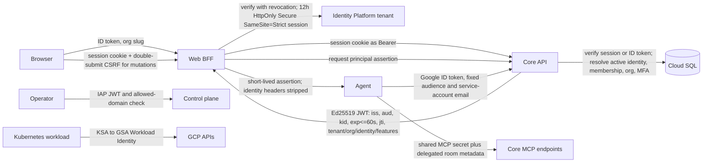
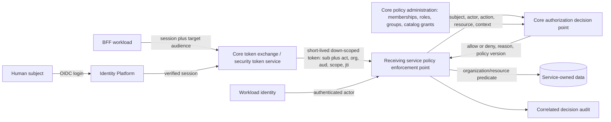

# Release 0.4.0 authentication, authorization, GDPR, and SOC 2 assessment

Assessment date: 2026-09-20  
Assessment type: source and rendered-manifest review  
Decision: **do not promote this baseline to additional customer tenants until the release-blocking exceptions below are closed**

## 1. Scope and assurance boundary

This assessment is pinned to the following immutable revisions:

| Repository | Revision |
| --- | --- |
| `celesnity-infra` | `15b873b81d466992420dd77d7e7654ba0f19cc7e` |
| `celesnity-core` | `a5ec751dfc67e6b01c0951665bc67b54a47a47a3` |
| `celesnity-web` | `b3508d9e77b36f97ed5821a8a2ab4e00b61c36c8` |
| `celesnity-agent` | `eb25907217a2f0d2c2624a9354deb529d38869fa` |

The review covers the GCP development and production source configuration. It does not inspect GCP, Kubernetes, deployed image digests, runtime logs, Identity Platform state, Secret Manager values, DNS, certificates, or actual IAM bindings. Accordingly, source controls are graded as **Designed** or **Implemented**, while operating effectiveness remains **Operating evidence required**. Nothing in this report is a declaration of GDPR compliance, legal advice, SOC 2 readiness, or a SOC 2 attestation. SOC 2 Type II requires an independent examination of control operation throughout the audit period.

Processing Integrity is outside the stated SOC 2 scope. Security, Availability, Confidentiality, and Privacy are in scope.

Status vocabulary:

- **Designed**: the intended control is documented but source enforcement is incomplete or not demonstrated.
- **Implemented**: enforcement exists in the pinned source or rendered manifest.
- **Operating evidence required**: implementation exists, but live and period evidence was excluded or is missing.
- **Verified**: the control was successfully exercised during this source assessment. This never means live production operation was verified.
- **Exception**: the control is absent, bypassable, inconsistent, or failed validation.

## 2. Executive assessment

Release `0.4.0` has a credible human-authentication foundation: Identity Platform multi-tenancy and TOTP MFA are configured; the Web BFF verifies revoked tokens and creates secure server-side sessions; Core uses default-on authentication, RBAC, feature checks, organization context, and audit hooks; and the Web-to-Agent path exchanges the session for a short-lived Ed25519 Core assertion. Dedicated workload identities, private cluster nodes, Dataplane V2, network policies, regional production Cloud SQL, PITR, and monitoring components are positive design elements.

The baseline nevertheless has four release-blocking security exceptions:

1. **Documents are not tenant scoped.** `Document` has no `organizationId`, its repository has no organization predicate, and `DocumentMcpController` deliberately runs without room delegation when both delegation metadata fields are absent. A caller with the shared MCP secret can list/read all stored documents and create documents in a global namespace.
2. **Core is publicly routed in both environments.** The rendered Core overlays contain `HTTPRoute` objects for `api-dev.celesnity.com` and `api.celesnity.com`. The repository's own trust-boundary check fails because it expects no public Core route. This contradicts the desired Web-only customer edge.
3. **Agent authentication configuration can fail open operationally.** Production composition errors are caught and an empty server continues to start; `/healthz` still reports success and is used for startup, readiness, and liveness. Kubernetes can therefore advertise a misconfigured Agent as ready.
4. **Assertion replay protection is only process-local.** The 60-second assertion contains `jti`, but replay consumption is held in an in-memory cache. A replay can be accepted once by each replica and again after a pod restart.

Additional high-priority exceptions are a client-controlled `X-Caller-Id` path in Agent catalog handling, a long-lived shared MCP secret used across multiple privileged Core MCP endpoints, production Agent NetworkPolicy drift that omits the Core caller, and a failing Web security test showing that the standardized `Forwarded` header is not stripped by the BFF.

Audit hooks do not yet provide a reliable security ledger. Agent action-audit persistence intentionally fails open, so a privileged action can proceed without a durable row. The HTTP audit interceptor records after the handler; if that write fails after a state change commits, the client can see an error and retry an operation that already happened. Transactional outbox or equivalent commit-coupled audit semantics are required for security-significant mutations.

Overall milestone status:

| Milestone | Status | Reason |
| --- | --- | --- |
| M1 - trust boundary and evidence | **Exception / open** | Source validation fails, sign-off record is open, rollback and deployed negative evidence are absent. |
| M2 - tenant isolation | **Exception / blocked** | Document storage is globally scoped; the two-real-tenant identifier-swap matrix remains unexecuted. |
| M3 - GDPR lifecycle and governance | **Designed / largely open** | The repository contains a detailed plan, but ROPA, lawful-basis records, DSAR operation, retention/deletion, legal hold, DPIA/DPA, subprocessors, transfers, and breach evidence are not established by source. |
| M4 - infrastructure and recovery | **Partially implemented; evidence required** | Strong production design exists, but IAM/network exceptions remain and restore/failover/RTO/RPO evidence is unavailable. |
| M5 - recurring operation and Type II | **Not ready** | Recurring control evidence, exception handling, readiness review, and an independent observation period have not begun. |

## 3. Trust chain



### 3.1 Boundary contract matrix

**Architecture verdict:** the release has several individually sound controls, but the boundary design is not yet a single authorization architecture. Web -> Core, Web -> Agent, Agent -> Core application routes, and Agent -> Core MCP routes use different credential types, claim sets, identity resolution paths, replay properties, and audit behavior. That increases implementation drift and makes it hard to prove that the same subject, actor, organization, action, and resource are authorized consistently at every hop.

Centralization should not mean moving every authorization check into the BFF or trusting the cluster network. Authentication should be centralized at the identity provider; policy administration and decision semantics should be logically centralized; enforcement must still occur at every receiving service and, for bulk reads, in the data-access query. This follows the distinction between coarse request checks and resource-aware domain/data checks described by Microservices.io, and the identity-oriented zero-trust model in NIST SP 800-207A.

| Boundary | Credential and issuer | Audience/lifetime | Tenant and organization binding | Revocation/replay | Audit | Assessment |
| --- | --- | --- | --- | --- | --- | --- |
| Browser -> Identity Platform | Password plus TOTP; Google Identity Platform tenant | Tenant-specific | Organization slug resolves the Identity Platform tenant before sign-in | Provider token lifecycle | Provider request logging configured | Implemented; live policy unverified |
| Browser -> Web session | ID token verified with `checkRevoked=true`; Web creates Firebase session cookie | 12 hours | Tenant is derived from organization login context | Session cookie verified with revocation on protected server access; logout revokes refresh tokens | Web emits request/client telemetry | Implemented |
| Browser -> Web mutation | Session plus same-origin check and double-submit CSRF token | Session lifetime | Same session subject | CSRF rotation tied to session creation | Request IDs forwarded | Implemented |
| Web -> Core | Firebase session cookie forwarded as Bearer | Core verifier accepts session/ID token | Core resolves active identity, membership, organization, status, MFA, and visible features | Revocation checked | Global audit interceptor and denial recording exist; immutable live storage not verified | Implemented; operating evidence required |
| Web -> Agent | Core-issued Ed25519 assertion | `iss=celesnity-core`, `aud=minder-agent`, maximum 60 seconds, `kid`, `jti` | Explicit tenant, organization, identity, membership, role, MFA, feature claims | Signature/issuer/audience/expiry verified; replay is only per process | Agent run events plus Core issuance/request logs; correlation needs live proof | Exception: replay and catalog/header paths |
| Agent -> Core application endpoints | Google OIDC ID token | Fixed Core audience; exact configured Agent service-account email | Delegated room binding installs verified human organization context for protected operations | Google token lifecycle | Core audit path | Implemented on guarded routes; live IAM unverified |
| Agent -> Core MCP endpoints | Long-lived `MCP_SHARED_SECRET` | No per-request issuer, audience, or short expiry | Most endpoints require trusted room/caller metadata; document endpoint permits neither | Rotation requires secret rollout; replayable | Action audit varies by tool | Exception |
| Operator -> control plane | IAP signed JWT plus `celesnity.com` domain restriction | IAP OAuth client | Operator domain, not customer tenant | Provider lifecycle | IAP and application logs expected | Designed/implemented in adjacent control-plane source; that repository is not one of the four pinned baselines |
| Pod -> GCP | Projected KSA token exchanged through Workload Identity | GSA/IAM resource | Namespace and KSA binding | Short-lived Google credentials | Cloud Audit Logs expected | Implemented in source; live binding unverified |

The current matrix exposes four material design inconsistencies:

1. A human session is forwarded to Core, a custom Core assertion is minted for Agent, Google workload identity protects only some Agent -> Core routes, and a replayable shared secret protects MCP routes.
2. Some boundaries represent the human subject, some represent only the calling workload, and some reconstruct identity from room metadata or caller-controlled headers. There is no universal subject/actor model.
3. Organization roles, feature visibility, catalog grants, room delegation, and route annotations are evaluated through different APIs rather than one canonical decision contract.
4. Catalog authorization itself is stronger than the transport contracts: it is organization-scoped, validates namespace ownership, supports descendant grants, applies explicit deny over allow, and otherwise defaults to deny. However, the hard-coded shared demo namespace bypasses normal grants and must be treated as a separately approved platform policy, not as general inheritance.

#### Recommended target: one identity plane and one authorization contract



Use one canonical decision request everywhere:

```text
authorize(
  subject,   // human or service principal on whose behalf work is done
  actor,     // authenticated calling workload; never a client-controlled header
  action,    // stable business permission, not merely an HTTP verb
  resource,  // typed ID plus owning organization and ancestor chain
  context    // MFA/auth age, feature, request ID, purpose, time, network risk
) -> { allowed, reason, policyVersion, matchedPolicies }
```

The target boundary contracts should be:

| Boundary | Authentication | Authorization input | Required enforcement |
| --- | --- | --- | --- |
| Browser -> Web | Identity Platform/OIDC session; Web is the only browser token handler | Active organization selection and session assurance | CSRF/origin/session checks; UI permission display is advisory only |
| Web -> Core | Audience-bound access token or existing session during migration | Human `sub`, Web workload `act`, organization, coarse scopes, MFA/auth time | Core PEP validates token and performs local resource-aware authorization |
| Web/Core -> Agent | Token exchange produces a short-lived Agent-only delegated token | Human `sub`, Core/Web `act`, organization, permitted Agent actions, room/session reference | Agent validates issuer, exact audience, lifetime, `jti`, actor, and organization; no identity headers |
| Agent -> Core | GKE Workload Identity authenticates Agent; delegated token carries the human chain when acting for a user | `sub` plus Agent `act`, organization, narrow action/resource scope | Core validates both workload and delegation; shared MCP secret is removed |
| Worker/background job -> resource service | Workload Identity plus persisted delegation envelope | Original subject, job actor, organization, purpose/action, resource, policy version | Re-authorize before sensitive or long-running execution; never invent a default organization |
| Service -> GCP | Dedicated KSA/GSA Workload Identity | Workload principal and least-privilege IAM permission | IAM and resource policy; no human permission inheritance |

The delegated access token should be an access token, not an ID token, and should follow OAuth token-exchange semantics rather than another bespoke assertion format. Minimum claims are `iss`, one exact `aud`, human `sub`, workload `act`, `organization_id`, `membership_id`, narrow `scope` or actions, `auth_time`/`acr`/`amr`, `iat`, `nbf`, `exp`, `jti`, session reference, and `policy_version`. Detailed catalog resource lists should not be placed in the token: they are large, sensitive, fast-changing, and become stale. Keep the token small and fetch or locally replicate fine-grained policy data.

Workload Identity answers **which service is calling**; the delegated token answers **which user and organization the service is acting for**. Neither replaces the other. Effective authority is always the intersection:

```text
effective permission =
  human organization permission
  AND human resource grant
  AND delegated token scope
  AND caller workload permission
  AND target-service policy
  AND contextual constraints
```

#### Organization, role, and data-catalog inheritance

The current organization role and catalog grant systems should be composed, not flattened into one role and not copied through the service chain:

1. **Organization membership is the root boundary.** A subject must have an active membership in the resource's organization. No role or catalog grant may cross that boundary.
2. **Organization role is coarse RBAC.** It answers whether the subject may attempt an operation class, such as catalog discovery, query, grant management, or mutation. The present generic `workspace:read`/`workspace:write` permissions are too broad and should be replaced incrementally by stable business actions.
3. **Feature visibility is product entitlement, not data authorization.** It may hide or enable a capability but cannot grant access to an underlying catalog object.
4. **Catalog grants are resource-level RBAC/ReBAC.** Direct and authorization-group grants may be additive; explicit deny overrides allow; absence of a matching allow is deny.
5. **Resource inheritance is downward and explicit.** `CATALOG -> SCHEMA -> TABLE -> COLUMN` inheritance occurs only when `includeDescendants=true`. A schema grant must not imply access to another schema, and a table grant must not imply access to its parent schema beyond the minimum metadata needed to address it.
6. **Service delegation is down-scoping, not inheritance.** Agent does not inherit the user's entire organization role or catalog policy. It receives only the actions needed for the requested operation, and Core re-evaluates current catalog grants for the target resource.
7. **Administrative bypasses must be explicit policies.** Owners and platform administrators must not silently bypass catalog grants unless an approved break-glass policy says so, requires strong MFA and justification, expires quickly, and produces a high-severity audit event.

This gives Celesnity a practical hybrid of RBAC, ReBAC, and ABAC: roles supply coarse permissions, organization/resource relationships constrain the object, and MFA, purpose, time, feature, and risk supply context. It also preserves the strongest part of the current design: Core remains the policy authority for organization membership and catalog grants, while every service remains responsible for enforcement on the resources it owns.

#### Implementation sequence

1. Define shared `AuthContext`, `AuthorizationRequest`, and `AuthorizationDecision` schemas and a conformance test suite used by Core, Web, and Agent.
2. Expose a Core decision interface such as batch-capable `check`/`list-authorized-resources`; keep Core-owned resource checks local to avoid unnecessary network calls.
3. Standardize workload authentication on GKE Workload Identity and human delegation on short-lived, audience-bound token exchange. Remove `MCP_SHARED_SECRET` and identity headers after dual-read migration.
4. Put a PEP middleware in each service that validates tokens identically and denies by default; keep domain/resource checks in use cases and tenant predicates in repositories.
5. For high-volume reads, return authorized resource filters or maintain an event-driven local policy projection. Cache positive decisions only briefly and bind them to `policy_version`; do not turn PDP unavailability into allow.
6. Audit every decision with request ID, subject, actor, organization, action, resource, policy version, result, and reason. Use a transactional outbox or equivalent durable path for security-relevant audit events.
7. Prove the contract with cross-service negative tests: wrong audience, wrong actor, stale policy version, cross-organization resource, forged header, expired/replayed delegation, removed group grant, explicit deny, and PDP unavailable.

An external authorization product or service mesh is optional, not the first step. At the present boundary, a Core-owned policy administration/decision module plus shared protocol and conformance tests is simpler and keeps policy close to the existing source of truth. A separate PDP becomes justified when independent scaling, multi-language policy evaluation, or policy lifecycle ownership outweighs the new availability and synchronization dependency.

Key source anchors include `celesnity-web/app/api/auth/session/route.ts`, `celesnity-web/app/api/core/[...path]/route.ts`, `celesnity-web/app/api/agent/[...path]/route.ts`, `celesnity-core/src/presentation/http/bearer-authentication.guard.ts`, `celesnity-core/src/presentation/http/authorization.guard.ts`, `celesnity-core/src/application/administration/minder-principal-assertion.ts`, and `celesnity-agent/packages/minder-auth/src/assertion.ts`.

## 4. Endpoint and authorization inventory

### 4.1 Web

| Class | Routes | Authentication decision | Authorization decision |
| --- | --- | --- | --- |
| Public bootstrap | login UI, `/api/auth/config`, session creation | Organization login context selects tenant; submitted ID token is verified, email must be verified, and MFA/auth age policy is checked | No workspace data returned before session establishment |
| Human session | application pages and BFF reads | Revocation-checked server session | Core remains authoritative for membership, role, feature, and object access |
| Mutation | BFF POST/PUT/PATCH/DELETE | Session plus origin and CSRF validation | Core/Agent authorization still applies |
| Core proxy | `/api/core/**` | Session cookie required and converted to Bearer | Upstream Core guard; identity/organization headers are not trusted |
| Agent proxy | `/api/agent/**` | Session verified, then exchanged for Core assertion | Feature classification before exchange; Agent verifies assertion | 
| Operational | proxied Agent `healthz`, `metrics`, `stats` | `healthz` can be fetched for UI state; `stats` is authenticated/feature constrained by proxy policy; direct network paths remain separate | Network and route policy are compensating controls |

The Agent proxy strips `x-caller-id`, organization and identity headers, and `x-forwarded-*`, but does not strip the RFC `Forwarded` header. `tests/unit/app/agent-api-route.test.ts` catches this and fails.

### 4.2 Core

All Core controllers are human-authenticated by the global bearer and authorization guards unless a route is explicitly `@Public()` or `@MachineAuthenticated()`. Default authorization is `workspace:read` for GET/HEAD/OPTIONS and `workspace:write` for mutations, with explicit permissions and feature grants able to narrow the result.

Human-authenticated route families include administration, audit log, pending actions, databases/connectors, catalogs/metadata crawlers, pipelines/scripts/executions, SQL workbench, charts/collections/dashboards/citations, documents, streaming, devices/firmware, automation workflows, plant model, rooms/message history, and action catalogs not listed below as public.

Public routes and their compensating controls:

| Route family | Purpose | Compensating control | Finding |
| --- | --- | --- | --- |
| `GET administration/mfa-policy/:identityTenantId` | Login policy discovery | Returns only boolean policy | Implemented; tenant-ID enumeration/rate-limit review required |
| `GET administration/login-context/:organizationSlug` | Select Identity tenant before login | Returns tenant identifier and MFA boolean | Implemented; organization enumeration and read-rate limiting are not demonstrated |
| chart/canonical-chart/automation action MCP catalogs | Tool schema discovery | Static metadata only | Acceptable if schemas never include secrets or tenant data |
| device configuration event callback | Device state report | Per-configuration event-token guard | Implemented |
| device heartbeat, alert, and log callbacks | Device telemetry | Basic MQTT device credentials; device/gateway binding and organization background context | Implemented |
| firmware deployment event callback | Firmware status | Per-deployment event-token guard | Implemented |
| `GET metrics` | Prometheus scrape | Network/GMP policy only | Operating evidence required; must not be internet reachable |
| health endpoints | Kubernetes health | Network policy only | Acceptable for liveness if responses contain no sensitive data |

Machine-authenticated route families:

- Agent-originated message blocks and chart/automation mutations use Google workload identity guards with exact audience/service-account checks and delegated room context.
- `trino-mcp`, `chart-mcp`, `document-mcp`, `skill-mcp`, `automation-workflow-mcp`, and `plant-model-mcp` use the shared MCP secret. Most also require delegated room metadata. The document MCP exception is detailed below.

### 4.3 Agent

Agent application routes for rooms/runs/events/history/transcripts, approvals, governance, MCP management, manifests, skills, configuration, workspace, and runtime execution go through `resolveOwner`; with production authenticator configured, missing or invalid Core assertions are denied and `X-Caller-Id` is not authoritative. `/catalog` is the exception: it reads `X-Caller-Id` directly. `/healthz`, `/metrics`, and `/stats` are operational routes handled before application authentication.

## 5. Dev versus production infrastructure

| Area | Development source | Production source | Assessment |
| --- | --- | --- | --- |
| GKE | Private nodes, Workload Identity, Dataplane V2; zonal design | Private nodes, Workload Identity, Dataplane V2; regional design example | Production design stronger; live state unverified |
| Cloud SQL | Private IP; development-grade retention; no required PITR/deletion protection | Regional availability, PITR, 14 retained backups, deletion protection | Implemented in source; restore/failover evidence required |
| Public Web | One customer Web HTTPRoute | One customer Web HTTPRoute | Intended public entry point |
| Public Core | `api-dev.celesnity.com` HTTPRoute | `api.celesnity.com` HTTPRoute | **Exception in both environments**; conflicts with Web-only edge and repository verification script |
| Agent | ClusterIP plus default-deny and Web allow | ClusterIP plus default-deny and Web allow | Private by source; production policy omits Core as a caller while Core has Agent webhook clients |
| Trino/MCP | No active rendered infra HTTPRoute | No active rendered infra HTTPRoute | Private in the pinned rendered overlays; dormant public-route configuration permits a default-allow path and needs removal or a deny-by-default gate |
| Grafana | Optional public hostname through shared Gateway | Public hostname is shown in example configuration | Random 24-character admin password in Kubernetes Secret; no SSO/IAP configured by this module. Cloud Armor policy is attached, but its default action is allow |
| Workload IAM | Dedicated KSA/GSA identities | Dedicated KSA/GSA identities | Positive least-identity design; rendered automount settings must be reviewed per pod |
| Object storage | GCS through S3-compatible HMAC; broad object roles | Same | Long-lived HMAC plus `storage.objectAdmin`/`legacyBucketReader` is an exception to short-lived/least-privilege goals |
| Edge protection | Cloud Armor attachment, default allow | Cloud Armor attachment, default allow | Defense-in-depth is present but WAF/rate-limit/IP restrictions are not established |

The public Core route does not automatically mean Core authorization is bypassed; its global guards still protect normal application routes. It does materially enlarge the attack surface, makes every public/operational exception externally relevant, and violates the stated architecture contract.

## 6. Control inventory: what is doing well

| Control | Status | Evidence and limitation |
| --- | --- | --- |
| Tenant-aware Identity Platform with anonymous/phone disabled, password enabled, duplicate email disabled, mandatory TOTP, client signup/deletion disabled | Implemented | `celesnity-infra/infra/modules/gcp/identity/main.tf`; actual tenant state unverified |
| Browser API key restrictions | Implemented | Referrer and Identity Toolkit API restrictions are declared; live key restrictions unverified |
| Revocation-aware Web and Core session validation | Verified in source/tests | Web and Core use provider verification with revocation checks |
| Secure session cookie and mutation CSRF | Implemented | HttpOnly, Secure, SameSite Strict; origin plus double-submit token |
| Core default-on auth, RBAC, feature grants, MFA, active membership/status | Verified in targeted tests | Public/machine decorators remain high-risk review points |
| Short-lived asymmetric Core assertion with `kid` | Verified in targeted tests | Key overlap supported; replay is not globally enforced |
| Exact Agent workload identity verification by audience and service-account email | Verified in targeted tests | Live IAM binding and token acquisition excluded |
| Dedicated workload identities and default-deny network intent | Implemented in manifests | Public Core route and policy drift remain exceptions |
| Device callback replacement guards | Implemented | Public decorators have credential/token guards except metadata/operational endpoints |
| Production database HA/PITR design | Implemented in Terraform | Restore, zone failure, RTO/RPO operation unverified |
| Request IDs and audit hooks | Exception | Hooks exist, but action audit persistence intentionally fails open and HTTP success audit happens after the state change; immutable correlation and denial completeness are not assured |

## 7. Findings and remediation register

| ID | Severity | Environment/component | Root cause | Required remediation | Owner | Acceptance test and evidence | Promotion gate |
| --- | --- | --- | --- | --- | --- | --- | --- |
| AUTH-001 | Critical | Both; Core documents/MCP | `Document` lacks `organizationId`; repository is global; document MCP runs when both room/caller metadata are absent | Add non-null organization ownership and relation, migrate/backfill safely, scope every create/read/list/storage key, require room delegation unconditionally, and add authorization/audit policy | Core + Security | Two real tenants upload documents; list/read/ID swap and storage-key guesses deny cross-tenant; missing/partial delegation denies; migration report retained | Blocks M1/M2 and production promotion |
| NET-001 | High | Dev and prod; Core/Gateway | Both Core overlays render public HTTPRoutes although the trust contract says Core is private | Remove routes and route all browser traffic through Web; if device callbacks require public Core, split a narrow callback service/route with only guarded callback paths, rate limits, WAF, and explicit architecture approval | Platform + Core | Rendered route inventory and external negative probes prove no general Core edge; repository trust script passes for dev and prod | Blocks promotion |
| AUTH-002 | High | Both; Agent startup | Composition/auth errors are caught; empty server starts and `/healthz` remains 200 for all probe types | Exit non-zero on security configuration failure; split `/livez` and `/readyz`; readiness must fail until assertion keys and required dependencies are usable | Agent + Platform | Missing/malformed key, issuer, audience, and dependency tests show pod never Ready; rollout rollback rehearsed | Blocks promotion |
| AUTH-003 | High | Both; Agent replicas | `jti` replay state is in-memory per process | Implement atomic shared consume with TTL and uniqueness, or explicitly redesign the token as non-one-time and document residual risk; preserve `kid` overlap | Agent + Platform | Same assertion concurrently sent to two replicas succeeds exactly once; restart does not reset protection during token lifetime | Blocks multi-replica promotion |
| AUTH-004 | High | Both; Core MCP | One long-lived `MCP_SHARED_SECRET` authenticates multiple privileged MCP endpoints | Replace with short-lived workload identity or scoped Core assertions with fixed audience, workload identity, endpoint/tool scope, rotation overlap, and audit subject | Core + Agent + Platform | Wrong audience/SA/scope/expired/replayed credentials deny; per-workload revocation demonstrated | M2 gate |
| AUTH-005 | High | Both; Agent `/catalog` | Route directly trusts `X-Caller-Id` instead of `resolveOwner` | Route through the assertion authenticator; delete all header fallback outside explicit local-only composition | Agent | Forged/missing header plus valid/invalid assertion matrix; production build has no authoritative header path | M1 gate |
| AUTH-006 | Medium | Both; Web Agent BFF | `Forwarded` is not removed although `x-forwarded-*` is | Strip `forwarded` and all client-controlled proxy identity headers, then add a table-driven allowlist test | Web | Existing `agent-api-route` security test passes with mixed-case and duplicate headers | M1 gate |
| NET-002 | High availability | Prod; Agent NetworkPolicy | Prod ingress allows Web/GMP but not Core despite Core-to-Agent automation clients | Add narrowly selected Core KSA/namespace ingress or remove the Core caller design; prove no broad namespace allow | Platform + Agent/Core | Core webhook succeeds; unrelated pod and namespace fail | Production gate |
| IAM-001 | Medium | Both; storage | Broad `objectAdmin`/legacy reader roles and long-lived HMAC credentials support S3 compatibility | Split buckets/prefixes, create least-privilege custom roles, remove legacy role, rotate HMAC with overlap, and plan native short-lived auth | Platform | IAM policy diff, access-boundary negatives, rotation rehearsal, secret-age monitor | M4 gate |
| EDGE-001 | Medium | Both; public services | Cloud Armor defaults to allow; Grafana public module uses local admin password without IAP/SSO | Add managed WAF/rate limiting, restrict admin surfaces with IAP/SSO and MFA, and disable public Grafana by default | Platform + Security | Anonymous/WAF/rate-limit negatives and privileged login/MFA evidence | M4 gate |
| AUTH-007 | Medium | Both; public login context | Organization slug and tenant ID can be enumerated; read requests are exempt from the global mutation throttler | Return the minimum bootstrap data, normalize failure, and add distributed IP/device/account rate limiting and alerting | Core + Web | Enumeration and burst tests produce indistinguishable bounded responses; alert evidence retained | M2 gate |
| TEST-001 | Medium | Release process | Trust-boundary script checks public edge only for development and currently fails; release suites also contain formatting/lint/test drift | Enforce both overlays, pin workspace assumptions, repair tests, and make the release gate mandatory | All engineering | Clean CI from immutable commit with artifacts and no skipped security matrices | M1 gate |
| AUD-001 | High | Both; Core audit | Action-audit persistence errors are swallowed; HTTP audit is written after handler completion and may fail after a committed mutation | Couple security-significant mutation and immutable audit intent in one transaction/outbox; make delivery idempotent and alerted; return a truthful outcome; define explicit policy for read/denial audit loss | Core + Security | Inject audit database/outbox/delivery failures before, during, and after mutation; prove no unaudited committed privileged action, no duplicate retry, eventual immutable row, request/run/actor correlation, and alert | M1 gate |
| SUPPLY-001 | Low/Medium | Agent development dependency | Vitest dependency tree reports two moderate advisories | Upgrade to fixed compatible versions and retain dependency-review evidence | Agent | `npm audit` has no applicable high/moderate issue or documented accepted exception | M4 gate |

## 8. GDPR assessment

GDPR privacy by design/default is continuous and requires protective defaults, not only a launch-time security review. Accountability also requires documented decisions and demonstrable operation. On that basis:

| Obligation | Status | Assessment |
| --- | --- | --- |
| Integrity/confidentiality and privacy by design/default | Exception | Strong authentication exists, but global documents, public Core, header trust, replay, and shared-secret findings prevent a satisfactory tenant-isolation conclusion. |
| Data minimization and purpose limitation | Designed | No approved data inventory, field classification, purpose/lawful-basis gate, or minimization evidence is established here. |
| Accountability | Designed / open | A detailed plan and evidence templates exist, but M1 sign-off is blank/open and recurring evidence is absent. |
| Records of processing (ROPA) | Exception/open | No approved, current ROPA artifact and ownership evidence was identified in this source assessment. |
| Data-subject rights | Designed / open | No end-to-end intake, identity verification, search/export, rectification, erasure/restriction/objection, portability, or deadline evidence was demonstrated. |
| Retention, deletion, and legal hold | Exception/open | No approved retention schedule or automated lifecycle across primary, derived, logs, queues, object storage, and backups was demonstrated. |
| Breach handling | Designed / open | Response objectives are documented, but drill, notification-decision, and corrective-action evidence is absent. |
| Processor/subprocessor governance | Exception/open | DPA, subprocessor inventory/review, deletion/exit, and change-notice evidence require Privacy/Legal review. |
| International transfers | Exception/open | Transfer inventory, SCC/TIA decisions, support-access safeguards, and approved residency/export controls are not proven. |
| DPIA | Exception/open | Required triggers and completed DPIAs for monitoring, industrial/employee data, or consequential AI are not proven. |

The tenant-document defect is directly relevant to GDPR Articles 5(1)(f), 25, and 32 because organization separation is not a protective default. Whether any affected document is personal data, whether the organization is controller or processor, and whether notification duties arise are legal/factual questions outside this source review.

## 9. SOC 2 assessment

| Trust Services area | Status | Assessment |
| --- | --- | --- |
| CC6 logical/physical access | Exception | Human authentication/RBAC is strong, but document isolation, public Core, MCP shared identity, header trust, and replay gaps are material exceptions. |
| CC7 system operations/monitoring | Partially implemented; evidence required | Metrics, logs, Grafana/Loki and alerts are designed, but public operational routes, readiness semantics, paging/SLO evidence, vulnerability operation, and audit correlation are not proven. |
| CC8 change management | Exception/open | Protected-branch intent and build pipelines exist, but this pinned baseline fails repository release checks. Deployment approval, rollback rehearsal, provenance, and period operation are unverified. |
| Availability | Partially implemented; evidence required | Regional production cluster/SQL and PITR are positive; restore, failover, capacity, RTO/RPO, and Agent readiness/network operation need evidence. |
| Confidentiality | Exception | Tenant separation and storage credential findings prevent closure. Classification and retention operation are also missing. |
| Privacy | Designed / open | Governance and data-subject lifecycle controls have plans but no demonstrated operating evidence. |

The appropriate conclusion is **not ready to begin a Type II observation period**. First close the release-blocking exceptions, complete readiness review, and operate the scoped recurring controls without unresolved critical exceptions.

## 10. Milestone remediation backlog

### M1 - close trust-boundary evidence

1. Fix AUTH-001, NET-001, AUTH-002, AUTH-005, AUTH-006, AUD-001, and TEST-001.
2. Run the deployed negative matrix: revoked session, missing MFA, CSRF mismatch, wrong issuer/audience/service account, expired assertion, forged identity headers, missing/partial room delegation, audit-write fault, and public-edge probes.
3. Correlate every test using request ID across Web, Core, Agent, load balancer, and immutable audit row. Demonstrate that denial remains denial if audit persistence fails, while alerting captures the audit failure.
4. Rehearse rollback from a bad identity/network rollout and record timestamps, decision owner, deployed image digests, manifests, logs, and result.
5. Obtain Security, Platform, Application, and Privacy sign-off. Sign-off acknowledges evidence; it does not declare GDPR compliance or SOC 2 attestation.

### M2 - prove real tenant isolation

1. Finish AUTH-003, AUTH-004, AUTH-007 and all document data migration.
2. Use two real Identity Platform tenants and two organizations. Swap every identifier class: organization, membership, room, chart, dashboard, document, database, crawler, pipeline, execution, device, firmware, automation, plant model, pending action, audit row, object key, and stream topic.
3. Test reads, writes, lists, exports, SSE/history, asynchronous jobs, retries, caches, and guessed object-storage keys.
4. Remove remaining shared identities and default-allow paths. Preserve request, audit, Kafka/Redpanda, worker, and storage evidence for each denial.

### M3 - implement GDPR lifecycle and governance

Approve controller/processor roles, DPA, ROPA, purposes and lawful bases, privacy notices, minimization/classification, DPIA triggers and completed DPIAs, DSAR intake and one-month operation, retention/deletion across all copies, legal holds, breach response and 72-hour decision support, subprocessor reviews, transfer inventory, SCC/TIA decisions, and regional/export controls. Privacy/Legal owns legal conclusions.

### M4 - harden and prove recovery

Complete IAM least privilege, remove legacy roles, migrate/rotate HMAC credentials, harden Cloud Armor and Grafana access, verify all NetworkPolicies, add SLOs/alerts/paging, establish vulnerability/SBOM/provenance/admission operation, and execute Cloud SQL restore, zone/region failover, backup/object recovery, and RTO/RPO tests.

### M5 - operate controls and prepare for Type II

Assign control owners and frequencies, retain immutable evidence, review access/IAM/vendors/changes/incidents/restores/vulnerabilities on schedule, track exceptions to closure, complete an independent readiness review, and only then begin the auditor-agreed observation period.

## 11. Validation results at the pinned revisions

No tracked files were modified by validation.

| Validation | Result |
| --- | --- |
| Four Git revisions and clean worktrees | Pass before report creation |
| Dev/prod Kustomize rendering for Infra/Core/Web/Agent | Pass with the repositories' documented load restrictor where required |
| `terraform fmt -check -recursive` | Pass |
| Terraform validate | Not run: the two environment working directories were not initialized; no provider download/state operation was introduced |
| Core full Jest suite | 2,167/2,167 pass across 258 suites; targeted authentication/authorization subset also passed 23/23 |
| Agent targeted authentication/assertion tests | 53/53 pass |
| Web full Vitest suite | 1,664 pass and 2 fail: the `Forwarded` header reaches upstream, and one administration UI test times out |
| Infra `verify-m1-trust-boundary.sh` | Fail: rendered dev Core has one HTTPRoute while expected count is zero |
| Core typecheck/lint/build/Prisma validation | Pass; full tests pass; format check fails on 10 pre-existing files |
| Web typecheck/build | Pass; lint fails with 15 React hook/ref errors, format check fails on 5 files, and full tests have 2 failures |
| Agent typecheck/build | Pass; lint fails with 4 unsafe-`any` errors; full suite reports 1,237 pass, 9 skipped, 4 fail (two missing workspace-root files and two schema-version expectation mismatches) |
| Agent dependency audit | Two moderate development-dependency advisories in the Vitest tree |

These results are release evidence. Environment-sensitive failures may not represent runtime vulnerabilities, but they still mean this immutable baseline cannot produce a clean, reproducible release gate as assessed.

## 12. Required live-evidence checklist

- Exact deployed image digests mapped to the four source revisions and signed provenance.
- Rendered/applied manifests, Gateway routes, Cloud Armor rules, NetworkPolicies, KSA/GSA bindings, IAM policies, API-key restrictions, and token automount inventory.
- Identity Platform tenant settings, MFA enforcement, signup/deletion configuration, revocation tests, and privileged-access review.
- Secret metadata only: owner, creation time, last rotation, next rotation, consumers, and successful overlap rehearsal; never export values.
- M1 negative-matrix transcripts with request/audit correlation and rollback evidence.
- M2 two-real-tenant swap matrix, including documents and asynchronous paths.
- Audit immutability, retention, access review, alerting, and audit-write-failure proof.
- Uptime checks, RED/USE dashboards, SLOs, alert routes, paging acknowledgements, and incident samples.
- Cloud SQL PITR restore, zonal/regional failover, object recovery, and measured RTO/RPO.
- Vulnerability, container, IaC, SAST, dependency, secret, license, SBOM, signature, admission, and drift evidence.
- ROPA, DPA/DPIA, lawful basis, notices, DSAR samples, retention/deletion/legal-hold runs, breach drill, subprocessor review, transfer inventory, SCC/TIA decisions, and Privacy/Legal approval.
- Recurring-control calendar and retained samples sufficient for the auditor-agreed Type II period.

## 13. Authoritative references

- [EDPB: Data protection by design and by default](https://www.edpb.europa.eu/topics/ai-and-technology/privacy-by-design-and-by-default_en)
- [EDPB: Accountability](https://www.edpb.europa.eu/topics/accountability-and-compliance-tools/accountability_en)
- [EDPB: Respect individuals' rights](https://www.edpb.europa.eu/sme/be-compliant/respect-individuals-rights_en)
- [GDPR consolidated text](https://eur-lex.europa.eu/eli/reg/2016/679/oj/eng)
- [AICPA Trust Services Criteria with revised points of focus](https://www.aicpa-cima.com/resources/download/2017-trust-services-criteria-with-revised-points-of-focus-2022)
- [Microservices.io: Authentication and authorization, part 1](https://microservices.io/post/architecture/2025/04/25/microservices-authn-authz-part-1-introduction.html)
- [Microservices.io: Authentication, part 2](https://microservices.io/post/architecture/2025/05/28/microservices-authn-authz-part-2-authentication.html)
- [Microservices.io: JWT authorization, part 3](https://microservices.io/post/architecture/2025/07/22/microservices-authn-authz-part-3-jwt-authorization.html)
- [RFC 8693: OAuth 2.0 Token Exchange](https://datatracker.ietf.org/doc/html/rfc8693)
- [NIST SP 800-207A: Zero Trust Architecture for cloud-native applications](https://csrc.nist.gov/pubs/sp/800/207/a/final)
- [Google Cloud: Workload Identity Federation for GKE](https://docs.cloud.google.com/kubernetes-engine/docs/concepts/workload-identity)

## Appendix A - primary source anchors for material conclusions

| Conclusion | Source anchor |
| --- | --- |
| Web revocation, verified email, MFA, recent-auth, session creation, CSRF and logout revocation | `celesnity-web/app/api/auth/session/route.ts:25-115` |
| Agent BFF assertion forwarding and incomplete proxy-header stripping | `celesnity-web/app/api/agent/[...path]/route.ts:62-83` |
| Core default authentication, principal resolution, MFA and fail-closed denial | `celesnity-core/src/presentation/http/bearer-authentication.guard.ts:45-105` |
| Core default permission, RBAC, MFA and feature enforcement | `celesnity-core/src/presentation/http/authorization.guard.ts:45-103` |
| Organization role permission map | `celesnity-core/src/application/administration/authorization-policy.ts:1-48` |
| Catalog grant model, descendant inheritance and deny-overrides | `celesnity-core/src/infrastructure/prisma/administration/prisma-administration.repository.ts:432-509` |
| Authorization groups and catalog grant persistence | `celesnity-core/src/infrastructure/prisma/schema.prisma:521-584` |
| Shared demo namespace policy bypass | `celesnity-core/src/application/administration/demo-namespace-access.ts:1-54` |
| Document MCP no-delegation branch | `celesnity-core/src/presentation/document/document-mcp.controller.ts:55-70` |
| Document schema has no organization ownership | `celesnity-core/src/infrastructure/prisma/schema.prisma:1755-1767` |
| Action audit intentionally swallows persistence failure | `celesnity-core/src/infrastructure/actions/prisma-action-audit-log.ts:15-48` |
| Agent starts an empty composition after security/runtime setup failure | `celesnity-agent/apps/minder-serve/src/bin.ts:9-31` |
| Agent catalog trusts `X-Caller-Id` | `celesnity-agent/apps/minder-serve/src/catalog-http.ts:12-40` |
| Replay state is an in-process `Map` | `celesnity-agent/packages/minder-auth/src/replay-cache.ts:11-37` |
| Development Core public route | `celesnity-core/k8s/overlays/gcp/dev/routing/api-http-route.yaml:1-18` |
| Production Core public route | `celesnity-core/k8s/overlays/gcp/prod/routing/api-http-route.yaml:1-18` |
