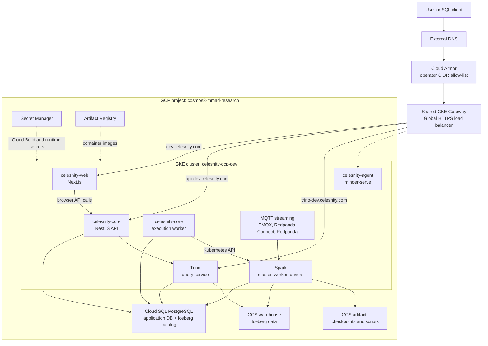
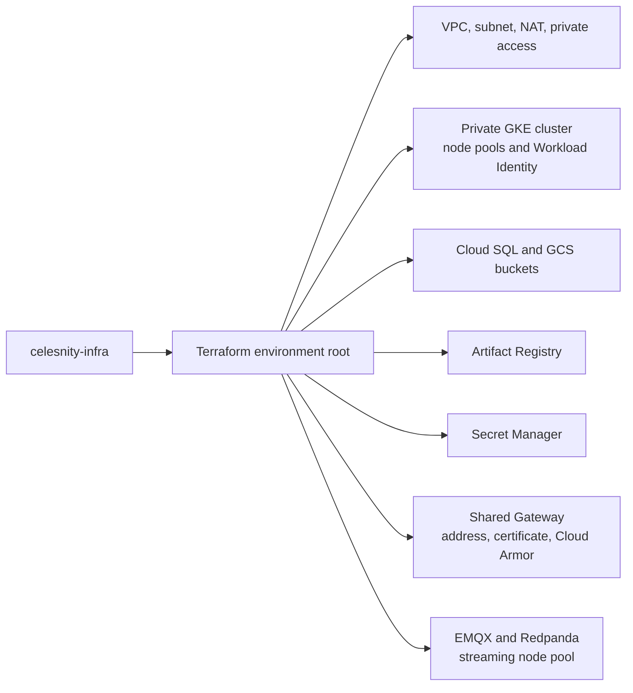
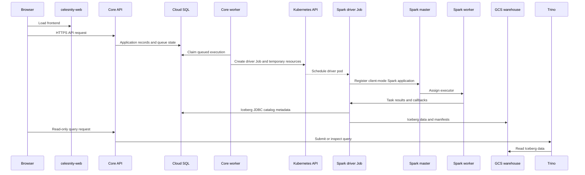
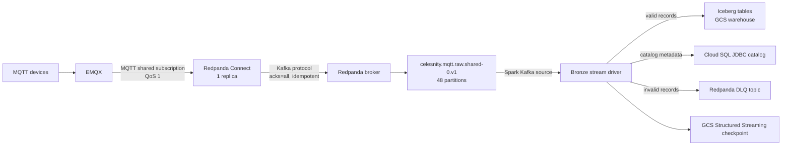

# Celesnity System Architecture

This document describes the current Celesnity architecture across the five
repositories in this workspace:

- `celesnity-infra`
- `celesnity-core`
- `celesnity-web`
- `celesnity-agent`
- `celesnity-control-plane-web`

It focuses on the GCP deployment and distinguishes deployed behavior from
integration that is only planned or partially wired.

## Architecture Status

| Field | Current value |
| --- | --- |
| GCP development project | `cosmos3-mmad-research` |
| GCP development cluster | `celesnity-gcp-dev` |
| Development location | `asia-southeast1-a` |
| GCP production project | `celesnity-minder-platform` |
| Production cluster | `celesnity-gcp-prod` |
| Production location | Regional `europe-west2` (London) |
| Primary runtime | Private-node GKE Standard |
| Infrastructure owner | `celesnity-infra` |
| Application deployment | Repository-owned Cloud Build pipelines |

The infrastructure repository's older architecture document refers to three
source repositories. The current workspace contains five; this document
includes `celesnity-agent` explicitly.

## System Context



`minder-serve` is shown as a separate agent runtime. The current agent
repository has its own HTTP API and deployment pipeline; it is not the same
process as the Core API.

## Repository Ownership

### `celesnity-infra`

`celesnity-infra` owns the platform and data-processing layer:

- Terraform modules and environment roots under `infra/`.
- VPC, private GKE, node pools, Cloud SQL, GCS, Artifact Registry, Secret
  Manager, IAM, Workload Identity, and observability resources.
- The shared GKE Gateway, static address, certificate map, Cloud Armor policy,
  and Gateway-related policies.
- Kubernetes base manifests and GCP overlays under `deploy/`.
- Spark standalone master and worker.
- Spark MQTT bronze stream deployment.
- Redpanda Connect, topic bootstrap, Trino, MCP Trino, and Iceberg maintenance.
- The Spark image and the GCS-backed Iceberg catalog configuration.

Important paths:

| Path | Responsibility |
| --- | --- |
| `infra/environments/gcp-dev` | Development Terraform root |
| `infra/environments/gcp-prod` | Production Terraform root |
| `infra/modules/gcp/network` | VPC, subnet, routing, NAT, private access |
| `infra/modules/gcp/cluster` | GKE cluster and node pools |
| `infra/modules/gcp/data` | Cloud SQL and storage buckets |
| `infra/modules/gcp/platform` | Namespace, IAM, secrets, Gateway, catalog bootstrap |
| `infra/modules/gcp/streaming` | EMQX and Redpanda Helm workloads |
| `deploy/base` | Cloud-neutral Kubernetes workloads |
| `deploy/overlays/gcp-dev` | GCP development namespace, routes, policies, and image names |

### `celesnity-core`

`celesnity-core` is the application control plane. It is a NestJS modular
monolith with two runtime processes built from one codebase:

- The API serves HTTP, Swagger, catalog browsing, connection management,
  script authoring, query workbench, and execution APIs.
- The worker polls Cloud SQL for queued executions, claims work, submits Spark
  driver Jobs, streams logs, and persists execution state.

The Core API does not submit Spark work directly. The worker creates a short-
lived Kubernetes Job, and that Job runs a Spark driver in client deploy mode
against the long-running Spark master and worker.

Core owns:

- `src/domain`, `src/application`, `src/infrastructure`, and HTTP presentation
  layers.
- `k8s/base` and `k8s/overlays/gcp-dev`.
- Its Cloud Build pipeline.
- The `core` and `core-migrate` Artifact Registry images.

The Core deployment expects these platform resources from `celesnity-infra`:

- Namespace `celesnity`.
- ServiceAccount `celesnity`.
- Secret `celesnity-database`.
- Secret `trino-client`.
- ConfigMap `celesnity-storage`.
- Shared Gateway `celesnity`.

The Core Cloud Build pipeline fails if those resources are missing rather than
creating a second platform.

### `celesnity-web`

`celesnity-web` is the Next.js frontend. It owns the browser experience for:

- Iceberg catalog browsing.
- Read-only SQL and query progress.
- Database connection management.
- PySpark script authoring and execution.
- Chat-oriented UI components where the corresponding backend contract exists.

The browser talks to the Core API. The frontend does not contain database,
cloud, or LLM credentials.

The Core API URL is compiled into the Next.js browser bundle during Cloud Build
using `NEXT_PUBLIC_CORE_API_URL`. Changing a Deployment environment variable
does not change this URL after the image has been built.

The web deployment expects the Terraform-owned `celesnity` namespace,
ServiceAccount, and shared Gateway. Its GCP route is:

```text
https://dev.celesnity.com/*
    -> Gateway HTTPS listener
    -> Service/celesnity-web:3000
```

### `celesnity-agent`

`celesnity-agent` contains two related parts:

- A Rust workspace containing the `minder-serve` runtime and its Clean
  Architecture crates.
- `minder-platform`, a TypeScript web/bridge workspace that stores signed room
  events, wakes agents, calls `minder-serve`, and publishes agent replies.

`minder-serve` provides the agent execution API, including turns, webhooks,
rooms, run event streams, agent definitions, skills, and reliability data. It
calls an OpenAI-compatible LLM endpoint and can persist runtime data in
PostgreSQL.

The agent repository currently deploys only `minder-serve` to GKE. Its Cloud
Build pipeline:

1. Builds and pushes the `minder-serve` image.
2. Reads LLM and database values from Secret Manager.
3. Renders `k8s/overlays/gcp-dev` with Kustomize.
4. Applies the `minder` namespace, Service, Deployment, HPA, and configuration.
5. Waits for the `minder-serve` rollout.

The agent overlay creates the `minder` namespace itself because Terraform in
`celesnity-infra` does not currently provision that namespace or its runtime
secrets. It uses a ClusterIP Service and has no authentication or authorization
inside `minder-serve`; it must remain behind a trusted authenticated caller.

The `minder-platform` web/bridge deployment is not currently represented by
GCP Kubernetes manifests in this repository. Its local architecture is:

```text
browser -> minder-platform web -> PostgreSQL event log
                                      |
                                      | LISTEN/NOTIFY
                                      v
                                    bridge -> minder-serve HTTP/SSE
```

## GCP Deployment Architecture

### Foundation ownership

`celesnity-infra` creates the shared GCP foundation through Terraform:



The GCP development environment is a zonal private-node GKE cluster in
`asia-southeast1-a`. Nodes use the `10.30.0.0/20` subnet, pods use the
`10.31.0.0/16` secondary range, and Services use `10.32.0.0/20`. Cloud SQL is
reachable through Private Service Access.

The production environment uses a separate regional cluster and separate
environment-specific buckets, secrets, Artifact Registry repository, and
Terraform state.

### Kubernetes ownership

The infrastructure repository owns the shared platform objects. Application
repositories consume them:

| Object | Owner | Consumers |
| --- | --- | --- |
| GKE cluster and node pools | `celesnity-infra` Terraform | All workloads |
| Namespace `celesnity` | `celesnity-infra` Terraform | Core, web, Spark, Trino |
| Namespace `celesnity-streaming` | `celesnity-infra` Terraform/module | EMQX and Redpanda |
| Namespace `minder` | `celesnity-agent` overlay currently | `minder-serve` |
| Shared Gateway | `celesnity-infra` | Web, Core, Trino, Grafana, optional agent route |
| `celesnity` ServiceAccount | `celesnity-infra` Terraform | Web, Core, Spark, Trino |
| `celesnity-core-worker` RBAC | `celesnity-core` | Core worker only |
| Spark and Trino workloads | `celesnity-infra` Kustomize | Core worker and data users |
| Core API and worker | `celesnity-core` Kustomize | Web and users |
| Web frontend | `celesnity-web` Kustomize | Browser users |
| `minder-serve` | `celesnity-agent` Kustomize | Trusted agent platform caller |

### Deployment sequence

The normal GCP deployment sequence is:

1. Terraform creates or updates the GCP foundation and cluster resources.
2. Terraform creates the `celesnity` platform namespace, ServiceAccount,
   storage ConfigMap, database Secret, Workload Identity bindings, Gateway,
   and cloud data services.
3. `celesnity-infra` renders and applies its GCP Kustomize overlay. This deploys
   Spark, Trino, streaming bridge components, topic bootstrap, maintenance,
   and shared routes and policies.
4. `celesnity-core` Cloud Build builds `core` and `core-migrate`, injects
   selected runtime secrets, applies its overlay, and waits for the API and
   worker rollouts.
5. `celesnity-web` Cloud Build builds the frontend with the Core API URL,
   applies its overlay, and waits for the web rollout.
6. `celesnity-agent` Cloud Build builds `minder-serve`, injects its own runtime
   secrets, applies its `minder` overlay, and waits for its rollout.

The application pipelines deliberately validate infrastructure prerequisites and
fail if the platform has not been created. This prevents each repository from
creating incompatible copies of the cluster, namespace, ServiceAccount, or
Gateway.

### Manual deployment commands

From `celesnity-infra`, the documented development flow is:

```bash
gcloud auth login
gcloud auth application-default login
gcloud auth application-default set-quota-project <project>

make preflight CLOUD=gcp
make infra-init CLOUD=gcp
make infra-apply CLOUD=gcp
make kubeconfig CLOUD=gcp
make image-push CLOUD=gcp
make deploy CLOUD=gcp
```

`infra-apply` is intentionally split because the Kubernetes and Helm providers
cannot authenticate against a GKE cluster before Terraform creates it.

The infrastructure Cloud Build pipeline applies the matching Terraform root and
Kustomize overlay. Development is tied to the `development` branch and
production is tied to release tags created from an approved release branch. The development trigger
must remain disabled until the existing live resources have been adopted into
the remote Terraform state and a no-replacement plan has been reviewed.

## Core Application Flow



The Core worker uses Cloud SQL as its durable queue and coordination boundary.
It does not use an in-memory queue or a Core-to-worker HTTP Service.

## MQTT, Redpanda, and Spark Flow



Redpanda implements the Kafka broker and consumer-producer protocol. Spark uses
the Spark Kafka source; there is no separate Apache Kafka deployment in this
architecture.

The bronze stream runs in a `Deployment` with a Spark driver in client deploy
mode. The driver registers with the standalone Spark master and receives an
executor from the Spark workers. The GCP development overlay configures two
workers advertising 2 cores each, while the bronze application requests one
executor core per application instance.

The source configuration currently includes:

- Topic: `celesnity.mqtt.raw.shared-0.v1`.
- Topic partitions: 48.
- Raw topic retention: 7 days.
- Topic replication factor in the current development cluster: 1.
- Checkpoint: `gs://<artifacts-bucket>/_platform/checkpoints/mqtt/shared-0`.
- `failOnDataLoss`: `true`.
- Default `startingOffsets`: `latest`, used only when no existing checkpoint is
  available.

## Current Streaming Failure Mode

During the incident, the durable checkpoint and Redpanda retention had
different lifetimes:

```text
GCS checkpoint says:
  partition 1 -> next offset 9444

Redpanda currently retains:
  partition 1 -> starts at offset 9459

Spark asks for offset 9444
  -> OffsetOutOfRangeException
  -> StreamingQueryException
  -> driver exits with code 1
  -> Kubernetes restarts the Deployment
```

The unavailable records are offsets `9444` through `9458` on partition `1`.
Because `failOnDataLoss=true`, Spark stops the entire streaming query rather
than skipping them. Changing `startingOffsets` does not repair an existing
checkpoint.

This was primarily a recovery and durability bottleneck, not a Redpanda CPU
bottleneck. The development Redpanda cluster is healthy, but it has one broker
and replication factor 1. The raw retention is now seven days, but an outage
longer than that window would still make the durable checkpoint unrecoverable
from Redpanda.

## Storage and Identity

### Iceberg storage planes

Iceberg uses two separate storage planes:

- Cloud SQL PostgreSQL stores JDBC catalog metadata, namespaces, table metadata,
  and application records.
- GCS stores Iceberg data files, manifests, metadata JSON, snapshots, scripts,
  and Spark streaming checkpoints.

Trino reads the same Iceberg catalog and warehouse used by Spark. Spark and
Trino use Google credentials through the `celesnity` ServiceAccount and
Workload Identity. Core still uses GCS's S3-compatible endpoint with HMAC
credentials because its object-storage adapter is based on the MinIO client.

### Secrets

Secret Manager is the durable source for platform and application secrets.
Terraform projects selected values into Kubernetes Secrets, while the Core and
agent Cloud Build pipelines inject application-specific values into their
rendered workspace before applying manifests. Secret values must not be
committed or printed in build logs.

The web frontend has no runtime cloud credentials. Its public API URL is not a
secret and is compiled into the image.

## Observability

Application logs are written to container stdout/stderr. Alloy runs as a
DaemonSet, reads pod logs from each node, and pushes them to Loki. Grafana reads
Loki and is exposed through the shared Gateway.

GKE system and audit logs are sent to Cloud Logging. Managed Prometheus is not
currently enabled, so checkpoint lag, Kafka lag, Spark throughput, and service
latency need explicit metrics before they can be monitored as time series.

## Known Integration Gaps

These are important when reading the repositories as one system:

1. `celesnity-agent` has a separate `minder` namespace and deployment pipeline;
   Terraform does not yet own that namespace or its runtime secrets.
2. The agent repository contains an `HTTPRoute` for
   `api-agent-dev.celesnity.com`, but the committed namespace manifest does not
   add the Gateway's required `celesnity.io/gateway-access=true` label. The route
   therefore requires an external namespace-label change before it can attach.
3. `minder-serve` has no built-in authentication or authorization. It must not
   be exposed publicly without an authenticated gateway or trusted caller.
4. `minder-platform` has local Docker Compose deployment but no corresponding
   GCP Kubernetes deployment in the agent repository. Its `MINDER_PLATFORM_URL`
   integration is unset in the agent GCP ConfigMap.
5. The agent's Trino integration is not wired for the deployed GCP Trino TLS,
   password, and CA requirements. Its GCP ConfigMap documents this and leaves
   `TRINO_URL` unset.
6. The web repository contains chat clients that call Core API `/chat/...`
   routes. Matching chat routes were not found in the checked Core source tree;
   this cross-repository API contract should be verified before treating that
   chat path as deployed.
7. The MQTT raw topic retention is shorter than the durable Spark checkpoint
   lifetime. Retention should exceed the maximum expected recovery window, or
   data-loss handling must be made explicit.
8. The development Redpanda deployment uses one broker and replication factor
   1. This is not a highly available production topology.

## Scaling Priorities

The recommended order for improving the current architecture is:

1. Align Redpanda retention with the maximum Spark outage and add checkpoint-lag
   alerting.
2. Use multiple Redpanda brokers and replication factor 3 in production.
3. Decide whether `failOnDataLoss=false` is acceptable for each stream; otherwise
   provide a replay source.
4. Scale Spark workers and executor cores based on measured input rate.
5. Optimize the bronze `foreachBatch` sink, which currently discovers tenants
   and appends tenant tables sequentially.
6. Add metrics for MQTT ingress, Redpanda partition lag, Spark batch duration,
   checkpoint age, Iceberg write latency, and Cloud SQL catalog latency.
7. Make the agent namespace, identity, secrets, and platform integration either
   Terraform-owned or explicitly documented as a separate application platform.
