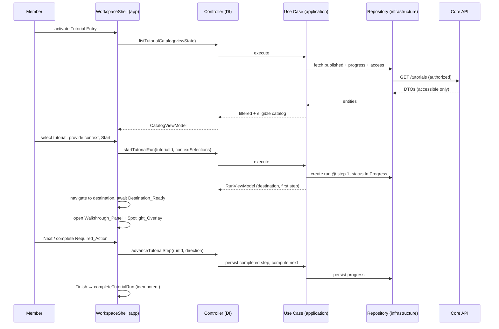

# Design Document

## Overview

Guided User Tutorials add interactive, task-oriented learning to the Celesnity
Workspace. A Member discovers published tutorials from a catalog reachable
anywhere in the Workspace, inspects a tutorial's readiness (prerequisites,
required workspace features, and required context), starts a run, follows an
ordered walkthrough beside their live Workspace with the relevant control
spotlighted, and has progress persisted per tutorial so they can pause, resume,
complete, and repeat.

This design realizes the feature inside the existing celesnity-web Clean
Architecture. The dependency direction is lint-enforced by
`eslint-plugin-boundaries`:

```text
app → di / controllers / presenters / entities
controllers → use-cases / presenters / entities
use-cases → ports (repositories, services) / entities
infrastructure → ports / entities
entities → entities
```

Two rules shape every decision below:

1. **React never calls the API.** UI resolves controllers through the ioctopus
   DI container (`getInjection`) in a frozen feature root and passes them to a
   screen. All network access lives in `src/infrastructure` behind ports.
2. **Business rules live in `src/entities` and `src/application`, never in
   React.** Catalog filtering, progress arithmetic, publication validation,
   eligibility evaluation, resume revalidation, and completion idempotence are
   pure domain functions or use cases — testable without a browser.

### Design decisions and rationale

- **The Guided Tutorial System is a Core API capability, not a browser-only
  feature.** Tutorial definitions, progress records, onboarding decisions, and
  completion records are identity- and organization-scoped and must survive
  across sessions and devices (Req 9.10, 4.6, 12.7). They are therefore modeled
  as server resources reached through repositories. The browser holds only
  transient interaction state (which surface is open, catalog scroll position,
  spotlight geometry).
- **The Workspace shell owns the Tutorial Entry.** The catalog must be reachable
  from every Workspace Destination without navigating away (Req 2.1, 2.2), so
  the entry and its overlay surfaces mount in `WorkspaceShell`
  (`app/_components/layout/`), not in a route page. This mirrors how the shell
  already owns the language switcher and navigation.
- **A tutorial run is an overlay over the real Workspace, not a separate route.**
  Requirement 5.3, 6.1, and 7 require the walkthrough to sit beside the live
  destination while the member performs real work with spotlighted controls.
  The walkthrough panel and spotlight overlay render in the shell above the
  routed page; step-driven navigation uses the App Router (`next/navigation`)
  rather than replacing the page tree.
- **Spotlight geometry and destination-readiness are UI-owned; the domain never
  measures pixels.** Locating a Target Control, scrolling it into view, applying
  page dimming, and realigning on scroll/resize are DOM concerns that live in
  `app/_components`. The domain models only the *outcome* (target located vs.
  not, destination ready vs. not) so step-completion gating stays testable.
- **Required Actions reuse existing Workspace operations unchanged.** Req 12.4–
  12.6 forbid the tutorial system from creating a privileged side channel. A
  Required Action is satisfied by observing the member completing the *same*
  operation through the *same* controller the unguided Workspace uses; the
  tutorial system verifies the outcome, it does not re-invoke with elevated
  rights.

## Architecture

### Layer map for this feature

```text
src/entities/models/
  tutorial-definition.ts        Tutorial_Definition, Tutorial_Step, Tutorial_Metadata,
                                Context_Requirement, Prerequisite descriptor, publication rules
  tutorial-catalog.ts           catalog filtering + search normalization (pure)
  tutorial-progress.ts          Progress_Record, Progress_Percentage arithmetic, Resume_Point (pure)
  tutorial-run.ts               Tutorial_Run, Tutorial_Status transitions, completion idempotence
  tutorial-eligibility.ts       Eligible_Tutorial evaluation from features + prerequisites + context
  onboarding.ts                 Onboarding_Decision, recommendation selection
src/entities/errors/
  application-errors.ts         + TutorialPublicationError, TutorialAccessError (extend existing file)

src/application/repositories/
  tutorial.repository.interface.ts          catalog, definition, publication
  tutorial-progress.repository.interface.ts progress + onboarding + completion persistence
src/application/services/
  workspace-context.service.interface.ts    lists authorized resources for a Context_Requirement
  tutorial-feature-access.service.interface.ts re-evaluates required Workspace_Features
src/application/use-cases/tutorials/
  list-tutorial-catalog.use-case.ts
  open-tutorial-detail.use-case.ts
  start-tutorial-run.use-case.ts
  advance-tutorial-step.use-case.ts   (next / previous / complete-action)
  pause-tutorial-run.use-case.ts
  resume-tutorial-run.use-case.ts
  complete-tutorial-run.use-case.ts
  repeat-tutorial.use-case.ts
  resolve-onboarding.use-case.ts
  record-onboarding-decision.use-case.ts

src/interface-adapters/presenters/
  tutorial-catalog.presenter.ts     CatalogViewModel, TutorialCardViewModel (status + percentage)
  tutorial-detail.presenter.ts      DetailViewModel (prereq states, context selectors, start-enabled)
  walkthrough.presenter.ts          StepViewModel (title, position, content, callout, target name)
  completion.presenter.ts           CompletionSummaryViewModel
src/interface-adapters/controllers/tutorials/
  tutorial.schemas.ts               Zod boundary schemas
  <one controller per use case>.controller.ts

src/infrastructure/repositories/
  core-api-tutorial.repository.ts
  core-api-tutorial-progress.repository.ts
src/infrastructure/services/
  core-api-workspace-context.service.ts
  core-api-tutorial-feature-access.service.ts

di/types.ts                        tokens + return types
di/modules/tutorials.module.ts     repositories → services → use cases → controllers

app/_stores/
  tutorial-session.store.ts         which surface is open, active run id, catalog view state
app/_components/layout/
  workspace-shell.tsx               mounts TutorialEntry + TutorialOverlayHost
app/_components/tutorials/          (app-wide: the overlay is not route-local)
  tutorial-entry.tsx
  tutorial-overlay-host.tsx         chooses catalog | detail | onboarding | walkthrough
  tutorial-catalog-panel.tsx
  tutorial-detail-panel.tsx
  walkthrough-panel.tsx
  spotlight-overlay.tsx             DOM measurement, dimming, realignment, reduced-motion
  onboarding-invitation.tsx
  completion-summary.tsx
  use-target-control.ts            locate + scroll-into-view + observe a Target_Control
  use-destination-ready.ts         detect Destination_Ready for a step's destination
```

The overlay components live in `app/_components/tutorials/` (app-wide) rather
than a route's `_components/`, because a tutorial run overlays *any* route and
the shell hosts it — a route-local folder would fail
`tests/unit/app/frameworks-layer.test.ts` the moment a second route needed it.

### Runtime flow (start → walk → pause → resume → complete)



### Access-control boundary

Every read and write in this feature passes through existing Workspace
authorization. The catalog repository requests only tutorials whose required
Workspace Features the member can access; context selectors list only
authorized resources; the domain never receives identifiers, names, or metadata
for inaccessible tutorials or resources (Req 12.1–12.3). Required Actions invoke
the same controllers, with the same member inputs, authorization, validation,
and confirmation behavior as the unguided operation (Req 12.4–12.6). Sensitive
Values never enter progress records, completion records, view models, or
assistive-technology descriptions; presenters deep-copy and omit any such field
(Req 12.7).

## Components and Interfaces

### Entities (domain vocabulary and pure rules)

`tutorial-definition.ts` holds the published shape and the publication
validation function:

```ts
export type TutorialId = string;

export interface TutorialMetadata {
  readonly title: string;
  readonly summary: string;
  readonly category: string;
  readonly learningOutcomes: readonly string[];
  readonly estimatedMinutes: number;
  readonly stepCount: number;
}

export interface ContextRequirement {
  readonly id: string;
  readonly resourceType: string; // e.g. 'DATABASE', 'CONNECTION', 'PIPELINE'
  readonly selectionCount: number; // >= 1
}

export interface PrerequisiteDescriptor {
  readonly id: string;
  readonly description: string;
}

export interface TutorialStep {
  readonly id: string;
  readonly order: number;
  readonly title: string;
  readonly destinationFeature: WorkspaceFeature;
  readonly destinationHref: string;
  readonly requiredAction?: RequiredActionDescriptor; // zero or one
  readonly targetControl?: TargetControlDescriptor;   // zero or one
}

export interface TutorialDefinition {
  readonly id: TutorialId;
  readonly metadata: TutorialMetadata;
  readonly steps: readonly TutorialStep[]; // non-empty, ordered
  readonly requiredFeatures: readonly WorkspaceFeature[]; // may be empty
  readonly prerequisites: readonly PrerequisiteDescriptor[]; // may be empty
  readonly contextRequirements: readonly ContextRequirement[]; // may be empty
}

export type PublicationViolation =
  | 'MISSING_ID' | 'MISSING_METADATA' | 'EMPTY_STEPS'
  | 'AMBIGUOUS_ACTION' | 'AMBIGUOUS_TARGET' | 'METADATA_STEP_COUNT_MISMATCH';

export type PublicationResult =
  | { readonly ok: true }
  | { readonly ok: false; readonly violations: readonly PublicationViolation[] };

export function validatePublication(candidate: TutorialDefinition): PublicationResult;
```

`tutorial-catalog.ts` holds search and filtering (Req 2.7, 2.8, 2.9):

```ts
export function normalizeSearchTerm(raw: string): string; // trim only; matching lowercases
export function filterCatalog(
  tutorials: readonly CatalogTutorial[],
  searchTerm: string,
  statusFilters: readonly TutorialStatus[],
): readonly CatalogTutorial[];
```

`tutorial-progress.ts` holds progress arithmetic (Req 9.2–9.6):

```ts
export type TutorialStatus = 'NOT_STARTED' | 'IN_PROGRESS' | 'PAUSED' | 'COMPLETED';

export interface ProgressRecord {
  readonly tutorialId: TutorialId;
  readonly memberId: string;
  readonly organizationId: string;
  readonly status: TutorialStatus;
  readonly currentStepId: string;
  readonly completedStepIds: readonly string[]; // distinct
  readonly contextSelections: readonly ContextSelection[];
  readonly updatedAt: string;
}

export function progressPercentage(completedDistinct: number, totalSteps: number): number;
export function markStepComplete(record: ProgressRecord, stepId: string): ProgressRecord;
export function resumePoint(record: ProgressRecord, steps: readonly TutorialStep[]): TutorialStep;
```

`tutorial-eligibility.ts` composes feature access, prerequisite satisfaction,
and context validity into an `Eligible_Tutorial` judgment (Req 3.12, 5, 10.8–
10.12):

```ts
export interface EligibilityInput {
  readonly requiredFeatures: readonly WorkspaceFeature[];
  readonly accessibleFeatures: readonly WorkspaceFeature[];
  readonly prerequisiteStates: readonly { id: string; satisfied: boolean }[];
  readonly contextRequirements: readonly ContextRequirement[];
  readonly contextSelections: readonly ContextSelection[];
}
export interface EligibilityResult {
  readonly eligible: boolean;
  readonly blockingFeatureIds: readonly WorkspaceFeature[];
  readonly unsatisfiedPrerequisiteIds: readonly string[];
  readonly unfilledContextRequirementIds: readonly string[];
}
export function evaluateEligibility(input: EligibilityInput): EligibilityResult;
```

`tutorial-run.ts` owns run/status transitions and completion idempotence (Req 5,
8, 10, 11):

```ts
export function canAdvanceNext(step: TutorialStep, record: ProgressRecord): boolean;
export function isFirstStep(step: TutorialStep, steps: readonly TutorialStep[]): boolean;
export function isFinalStep(step: TutorialStep, steps: readonly TutorialStep[]): boolean;
export function applyCompletion(record: ProgressRecord): ProgressRecord; // idempotent
```

### Ports (application)

```ts
// tutorial.repository.interface.ts
export interface TutorialRepository {
  listAccessibleCatalog(): Promise<readonly CatalogTutorial[]>; // authorization applied server-side
  getDefinition(id: TutorialId): Promise<TutorialDefinition>;
  publish(candidate: TutorialDefinition): Promise<PublicationResult>;
}

// tutorial-progress.repository.interface.ts
export interface TutorialProgressRepository {
  listForMember(): Promise<readonly ProgressRecord[]>;
  save(record: ProgressRecord): Promise<ProgressRecord>;
  getOnboardingDecision(): Promise<OnboardingDecision | null>;
  saveOnboardingDecision(decision: OnboardingDecision): Promise<OnboardingDecision>;
  saveCompletion(runId: string): Promise<CompletionRecord>; // idempotent per run
}

// workspace-context.service.interface.ts
export interface WorkspaceContextService {
  listAuthorizedResources(resourceType: string): Promise<readonly ContextResource[]>;
  isResourceStillValid(resourceType: string, resourceId: string): Promise<boolean>;
}

// tutorial-feature-access.service.interface.ts
export interface TutorialFeatureAccessService {
  accessibleFeatures(): Promise<readonly WorkspaceFeature[]>;
}
```

### Use cases (application)

Each use case follows the `createXUseCase(deps) => async (input) => …` factory
style, owns validation/ordering, and calls only ports (never another use case).
Key responsibilities:

- **list-tutorial-catalog** — fetches accessible catalog + progress, applies
  `filterCatalog`, attaches status and percentage. (Req 2.4–2.10, 12.1–12.3)
- **open-tutorial-detail** — loads definition, evaluates prerequisites and
  context selectors against current member/org, computes start-enabled via
  `evaluateEligibility`. (Req 3)
- **start-tutorial-run** — enforces single active run, creates run at step 1
  with status In Progress, or requests pause/cancel choice on conflict. (Req 5)
- **advance-tutorial-step** — Next/Previous/complete-action; persists completed
  step before advancing; gates on destination readiness signaled by the caller.
  (Req 8, 9.5–9.7)
- **pause-tutorial-run** — persists Paused + Resume_Point before confirming; on
  failure retains In Progress. (Req 10.2–10.7)
- **resume-tutorial-run** — re-evaluates features, prerequisites, and saved
  context; sets In Progress only when all validations and readiness succeed.
  (Req 10.8–10.16)
- **complete-tutorial-run** — persists Completed + one Completion_Record
  idempotently. (Req 11.1, 11.6)
- **repeat-tutorial** — after confirmation, creates a fresh run, preserving
  prior completion records. (Req 11.9–11.13)
- **resolve-onboarding / record-onboarding-decision** — recommend an accessible
  starter tutorial, persist accept/dismiss. (Req 4)

### Controllers, presenters, and DI

One controller per use case; boundary input validated with Zod schemas in
`tutorial.schemas.ts`; each controller makes exactly one use-case call and
returns a presenter ViewModel. Presenters return fresh immutable ViewModels,
deep-copying nested arrays and omitting any Sensitive Value. Tokens and return
types are declared in `di/types.ts` and bound in `di/modules/tutorials.module.ts`
(repositories → services → use cases → controllers), then loaded in
`di/container.ts`. Only the feature roots (`tutorial-entry.tsx`,
`tutorial-overlay-host.tsx`) resolve controllers, via `getInjection`, into a
frozen object.

### UI composition

- `WorkspaceShell` renders `TutorialEntry` (always available, Req 2.1) and
  `TutorialOverlayHost`.
- `TutorialOverlayHost` reads `tutorial-session.store.ts` to decide which surface
  is open (catalog, detail, onboarding, walkthrough) and resolves controllers.
- On a Wide Viewport the catalog and walkthrough align right without overlapping
  the Workspace; on a Narrow Viewport they fill the viewport without horizontal
  scroll (Req 2.3, 6.1, 13.1). Layout uses Tailwind v4 mobile-first
  `min-[1024px]:` breakpoints only; appearance comes from `ui/` primitives.
- `spotlight-overlay.tsx` (with `use-target-control.ts`) locates the Target
  Control, scrolls it fully into view, applies page dimming only outside the
  control and panel, realigns on scroll/resize via `ResizeObserver` /
  scroll listeners, and replaces motion with immediate transitions under
  `prefers-reduced-motion` (Req 7, 13.2, 13.12).

### State ownership

Server data (catalog, definitions, progress) is fetched through controllers and
held by the screen/host that fetched it — never cached in a store. The Zustand
store holds only cross-component interaction state: which surface is open, the
active run id, and the preserved Catalog View State (search term, status
filters, scroll position) so returning from detail restores it (Req 2.11, 2.12).
The store carries no business rules and calls no controllers.

## Data Models

### Persisted (Core API) resources

- **Tutorial_Definition / Published_Tutorial** — stable `id` across revisions
  (Req 1.1, 1.2); one metadata record; non-empty ordered steps; explicit
  (possibly empty) required-feature, prerequisite, and context-requirement sets.
- **Progress_Record** — keyed by (member, organization, tutorial) (Req 9.1);
  holds status, current step, distinct completed step ids, context selections,
  updated time.
- **Onboarding_Decision** — keyed by (member, organization); `accepted |
  dismissed`.
- **Completion_Record** — one per completed Tutorial_Run (Req 11.1, 11.6),
  with completion timestamp; prior records preserved on repeat (Req 11.13).

### View models (interface-adapters → app)

- **CatalogViewModel** — ordered `TutorialCardViewModel[]` (title, summary,
  category, outcomes, minutes, step count, status, optional percentage) plus
  a no-results flag.
- **DetailViewModel** — metadata, prerequisite state list with remediation,
  context selector descriptors, selected resource names, `startEnabled`.
- **StepViewModel** — title, `stepNumber`/`totalSteps`, instructional content
  with emphasized-text and action-callout markers, target control accessible
  name, `previousEnabled`, `forwardLabel` (`Next` | `Finish`), `forwardEnabled`.
- **CompletionSummaryViewModel** — title, completed outcomes, timestamp, next
  recommendation.

### Client interaction state (Zustand)

```ts
interface TutorialSessionState {
  readonly openSurface: 'none' | 'catalog' | 'detail' | 'onboarding' | 'walkthrough';
  readonly activeRunId: string | null;
  readonly catalogView: { readonly search: string; readonly filters: readonly TutorialStatus[]; readonly scrollTop: number };
  // actions that produce new immutable state
}
```

## Correctness Properties

*A property is a characteristic or behavior that should hold true across all
valid executions of a system — essentially, a formal statement about what the
system should do. Properties serve as the bridge between human-readable
specifications and machine-verifiable correctness guarantees.*

The properties below target the pure domain functions and use cases
(`src/entities/**`, `src/application/use-cases/**`). UI geometry (spotlight,
focus, responsive layout, contrast, reduced motion) and one-shot persistence
side effects are verified with example, integration, snapshot, and visual tests
instead — see Testing Strategy. Each property was derived from the prework
classification and consolidated to remove redundancy.

### Property 1: Identifier uniqueness across the catalog

*For any* collection of Tutorial Definitions the system exposes as a catalog,
every definition's identifier is distinct from every other definition's
identifier.

**Validates: Requirements 1.1**

### Property 2: Identifier is preserved across revisions

*For any* Tutorial Definition and *any* revision to its metadata or steps, the
revised definition retains the original identifier.

**Validates: Requirements 1.2**

### Property 3: A definition satisfying every publication rule publishes

*For any* Tutorial Definition that has an identifier, exactly one metadata
record, a non-empty ordered step collection, at most one Required Action and at
most one Target Control per step, and explicit (possibly empty) feature,
prerequisite, and context sets, `validatePublication` returns a success result.

**Validates: Requirements 1.3, 1.4, 1.5, 1.6, 1.7, 1.8, 1.9, 1.10**

### Property 4: Every publication violation is reported and the catalog is unchanged

*For any* otherwise-valid Tutorial Definition with a single injected publication
violation, `validatePublication` returns a failure result whose violation list
includes that violation, and *for any* existing catalog the rejected publication
leaves the catalog identical.

**Validates: Requirements 1.11, 1.12**

### Property 5: Search trims and matches case-insensitively across title, summary, and category

*For any* catalog and *any* raw search term, `filterCatalog` returns exactly the
tutorials whose title, summary, or category contains the whitespace-trimmed term
under case-insensitive comparison, and leading/trailing whitespace or letter case
in the term does not change the result set.

**Validates: Requirements 2.7**

### Property 6: Filters combine with search as conjunction

*For any* catalog, *any* search term, and *any* set of active status filters,
every tutorial returned satisfies the search term and every active filter, and no
tutorial satisfying all of them is omitted.

**Validates: Requirements 2.8**

### Property 7: Clearing search and filters restores the full catalog from the start

*For any* Catalog View State, applying the clear action produces an empty search
term, no active filters, the complete catalog in its original order, and scroll
position at the start.

**Validates: Requirements 2.10**

### Property 8: Catalog View State round-trips through detail

*For any* Catalog View State, preserving it before opening Tutorial Detail and
restoring it on return yields a Catalog View State equal to the original.

**Validates: Requirements 2.11, 2.12**

### Property 9: Catalog card completeness

*For any* catalog tutorial, its card ViewModel includes the complete metadata
(title, summary, category, learning outcomes, estimated duration, step count),
the current Tutorial Status, and — when a Progress Record exists — the
Progress Percentage equal to `progressPercentage` of that record.

**Validates: Requirements 2.4, 2.5, 2.6, 3.1**

### Property 10: Every prerequisite is evaluated with a remediation when unsatisfied

*For any* Tutorial Definition opened as Detail, the result contains exactly one
satisfied/unsatisfied state for each prerequisite, and every unsatisfied
prerequisite carries exactly one usable Remediation Action.

**Validates: Requirements 3.2, 3.3, 3.4**

### Property 11: One selector per required context selection, limited to authorized matching resources

*For any* Context Requirement of resource type T requiring N selections, Detail
presents N selectors whose options are exactly the resources of type T the member
is authorized to access in the current Organization.

**Validates: Requirements 3.6, 3.7, 12.2**

### Property 12: Only invalid context selections are cleared and their requirements are flagged

*For any* set of context selections in which an arbitrary subset becomes
unavailable, exactly those unavailable selections are cleared, every still-valid
selection is retained, and each cleared selection's Context Requirement is flagged
as needing a replacement.

**Validates: Requirements 3.10, 3.11, 10.11**

### Property 13: Start is available exactly when there are no blocking conditions

*For any* eligibility input, `evaluateEligibility` reports eligible (start
available) if and only if there are no missing required features, no unsatisfied
prerequisites, and no unfilled context requirements; when not eligible, the result
lists every blocking feature, prerequisite, and context requirement. The same
evaluation applied on resume yields the same judgment and complete blocker list.

**Validates: Requirements 3.5, 3.8, 3.12, 3.13, 10.8, 10.9, 10.10, 10.12**

### Property 14: Onboarding auto-visibility follows the persisted decision

*For any* member/organization, the Onboarding Invitation is auto-presented if and
only if no Onboarding Decision is persisted; a persisted accepted or dismissed
decision suppresses auto-presentation.

**Validates: Requirements 4.1, 4.10**

### Property 15: An onboarding recommendation is accessible when one exists

*For any* catalog and member feature access, if at least one starter tutorial is
accessible (the member can access every required Workspace Feature), the resolver
returns at least one recommendation, and every returned recommendation is
accessible.

**Validates: Requirements 4.3**

### Property 16: Starting an eligible tutorial creates exactly one run at the first step, In Progress

*For any* Eligible Tutorial with no existing Progress Record and no Active Tutorial
Run, starting creates exactly one Tutorial Run whose current step is the first step
and whose status is In Progress.

**Validates: Requirements 5.1, 5.2**

### Property 17: At most one active run exists

*For any* sequence of start attempts, the number of Active Tutorial Runs for the
member never exceeds one.

**Validates: Requirements 5.5**

### Property 18: Cancelling a conflicting start preserves the active run

*For any* Active Tutorial Run, cancelling a conflicting start leaves its status,
current step, and completed-step records unchanged.

**Validates: Requirements 5.7**

### Property 19: Walkthrough step ViewModel completeness

*For any* active step, the step ViewModel exposes the complete tutorial title, a
current step number within `[1, totalSteps]` with `totalSteps` equal to the step
count, the complete step title and instructional content, and — when the step has
a Target Control — the Target Control's accessible name.

**Validates: Requirements 6.2, 6.3, 6.4, 6.7**

### Property 20: Destination transitions preserve run identity and completed steps

*For any* step-triggered destination transition, whether it succeeds or fails, the
Tutorial Run identifier, current step, and completed-step records are preserved.

**Validates: Requirements 6.8, 6.9, 8.15**

### Property 21: Previous availability and non-advancing navigation

*For any* tutorial position, the Previous control is available if and only if the
current step is not the first step; activating an unavailable Previous, activating
an unavailable Next, and moving Previous never clear or shrink the completed-step
records, and moving Previous sets the current step to the immediately preceding
step.

**Validates: Requirements 8.2, 8.3, 8.6, 8.11**

### Property 22: Forward availability reflects required action, target, and destination readiness

*For any* step, the forward control is available if and only if the step's Target
Control (when present) is located, the step's Required Action (when present) has
succeeded, and any required destination transition is complete; a step with no
Required Action and a located target is forward-available.

**Validates: Requirements 7.7, 8.4, 8.5, 8.8, 8.13, 8.14**

### Property 23: Step completion is an idempotent addition

*For any* Progress Record and step, the first successful completion adds the step
exactly once to the completed-step records and can increase Progress Percentage;
completing or revisiting the same step again leaves the completed-step records and
Progress Percentage unchanged. A failed Required Action adds nothing.

**Validates: Requirements 8.7, 8.9, 9.5, 9.6**

### Property 24: Progress Percentage formula, rounding, and bounds

*For any* count of distinct completed steps between 0 and a non-zero total step
count, `progressPercentage` equals the completed count divided by the total,
multiplied by 100, rounded to the nearest whole number with halves rounded upward,
and constrained to the inclusive range 0 through 100.

**Validates: Requirements 9.2, 9.3, 9.4**

### Property 25: Progress Records are isolated by member, organization, and tutorial

*For any* set of Progress Records, records are uniquely keyed by the
(member, organization, tutorial) triple, so records differing only in that triple
never collide.

**Validates: Requirements 9.1**

### Property 26: Persisted progress round-trips on restore

*For any* Progress Record, saving it and then restoring it for the member returns
an equivalent Progress Record.

**Validates: Requirements 9.10**

### Property 27: Restored status display matches persisted status

*For any* restored Progress Record, the displayed Tutorial Status equals the
persisted status: Paused or In Progress when steps remain incomplete, and Completed
when every step is complete and the persisted status is Completed.

**Validates: Requirements 9.11, 9.12**

### Property 28: The Resume Point is the first incomplete step

*For any* Progress Record and ordered step collection, `resumePoint` returns the
first step in order that is not in the completed-step records.

**Validates: Requirements 10.16**

### Property 29: Finish applies completion without advancing past the final step

*For any* tutorial on the final complete step, the forward control is labeled
Finish (and Next otherwise), and activating Finish applies completion while leaving
the current step at the final step.

**Validates: Requirements 8.17, 8.18**

### Property 30: Completion is a single idempotent outcome

*For any* Tutorial Run, applying completion — including repeating the completion
request for the same run — results in status Completed and exactly one Completion
Record for that run.

**Validates: Requirements 11.1, 11.6**

### Property 31: Completion summary completeness and next recommendation

*For any* completed Tutorial Run, the completion summary ViewModel includes the
tutorial title, the completed learning outcomes, and the completion timestamp; and
*for any* catalog containing another Eligible Tutorial, the summary offers at least
one next-tutorial recommendation that is itself eligible.

**Validates: Requirements 11.3, 11.5**

### Property 32: Repetition resets the run and preserves prior completion records

*For any* Completed tutorial, confirming repetition creates a new Tutorial Run with
status In Progress and no completed steps, while every prior Completion Record for
the Published Tutorial is preserved.

**Validates: Requirements 11.12, 11.13**

### Property 33: The catalog exposes only accessible tutorials and never inaccessible details

*For any* set of tutorials and member feature access, every tutorial listed in the
catalog is one whose required Workspace Features are all accessible to the member,
and no ViewModel, Progress Record, or Completion Record produced for the member
contains an identifier, name, metadata, or status for an inaccessible tutorial or
resource.

**Validates: Requirements 12.1, 12.3, 12.10**

### Property 34: Sensitive Values never appear in records, surfaces, or descriptions

*For any* input containing Sensitive Values (credentials, tokens, passwords, keys),
the resulting Progress Records, Completion Records, ViewModels, and
assistive-technology descriptions contain none of those Sensitive Values.

**Validates: Requirements 12.7**

### Property 35: Resume is unavailable while a saved tutorial is inaccessible

*For any* saved Tutorial Run whose Published Tutorial is inaccessible to the member,
resume is reported as unavailable, and the Progress Record is retained without
exposing inaccessible details.

**Validates: Requirements 12.10, 12.11**

### Property 36: Missing localized content names a Fallback Locale before falling back

*For any* selected Supported Locale and tutorial content, when the content is
unavailable in the selected locale the presenter identifies the named Fallback
Locale before returning fallback content.

**Validates: Requirements 13.17**

## Error Handling

Errors are translated once, at the infrastructure boundary, into the shared
application error types in `src/entities/errors/application-errors.ts`, and never
cross inward as `CoreApiError`, a DTO, or a raw `Response`
(see `skills/api-integration/SKILL.md`). Two feature-specific error types extend
that file:

- `TutorialPublicationError` — carries the `PublicationViolation[]` so a rejected
  publication identifies every violated rule (Req 1.11) without leaking DTO shape.
- `TutorialAccessError` — signals feature-access loss or an inaccessible tutorial
  without carrying identifiers, names, or metadata for the inaccessible item
  (Req 12.9, 12.10).

Reused existing types: `NotFoundError` (definition/resource gone),
`ConflictError` (single-active-run conflict, duplicate completion),
`FeatureAccessDeniedError` (required feature not accessible),
`RemoteServiceError` (persistence/restoration failures, with `exposeMessage`
governing whether the message may be shown verbatim).

Handling rules mapped to requirements:

- **Persistence failures are non-destructive.** A failed Progress Record update
  retains the last successfully persisted record and preserves the visible run
  state (Req 9.13, 9.14); a failed pause retains In Progress and keeps the
  Walkthrough Panel while the session is active (Req 10.6, 10.7); a failed
  completion retains the pre-completion status and final step (Req 11.7). Use
  cases return a discriminated result the screen renders as a `PageAlert` /
  `InlineError`; they never overwrite persisted state on failure.
- **Readiness and transition failures retain position.** When a destination does
  not become Destination_Ready or a transition fails, the run stays at its
  current step with completed steps intact, and the UI surfaces retry and pause
  actions with the failure identified (Req 5.10, 5.11, 6.10, 8.16, 10.14).
- **Target-not-found blocks completion.** When a Target Control cannot be located
  after Destination_Ready, forward progress is blocked (Property 22), state is
  retained (Property 20), and retry/pause with an identified failure are offered
  (Req 7.7–7.9).
- **Restoration failure disables resume.** A failed Progress Record restoration
  makes resume unavailable for the affected tutorial and identifies the failure
  without overwriting the unavailable record (Req 9.15, 9.16).
- **Sign-out during a run persists a pause first.** The sign-out path awaits pause
  persistence (status Paused + Resume_Point) before ending the session (Req 10.5),
  ordered in the use case, not the component.
- **Dialog-scoped errors render inside the dialog.** Because Radix marks siblings
  `aria-hidden`, an error from a confirmation dialog (repeat, pause/cancel choice)
  renders as an `InlineError` inside that dialog, not as a page-level alert
  (see `skills/react-component-development/SKILL.md`).
- **Error messages are localized and safe.** All user-visible error text comes
  through the dictionaries; access-related messages never reveal inaccessible
  tutorial or resource details (Req 12.9), and only `exposeMessage` errors are
  shown verbatim.

## Testing Strategy

Testing follows the layered convention in `skills/testing-react-web/SKILL.md`:
Vitest, `.ts` test files under `tests/unit/<layer>/…`, no network and no real
timers, and the layer that owns a behavior is the layer that tests it. Property
tests and example tests are complementary — property tests verify universal
correctness over generated inputs; example tests pin concrete behavior, edge
cases, error paths, and side-effect ordering.

### Property-based testing

Property-based testing **is** appropriate here: the catalog filtering, progress
arithmetic, publication validation, eligibility evaluation, resume revalidation,
context clearing, completion idempotence, and sanitization are pure functions with
large input spaces and universal invariants.

- **Library:** `fast-check` (the standard PBT library for the TypeScript/Vitest
  ecosystem). It is not yet a dependency; add it as a dev dependency
  (`npm i -D fast-check`) rather than hand-rolling generators. It integrates with
  Vitest via `test('…', () => fc.assert(fc.property(...)))`.
- **Iterations:** each property test runs a minimum of 100 generated cases
  (`fc.assert(prop, { numRuns: 100 })` or higher for cheap pure functions).
- **Placement:** property tests live beside the layer under test —
  `tests/unit/entities/tutorial-*.test.ts` for the pure functions and
  `tests/unit/application/use-cases/tutorials/*.test.ts` for use-case-level
  properties (faking the ports, never the network).
- **Tag each property test** with a comment referencing its design property, using
  the format: `// Feature: guided-user-tutorials, Property {number}: {property text}`.
- **One property, one test.** Each of Properties 1–36 is implemented by a single
  property-based test. Generators are shared in a
  `tests/unit/entities/tutorial-arbitraries.ts` helper (definitions, steps, progress
  records, eligibility inputs, catalog view states, resources with mixed
  authorization and type, and payloads seeded with Sensitive Values for
  Property 34).

### Unit and integration (example) tests

Kept deliberately focused — the property tests carry input coverage, so example
tests target specific behavior, edge cases, error conditions, and ordering:

- **Entities:** examples for empty feature/prerequisite/context sets publishing
  (Req 1.5–1.7, 1.13), single-metadata rejection (Req 1.3).
- **Use cases:** call-order assertions with faked ports — pause persists before
  the second run is created (Req 5.8), Next persists completion before the step
  changes (Req 8.12), pause/completion persist before confirming (Req 9.8, 9.9,
  10.2), sign-out persists a pause first (Req 10.5), feature-access loss persists
  progress before Paused (Req 12.8); and error paths where a faked port rejects
  (Req 4.12, 4.13, 5.9, 9.13, 9.14, 10.6, 10.7, 11.7, 11.8, 9.15, 9.16).
- **Repositories:** `tests/unit/infrastructure/repositories/core-api-tutorial*.test.ts`
  assert method, path, encoding, body, DTO→Entity mapping, and error translation
  against a fake transport; authorization is applied server-side so the repository
  test asserts the request shape, and mapping tests confirm inaccessible items and
  Sensitive Values never enter an Entity.
- **Controllers:** boundary Zod validation, exactly one use-case call, ViewModel
  shape.
- **Presenters:** immutability, deep copies, and Sensitive Value / inaccessible
  detail omission (supports Properties 33, 34).
- **DI:** resolution in `tests/unit/di/container.test.ts` and compile-time misuse
  in `typed-wiring.compile.ts` for every new token.
- **App (jsdom):** entry always present (Req 2.1), opening the catalog without
  resetting destination state (Req 2.2), no-results + clear (Req 2.9),
  onboarding transitions (Req 4.2, 4.4–4.9, 4.11), start/resume lifecycle and
  destination-ready gating (Req 5.3, 5.4, 5.6, 10.13–10.15), focus management
  (Req 13.3–13.9), live-region announcements (Req 13.10, 13.11), and reduced-motion
  behavior (Req 13.12). Spotlight geometry is tested with mocked
  `getBoundingClientRect`/`ResizeObserver` for scroll-into-view, realignment, and
  no-target dimming omission (Req 7.1–7.6, 7.10, 7.11). Required-Action equivalence
  (Req 12.4–12.6) is verified by asserting the guided path invokes the same
  controller with identical inputs and no bypass.
- **i18n:** key parity for the new tutorial keys is enforced by the existing
  `tests/unit/app/internationalization.test.ts`; a focused example covers the
  fallback-locale message (Req 13.17 example side) alongside Property 36.

### Visual and accessibility verification

- **Visual regression (Playwright):** add fixtures and baselines for the catalog
  panel, detail panel, walkthrough panel, spotlight overlay, onboarding invitation,
  and completion summary at a Wide and a Narrow viewport (Req 2.3, 6.1, 13.1, 13.2),
  fulfilling every Core API call from the mock. Run `npm run test:visual` for any
  change that can move pixels.
- **Contrast (Req 13.13, 13.14):** satisfied by using the design-system tokens
  (`text-foreground`, `text-muted-foreground`, `Badge` status variants) rather than
  ad-hoc colors; verified by design-token review and the visual suite. Full WCAG
  2.2 AA conformance requires manual assistive-technology testing and expert review
  beyond automated checks.

### Quality gate

Before claiming done: `npm test`, `npm run typecheck`, `npm run lint`,
`npm run format:check`, `npm run build`, and `npm run test:visual` for the
pixel-affecting surfaces.
