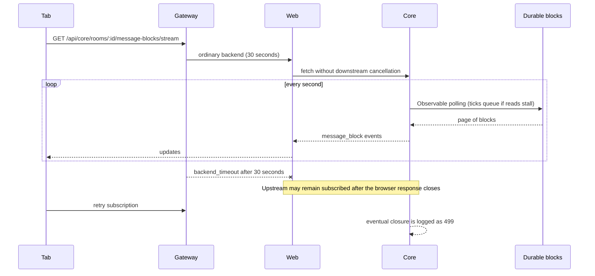

# Message-block connections: lifecycle and rollout

The 240-second deadline closes an HTTP subscription, not a room or a durable agent run. Each tab keeps its selected room and delivered block cursor in its own memory. No shared browser selection storage or database migration is added.

## Before



## After

```mermaid
sequenceDiagram
    participant Tab
    participant Edge as Gateway / Cloud Armor
    participant Web
    participant Core
    participant DB as Durable blocks
    Tab->>Edge: GET + Accept: text/event-stream
    Edge->>Web: dedicated backend (300 seconds); throttle openings
    Web->>Web: verify cookie; admit subject/pod slot
    Web->>Core: cancellable upstream fetch
    Core->>Core: authenticate/authorize; admit identity/org/pod slot
    alt capacity exhausted
        Core-->>Tab: 429 + Retry-After: 10 (no stream opened)
    else admitted
        loop caught up / catching up
            Core->>DB: one pending read, one block
            DB-->>Core: next block
            Core-->>Web: message_block; await drain before next read
            Web-->>Tab: pull-based bytes (64 KiB application buffering budget)
        end
        Core-->>Tab: heartbeat every 15 seconds
        Core-->>Tab: stream_end at 240 seconds; HTTP ends normally (200)
        Core->>Core: release all resources / slot once
        Web->>Web: release upstream reader / slot once
        alt run or approval/input pending
            Tab->>Edge: reopen after 0.5–1.5 seconds from delivered cursor
        else idle
            Tab->>Tab: paused; preserve room and delivered cursor
        end
        Note over Tab,DB: focus / visibility / next send coalesce into one restoration
        Tab->>Web: retrieve current session, run state, and missed block pages
        Web->>DB: authenticated history access
        DB-->>Tab: missed blocks (deduplicate by ID)
        Tab->>Edge: reopen from newest delivered cursor
        Tab->>Web: dispatch only the new prompt, once
    end
```

Transport cancellation propagates through both Web proxies, including Agent policy/assertion fetches. It does not invoke a run cancellation API. Other stream routes retain their existing gateway policies and lifetimes.

## Core provider responsibilities

Nest's `MessageBlockModule` registers shared singleton providers. The controller calls the 27-line `MessageBlockStreamWriter` facade, which creates a response adapter and delegates to the lifecycle:

| Provider                      | Responsibility                                                                                          |
| ----------------------------- | ------------------------------------------------------------------------------------------------------- |
| `MessageBlockStreamAdmission` | Identity, organization, and pod slots; pending-read leases; admission and cleanup metrics.              |
| `MessageBlockStreamLifecycle` | Polling and cursor advancement, heartbeats, connection rotation, cancellation, and Nest shutdown hooks. |
| `MessageBlockSseTransport`    | Per-response SSE encoding, headers, frame limits, drain deadlines, and HTTP completion.                 |

The lifecycle has no Express dependency. Only the transport adapter and controller facade access the HTTP response. Nest dependency injection owns the providers and invokes lifecycle shutdown hooks; explicit transport control preserves the requirement to stop reading under backpressure. A Nest-container regression test verifies shared quotas and shutdown cleanup using the production provider registrations.

## Fixed safety limits

| Process      | Total | Organization | Authenticated identity |
| ------------ | ----: | -----------: | ---------------------: |
| Core API pod |    32 |           16 |                      8 |
| Web pod      |    64 |            — |    8 verified subjects |

Limits are process-local; existing HPA ceilings are unchanged. Web admission happens after session verification and before upstream fetch. Core admission happens after global authentication and authorization, before response headers and database polling. Excess openings return 429 with `Retry-After: 10`; admitted streams are unaffected.

Core writes one encoded frame at a time, capped at 1 MiB. A write awaiting drain stops further reads; a consumer that cannot drain within ten seconds is closed. Oversized frames emit a non-retryable `stream_error` without advancing the cursor; the history endpoint remains available. Prisma cannot cancel an already issued projection query: closure stops waiting and schedules no further queries; its eventual result is discarded. A process-wide budget of 32 pending reads includes those settling after disconnection, so connection churn cannot accumulate unbounded queries. There are no queued polling ticks.

Web uses BYOB reads of at most 16 KiB and a 48 KiB byte queue, giving a 64 KiB application buffering budget. Node's fetch byte-stream support is required for message-block relays; ordinary responses retain a compatible default-reader fallback. Upstream error statuses and JSON bodies remain intact. Route bundles share one process-wide quota registry and health snapshot. SIGTERM/SIGINT abort live proxy fetches/readers and release slots before server termination.

The client tracks connected, reconnecting, paused, and failed states. A heartbeat or valid block resets consecutive failures. Unexpected failures back off from one second with 20% jitter and stop after five consecutive failures. Authentication and capacity rejections surface immediately. Normal rotations and idle suspension do not consume retries. Manual reconnect and the next send restore state; focus and visibility resume paused subscriptions, without restarting failed subscriptions automatically.

## Observability

Core `/metrics` exposes `message_block_active_streams`, `message_block_pending_reads`, `message_block_stream_rejections_total{scope}`, and `message_block_stream_closes_total{reason}`. Scope and reason values are finite; labels never contain users, organizations, or rooms. Request accounting retains 200 for completed rotation and 499 for incomplete responses. Admitted message-block consumer disconnects are INFO with `responseStatus: 200` and `outcome: client_disconnected`; server failures remain warnings. See [disconnect classification and replay recovery](message-block-recovery.md) for the additive follow-up and its current validation.

Web `/health` includes an aggregate `messageBlockStreams` snapshot (active, rejected by scope, closed by reason). Structured `message_block_proxy_opened`, `message_block_proxy_rejected`, and `message_block_proxy_closed` events expose the same bounded counters and close reasons through existing logs. They contain no identity or room identifiers. The dedicated backend preserves Cloud Armor and request logging.

The Terraform throttle matches decoded, normalized GET message-block stream paths: 300 openings per minute per source IP, excess denied with 429. Cloud Armor throttling is an edge safety control; application slot caps are the precise concurrency limits. See [Google's path normalization guidance](https://docs.cloud.google.com/armor/docs/rules-language-reference) and [rate-limiting behavior](https://docs.cloud.google.com/armor/docs/rate-limiting-overview).

## Original timeout rollout (historical)

These are local feature-branch changes from the current `release/0.5.0` checkouts. No commit, push, protected-branch merge, Terraform apply, or live deployment is included.

1. Review the changes and existing release quality failures described below. Build immutable Core and Web images through the approved release workflow.
2. Deploy Core cleanup/admission and Web cancellation/admission/client changes to development **while retaining the current 30-second Web HTTPRoute/backend**. Keep routing manifests out of this first deployment stage. Confirm readiness, resource cleanup, 429 behavior, and that agent runs survive transport closure.
3. Apply the reviewed Terraform Cloud Armor rule to development. Verify the existing Web security policy and priority-1000 throttle in edge logs. Do not apply production yet.
4. Apply the development Web streaming Service, HealthCheckPolicy, GCPBackendPolicy, and updated HTTPRoute. Check HTTPRoute `Accepted`/`ResolvedRefs`, backend policy attachment, healthy backend status, timeout 300 seconds, security policy, and logging. Ordinary Web requests must still use its 30-second backend. The new Service selects the existing pods; no extra deployment is created.
5. Run the 15-minute capacity gate below and inspect load-balancer logs for `/api/core/rooms/*/message-blocks/stream`: there must be no recurring 30-second `backend_timeout`. Confirm normal Core completions are 200 and client navigation/disconnection may still produce 499.
6. Verify three real browser tabs with separate rooms, an idle tab resumed after ten minutes, expired authentication, and a durable run/pending approval beyond ten minutes. Closing a tab must release slots without cancelling execution. Resume must retrieve missed blocks and never replay a send.
7. After development evidence is accepted, promote matching production manifests and images in the same order. Production rollout/merge remains separate.

Rollback the HTTPRoute to the ordinary Web backend first if the extended route is unhealthy. Keep cleanup and admission controls enabled. Do not raise capacity limits or HPA maxima as a timeout workaround.

The development GKE controller rejects HTTPRoute `matches.method` with
`GWCER104: Matching by method is not supported`. Match the room path and
`Accept: text/event-stream` at the gateway; Web still validates GET, the actual
message-block stream path, and authenticated identity. A Kubernetes render or
server-side dry-run does not check controller support. Verify the current
HTTPRoute generation has `Accepted=True` and the Gateway has reconciled before
calling the 300-second timeout active. A rejected route can leave the previous
URL map serving streams through the ordinary 30-second backend.

## Capacity harness

`scripts/message-block-capacity.mjs` requires a private JSON fixture containing fresh authenticated headers and pre-existing test rooms. Keep it outside Git; neither URLs nor credentials are included in test results. It performs identity/ninth-stream/slot-reuse checks, Core organization checks, and pod caps, followed by at least 900 seconds of rotations and deliberate connection churn. It checks heartbeats, normal connection duration, cleanup probes, memory below 80% of container limits, and progressive growth across five-minute sample windows.

Example shape (replace placeholders only in a private file):

```json
{
  "target": "core",
  "durationSeconds": 900,
  "profiles": [
    {
      "url": "http://127.0.0.1:3001/api/v1/rooms/TEST_ROOM/message-blocks/stream",
      "headers": { "Authorization": "Bearer PRIVATE_SESSION" },
      "identity": "fixture-a",
      "organization": "fixture-org-a"
    }
  ],
  "kubernetes": { "context": "DEVELOPMENT_CONTEXT", "namespace": "celesnity" },
  "pods": ["DEVELOPMENT_CORE_POD", "DEVELOPMENT_WEB_POD"],
  "probes": [
    { "kind": "core", "url": "http://127.0.0.1:3001/metrics" },
    { "kind": "web", "url": "http://127.0.0.1:3000/health" }
  ]
}
```

Use a port-forward to one specific Core pod for deterministic Core caps. Provide three distinct identities in the first organization, plus enough identities across other organizations to fill 32 streams without exceeding 16 per organization. Profiles must correspond to actual authenticated identities; fixture labels grant no access.

For the Web pod cap, use a specific Web pod and enough Core upstream capacity across its existing replicas, with at least eight distinct subjects. A Core 429 may prevent reaching Web's higher total cap; report this instead of treating it as proof of the Web cap. Web's total cap is independently verified in unit tests.

Run `target: "gateway"` separately against the development hostname to test the actual 300-second route and inspect Cloud Armor/LB logs. That mode skips deterministic per-pod admission probes, which the load balancer cannot pin. Use fresh isolated rooms and a quiet test window so cleanup probes can legitimately expect zero active streams.

```sh
STREAM_TEST_CONFIG=/private/development-stream-test.json node scripts/message-block-capacity.mjs
```

The harness's memory-growth check is a regression signal, not a heap analysis: it flags median growth above 2% of a container's limit in each consecutive five-minute window. Inspect the raw samples and container logs before drawing a root-cause conclusion.

## Original lifecycle verification and remaining gate (historical)

- Core full suite: 280 suites and 2,378 tests pass; 18 targeted lifecycle tests include real HTTP admission/cancellation and a pending-read budget under connection churn.
- Web lifecycle tests cover independent tabs/cursors, idle restoration, focus/send races, duplicate history/SSE blocks, active/pending rotations beyond ten minutes, retries/watchdog, auth/capacity status, oversized events, admission limits, and bounded cancellation-aware proxy reads.
- Web full suite: 2,105 tests pass; one existing route-privacy test fails on an untouched chat-screen/plugin-component import. Changed-file lint and formatting pass.
- Web visual suite: all 68 checks pass, including capacity reconnect, idle focus/visibility restoration, and expired authentication recovery.
- Built Next server smoke test passes: shared quota/health state, eight admitted streams, ninth 429 with Retry-After, slot reuse, upstream cancellation, and SIGTERM cleanup.
- Core/Web builds and typechecks are run against regenerated release dependencies.
- Development and production Kubernetes overlays render; streaming selectors, health checks, route matches, policies, and unchanged HPA limits are inspected.
- Terraform development and production validate using an isolated configuration copy without remote state. The cached live GCP credentials returned `invalid_rapt`; no state write or apply was attempted.
- Existing release failures are outside this change: Core lint has an empty catch in `google-sheets-writer.ts`; Core formatting already reports 63 untouched files. Web has existing plugin/composer lint issues and formatting violations, and its route-privacy test rejects the chat screen's existing import from plugin route-local components. Changed files are checked separately.
- **Not yet performed:** deployment, live backend health/policy verification, fresh authenticated browser sessions, the 15-minute development gate, live memory/churn evidence, and production promotion. Local test/build success does not establish development recovery.
