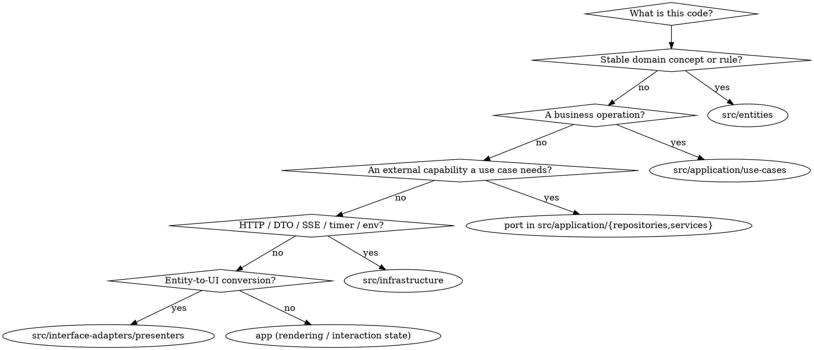

# Clean Architecture Rules

## Overview

Dependencies point inward. Business code must not know about React, Next.js,
`fetch`, `EventSource`, or the Core API's DTOs.

Full rationale and worked examples: `clean-architecture-guide.md` in this folder.
This SKILL.md is the decision procedure.

## Allowed dependencies (lint-enforced)

| From                                                       | May import                                           |
| ---------------------------------------------------------- | ---------------------------------------------------- |
| `app/**`                                                   | `app`, `di`, controllers, presenters, entities       |
| `src/interface-adapters/controllers`                       | use cases, presenters, entities                      |
| `src/interface-adapters/presenters`                        | entities                                             |
| `src/application/use-cases`                                | use cases, repository ports, service ports, entities |
| `src/application/repositories`, `src/application/services` | entities                                             |
| `src/entities`                                             | entities                                             |
| `src/infrastructure`                                       | infrastructure, ports, entities                      |
| `di`                                                       | every layer it composes                              |

Anything else fails `npm run lint`. Type-only imports, relative imports, and
alias imports are all covered — `tests/unit/tooling/architecture-boundaries.test.ts`
proves the bypasses are closed.

## Placement decision



## Hard rules

- A controller validates boundary input, calls **exactly one** use case, and
  returns a presenter result.
- A use case never calls another use case. Share a private pure helper in the
  same feature folder, or promote the capability to a service port.
- A presenter returns a new immutable ViewModel. Deep-copy nested data; never
  hand out an Entity or DTO reference; never expose credentials.
- Infrastructure translates its errors (`CoreApiError`, `Failed to fetch`) into
  application errors before they cross inward.
- DI is the only place that names concrete implementations.
- React owns rendering, interaction state, and cleanup — nothing else.

## Rationalization table

| Excuse                                                        | Reality                                                                                            |
| ------------------------------------------------------------- | -------------------------------------------------------------------------------------------------- |
| "It is one `fetch`, the component is simpler this way"        | Boundary lint rejects it, and the endpoint becomes untestable. Add a port + use case + controller. |
| "The use case just needs this other use case"                 | Extract a pure helper. Use-case chains make DI and failure modes unreadable.                       |
| "The presenter can return the entity, the UI won't mutate it" | Presenters exist to make that impossible. Copy.                                                    |
| "I'll put the DTO type in entities so both sides can use it"  | The domain then tracks Core API renames. Map in infrastructure.                                    |
| "TypeScript compiles, so the dependency is fine"              | `tsc` does not check direction. Run `npm run lint`.                                                |
| "I'll disable the boundaries rule for this file"              | Never. Fix the placement instead.                                                                  |

## Verify

```bash
npm run lint    # boundaries/dependencies
npm test        # includes tests/unit/tooling/architecture-boundaries.test.ts
```
