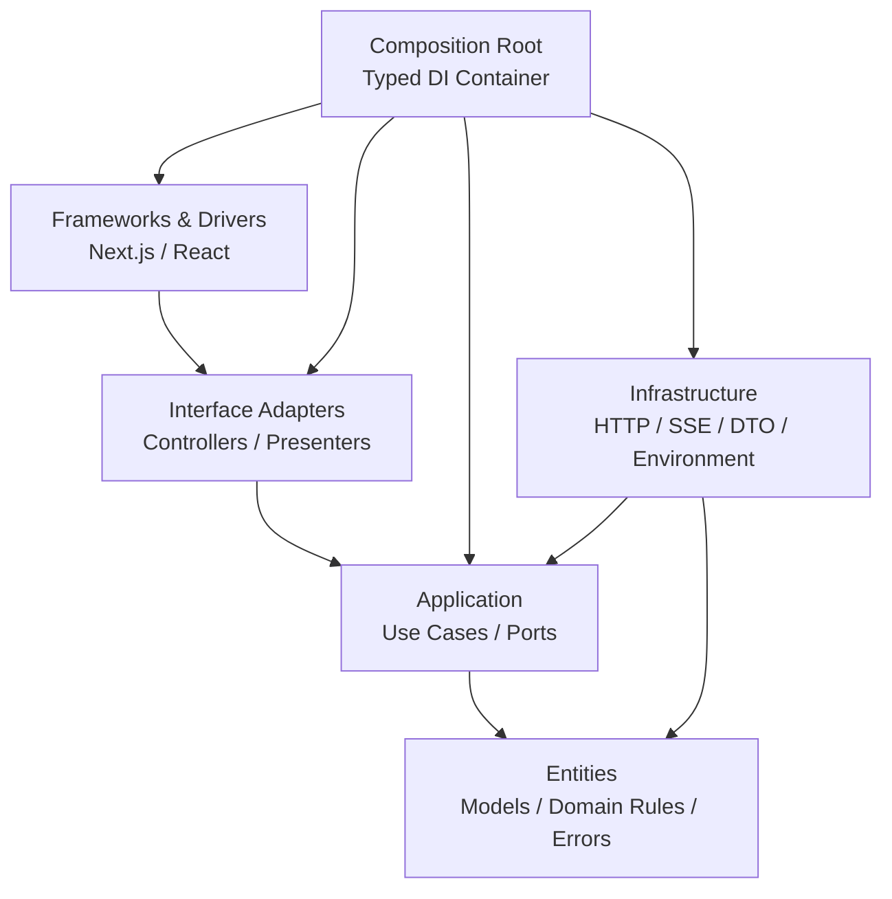
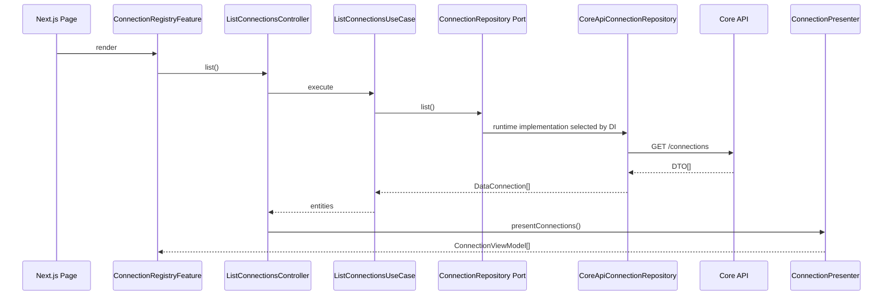

# Clean Architecture in Celesnity Web

This guide explains the architecture of `celesnity-web`, how to work with it,
what problems it solves, and why the source code is divided into its current
layers.

It is intended for:

- New team members and junior developers who need a practical introduction.
- Mid-level and senior developers who need a reference for dependency rules,
  dependency injection, testing, and feature development.

## 1. Executive summary

The project follows the most important Clean Architecture principle:

> Business code must not depend on frameworks, browsers, HTTP clients, or a
> specific external API.

In practical terms:

- Entities do not know that React, Next.js, or the Core API exists.
- Use cases depend only on interfaces that describe the capabilities they need.
- Infrastructure implements those interfaces with `fetch`, `EventSource`, and
  the Core API.
- Controllers translate UI input into use-case calls.
- Presenters translate entities into immutable, UI-safe ViewModels.
- The DI container is the only place that composes concrete implementations.
- React focuses on rendering and interaction state.

Source-code dependencies point inward:



The arrows represent **source-code dependencies**, not the order in which a
runtime request is executed.

## 2. Why does this project need Clean Architecture?

`celesnity-web` is more than a collection of CRUD pages. It coordinates several
non-trivial workflows:

- Registering PostgreSQL connections while protecting credentials.
- Saving script metadata, publishing an immutable source version, and running
  the exact version that was just published.
- Monitoring executions through SSE, falling back to polling, and loading a
  final detail snapshot.
- Browsing catalogs with lazy-loaded namespaces, tables, metadata, snapshots,
  and previews.
- Submitting asynchronous SQL queries and displaying status, statistics,
  results, and failures.
- Communicating with the Core API, Trino, Spark, PostgreSQL, and MinIO.

If all of this logic lived inside React components, a small change could affect
all of the following at once:

- UI state.
- API call ordering.
- DTO mapping.
- Error handling.
- Timer and SSE lifecycle.
- Business rules.

Clean Architecture separates these reasons for change. Replacing `fetch` with
another transport primarily affects Infrastructure. Changing the UI does not
change a use case. Changing a Core API DTO does not force Entities or React
components to understand the new DTO shape.

## 3. Project structure

```text
celesnity-web/
├── app/                          # Next.js, React, CSS, and interaction state
│   ├── (workspace)/             # Route pages
│   └── _components/
│       ├── catalog-explorer/
│       ├── connection-registry/
│       ├── execution-monitoring/
│       ├── query-workbench/
│       ├── script-workbench/
│       ├── shared/
│       └── workspace/
├── di/                           # Composition root and typed injection tokens
│   ├── container.ts
│   ├── types.ts
│   └── modules/
├── src/
│   ├── entities/                 # Domain models, rules, and application errors
│   ├── application/
│   │   ├── repositories/         # Repository ports
│   │   ├── services/             # Scheduler and progress-service ports
│   │   └── use-cases/            # Business operations
│   ├── interface-adapters/
│   │   ├── controllers/          # Input validation and use-case calls
│   │   └── presenters/           # Entity-to-ViewModel mapping
│   └── infrastructure/
│       ├── api/                   # Core API client, schema, and DTO mapping
│       ├── configuration/         # Public environment parsing
│       ├── repositories/          # Core API repository implementations
│       └── services/              # EventSource and browser scheduler
└── tests/unit/                    # Tests organized by architectural layer
```

## 4. Layer responsibilities

### 4.1. Entities

Location: `src/entities`

Entities contain the stable language of the domain:

- `DataConnection`, `Script`, `ExecutionDetail`, `Catalog`, and
  `QueryExecution`.
- Execution status and terminal/cancellable rules.
- Rules for handling sensitive data, such as sanitizing connection verification
  messages.
- Application-level errors such as `NotFoundError`, `ConflictError`,
  `RemoteServiceError`, `ScriptPublishError`, and `ScriptRunError`.

Entities may depend on other Entities. They must not import:

- React or Next.js.
- Repository implementations.
- `fetch`, `EventSource`, or browser APIs.
- The DI container.
- OpenAPI DTOs.

**Why?** Domain models should remain useful when the framework, API client, or UI
changes.

### 4.2. Application

Location: `src/application`

The Application layer answers the question: **what business operations can the
system perform?**

Each operation has a dedicated use case, for example:

- `list-connections.use-case.ts`
- `save-and-run-script.use-case.ts`
- `monitor-execution.use-case.ts`
- `preview-table.use-case.ts`
- `submit-query.use-case.ts`

Application also owns the ports required by those operations:

- Repository interfaces for loading and persisting domain data.
- Service interfaces for scheduling, progress subscriptions, and other external
  capabilities.

Example repository port:

```ts
export interface ConnectionRepository {
  list(): Promise<readonly DataConnection[]>;
  get(id: string): Promise<DataConnection>;
  create(input: DataConnectionInput): Promise<DataConnection>;
  update(id: string, input: DataConnectionInput): Promise<DataConnection>;
  archive(id: string): Promise<void>;
}
```

The use case depends only on the interface:

```ts
export const createListConnectionsUseCase = (repository: ConnectionRepository) => () =>
  repository.list();
```

The use case does not know whether data comes from HTTP, memory, IndexedDB, or a
test fake.

#### Why does Application own repository interfaces?

Application is the consumer that needs the capability, so Application defines
the contract. Infrastructure follows that contract instead of forcing business
logic to depend on a technology. This is the Dependency Inversion Principle.

Use cases do not call other use cases. When two operations share logic, they use
a private pure helper in the same feature. For example, save-script and
save-and-run share a draft-persistence helper without creating a hidden chain of
use-case calls.

### 4.3. Interface Adapters

Location: `src/interface-adapters`

This layer translates between the language of the UI and the language of the
Application layer.

#### Controllers

A controller:

1. Accepts input from the UI.
2. Validates boundary input when the operation has input.
3. Calls exactly one use case.
4. Uses a presenter to return a ViewModel.
5. Allows application errors to reach the UI error adapter.

Example:

```ts
export const createListConnectionsController = (useCase: ListConnectionsUseCase) => async () =>
  presentConnections(await useCase());
```

Controllers prevent React from importing use cases, repositories, or
Infrastructure.

#### Presenters

A presenter converts an Entity into an immutable ViewModel suitable for the UI.

Presenters have three important purposes:

- Prevent credentials, DTOs, and transport objects from reaching the UI.
- Keep the UI independent from internal Entity shapes.
- Centralize copying and formatting before data is rendered.

A presenter must deep-copy nested data when a ViewModel must not retain a shared
mutable reference to a repository DTO or Entity.

### 4.4. Infrastructure

Location: `src/infrastructure`

Infrastructure contains technology-specific details:

- `CoreApiClient` and `fetch`.
- Generated OpenAPI types.
- Request and response DTO mapping.
- URL encoding.
- Repository implementations.
- `EventSource` implementations for SSE.
- Browser scheduling for polling.
- Environment parsing.

Example:

```ts
export class CoreApiConnectionRepository implements ConnectionRepository {
  public constructor(private readonly transport: GeneratedApiTransport) {}

  public async list(): Promise<readonly DataConnection[]> {
    const response = await this.transport.request('/connections', {
      method: 'GET',
    });
    return response.map(mapConnection);
  }
}
```

Infrastructure translates technology-specific errors into application errors
before they cross the boundary. `CoreApiError` must not be exposed directly to a
use case or UI component.

#### Why does DTO mapping belong here?

A DTO is the Core API contract, not the web application's domain model. The API
may change field names or casing without forcing the domain and UI to change.

### 4.5. Dependency Injection

Location: `di`

The DI container is the Composition Root: the place where interfaces are wired
to concrete implementations.

The Connections module composes this object graph:

```text
CoreApiClient
    -> CoreApiConnectionRepository
    -> ListConnectionsUseCase
    -> ListConnectionsController
```

A feature root resolves controllers only:

```ts
const controllers = Object.freeze({
  list: getInjection('ListConnectionsController'),
  create: getInjection('CreateConnectionController'),
  update: getInjection('UpdateConnectionController'),
});
```

The typed DI wrapper checks that:

- A token resolves to the expected return type.
- A factory or class is bound to the correct target.
- The dependency tuple is in the correct order.
- Repositories and services are not cross-wired between features.

#### Why may DI import every layer?

One location must know the concrete implementations in order to construct the
object graph. Concentrating that knowledge in a single Composition Root is safer
than allowing every React component to instantiate repositories.

### 4.6. Frameworks and Drivers

Location: `app`

The outermost layer contains:

- Next.js routes, layouts, and metadata.
- React Client Components and hooks.
- CSS and visual formatting.
- Loading, empty, error, and retry states.
- Selection, dialogs, tabs, drafts, and expanded-tree state.
- Applying controller results to visible collections.

React must not contain:

- DTO mapping.
- Persistence sequencing.
- Business normalization.
- SSE-to-polling orchestration.
- Infrastructure-specific error inspection.
- Repository construction.

## 5. A complete request flow

When a user opens `/connections`, the flow is:



Important observations:

- The use case calls an interface and does not import the concrete repository.
- DI selects the concrete repository at runtime.
- DTOs stop at the Infrastructure boundary.
- The UI receives ViewModels only.

## 6. SSE and polling workflows

Execution and Query monitoring are more complex than ordinary request-response
operations.

### Execution monitoring

1. The Application monitor opens SSE through `ExecutionProgressService`.
2. Progress events update the current status.
3. If SSE fails, the monitor switches to polling every 3000 ms.
4. Polling requests are coalesced so they cannot overlap.
5. A terminal status closes the active transport and timer.
6. The monitor loads one final detail snapshot to obtain `finishedAt`, failure
   details, and resource profile data.
7. `close()` releases all resources and suppresses late callbacks.

### Query monitoring

1. Run an immediate seed refresh.
2. Prefer SSE.
3. Fall back to polling every 1500 ms.
4. Coalesce refreshes to avoid overlapping requests.
5. Notify the UI whether the active channel is `streaming` or `polling`.
6. Close all resources after a terminal status.

This orchestration belongs in Application because it defines operation behavior,
not React rendering behavior. Infrastructure supplies the SSE and timer
implementations.

## 7. Enforced dependency rules

| From                             | Allowed dependencies                               |
| -------------------------------- | -------------------------------------------------- |
| `entities`                       | `entities`                                         |
| `application/repositories`       | `entities`                                         |
| `application/services`           | `entities`                                         |
| `application/use-cases`          | use cases, repository/service interfaces, entities |
| `interface-adapters/presenters`  | entities                                           |
| `interface-adapters/controllers` | use cases, presenters, entities                    |
| `infrastructure`                 | infrastructure, application interfaces, entities   |
| `app`                            | app, DI, controllers, presenters, entities         |
| `di`                             | every layer required for composition               |

These rules are enforced by `eslint-plugin-boundaries` in `eslint.config.mjs`.
They are not documentation-only conventions.

Invalid example:

```ts
// An Entity must not know the Core API client.
import '@/src/infrastructure/api/core-api-client';
```

```ts
// A React component must not call a repository directly.
import { CoreApiConnectionRepository } from '@/src/infrastructure/repositories/core-api-connection.repository';
```

`npm run lint` rejects these dependencies. Architecture mutation tests also
cover alias imports, relative imports, type-only imports, unclassified
`.ts`/`.tsx` files, and extension bypasses.

## 8. How to add a new operation

Assume a new operation is required in the Connections feature. Work from the
inside out.

### Step 1: Define the domain vocabulary

If a new model or stable rule is required, add it to:

```text
src/entities/models/connection.ts
```

Only add concepts with stable domain meaning. A field used only by an API
response belongs in a DTO. A field used only for rendering belongs in a
ViewModel.

### Step 2: Extend the port

Add the required capability to:

```text
src/application/repositories/connection.repository.interface.ts
```

The contract must use Entity or Application input types. It must not expose an
OpenAPI DTO or `Response`.

### Step 3: Write the use case

Create an operation-specific file:

```text
src/application/use-cases/connections/<operation>.use-case.ts
```

The use case owns business validation, normalization, and port orchestration. It
must not contain UI formatting or an API URL.

### Step 4: Add a presenter and controller

- Update `connection.presenter.ts` if the UI needs a new ViewModel.
- Create a controller in `interface-adapters/controllers/connections`.
- Add an input schema beside the controllers when boundary validation is needed.

The controller must call exactly one use case.

### Step 5: Implement Infrastructure

Update `CoreApiConnectionRepository`:

- Use the correct HTTP method and endpoint.
- Encode path segments.
- Map Entity/Application input to a request DTO.
- Map the response DTO to an Entity.
- Translate errors.
- Copy nested data when shared mutation must be prevented.

### Step 6: Bind the operation in DI

Update:

- `di/types.ts` with the token and return type.
- `di/modules/connections.module.ts` with repository, use-case, and controller
  bindings.
- `di/container.ts` only when adding a completely new module.

### Step 7: Use the controller in App

Resolve the controller in the feature root and pass a frozen controller object
to the screen.

The route page renders the feature root only. The screen does not resolve a
repository or use case.

### Step 8: Add tests at the correct boundaries

At minimum, verify:

- Entity rules when a new domain rule is introduced.
- Use-case input, output, and dependency-call ordering.
- Repository path, method, body, DTO mapping, and error translation.
- Controller validation, one use-case call, and presenter output.
- DI binding when a token is introduced.
- UI lifecycle when the operation includes a race, timer, or subscription.

### Step 9: Run the quality gate

```bash
npm test
npm run coverage
npm run typecheck
npm run lint
npm run format:check
npm run build
git diff --check
```

## 9. How to choose the correct layer

| Question                                                    | Destination                                                    |
| ----------------------------------------------------------- | -------------------------------------------------------------- |
| Is this a stable domain model or rule?                      | `entities`                                                     |
| Is this a business operation?                               | `application/use-cases`                                        |
| Does a use case need an external capability?                | `application/repositories` or `application/services` interface |
| Is this boundary input validation?                          | controller schema                                              |
| Is this Entity-to-UI conversion?                            | presenter                                                      |
| Is this HTTP, DTO, EventSource, timer, or environment code? | `infrastructure`                                               |
| Does this compose implementations?                          | `di`                                                           |
| Is this rendering or interaction state?                     | `app`                                                          |

If one file answers “yes” to several rows, it may have too many
responsibilities.

## 10. Error handling

Errors cross boundaries in the same way as data:

```text
fetch/CoreApiError
    -> Infrastructure translation
    -> Entity/Application error
    -> Controller
    -> UI contextual message
```

Rules:

- Infrastructure errors do not escape Infrastructure.
- A server message is displayed only when classified as safe.
- Native transport details such as `Failed to fetch` may be replaced with a
  contextual fallback.
- Partial success must preserve data that was already saved successfully.

For save-and-run script:

- If publication fails after metadata is saved, throw `ScriptPublishError` with
  the persisted script.
- If execution startup fails after publication, throw `ScriptRunError` with the
  saved script and version.

This prevents the UI from incorrectly reporting that the entire operation
failed.

## 11. Testing strategy

| Layer          | Test focus                                                        |
| -------------- | ----------------------------------------------------------------- |
| Entities       | Pure rules, status helpers, sanitization, and error types         |
| Application    | Orchestration, sorting, normalization, and monitor lifecycle      |
| Infrastructure | HTTP contracts, DTO mapping, encoding, and error translation      |
| Controllers    | Boundary validation, one use-case call, and ViewModel output      |
| Presenters     | Field filtering and immutable/deep-copy output                    |
| DI             | Tokens, factory targets, dependency order, and runtime resolution |
| App            | Controller wiring, UI states, races, and cleanup                  |
| Tooling        | Alias resolution, architecture rules, and standalone output       |

Testing a use case with a fake repository is fast and requires no browser,
network, or Docker. Testing a repository with a fake transport verifies the
exact HTTP contract without making a real request.

## 12. Running the project

Node.js `>=22` is required.

### Development

Start Infrastructure:

```bash
cd ../celesnity-infra
docker compose up -d --build --wait
```

Build and start the Core API:

```bash
cd ../celesnity-core
npm run prisma:migrate:deploy
npm run build
npm run start
```

Start the worker in another terminal:

```bash
cd ../celesnity-core
npm run start:worker
```

Start the web app with hot reload:

```bash
cd ../celesnity-web
npm run dev
```

Open `http://localhost:3000`. The Core API defaults to
`http://localhost:3001/api/v1`.

### Local production build

```bash
npm run build
npm run start
```

The build script prepares the standalone server with `.next/static` and optional
`public` assets.

### Regenerate OpenAPI types

The Core API must be running first:

```bash
npm run api:generate
```

The generated file is written to:

```text
src/infrastructure/api/generated/schema.d.ts
```

## 13. Practical benefits

### Easier testing

A use case is a function that depends on an interface, so it can be tested
without React, network access, or Docker.

### Easier technology changes

The Core API transport or SSE implementation can be replaced without rewriting
business rules.

### Smaller change radius

An API DTO change primarily affects Infrastructure mapping. A UI change
primarily affects App and Presenters.

### Data protection

Presenters prevent credentials from reaching the UI. Infrastructure sanitizes
server details before returning Entities.

### Easier code review

Reviewers know to look for business rules in Use Cases, HTTP contracts in
Repositories, and rendering behavior in App.

### Fewer races and resource leaks

Monitoring lifecycle has an explicit owner and is tested with fake timers,
delayed promises, selection changes, and unmounts.

### Automated architecture enforcement

Incorrect dependency directions are rejected before merge instead of relying on
developer memory.

## 14. Trade-offs

Clean Architecture is not free.

### More files

One operation may require a port, use case, controller, presenter,
implementation, and tests. In return, each file is smaller and has one reason to
change.

### A dependency-direction learning curve

New team members must learn where code belongs. The table in section 9 and the
ESLint rules reduce mistakes.

### Additional DI abstraction

Objects are not constructed at their point of use. In return, composition is
centralized, typed, and testable.

### Not every helper needs a use case

Pure visual formatting, CSS state, and UI toggles should remain in App. Moving
every small helper into Application creates abstractions without value.

## 15. Common mistakes

### Calling an API directly from a component

The UI becomes coupled to endpoints, DTOs, and transport errors. Add a repository
capability, use case, and controller instead.

### Putting DTOs in Entities

The domain becomes coupled to the Core API schema. Map DTOs in Infrastructure.

### Returning an Entity or DTO reference from a presenter

The UI may mutate another layer's data. Create a new ViewModel and deep-copy the
required nested data.

### Calling one use case from another

The call graph becomes difficult to control and DI becomes more complex. Share a
private pure helper, or promote the capability to a service port when
appropriate.

### Constructing a repository in the UI

Concrete dependencies become scattered across components. Bind the repository
in a DI module and resolve a controller at the feature root.

### Incorrect SSE or timer cleanup

This can cause duplicate polling, late callbacks, or a missing final snapshot.
Keep orchestration in the Application monitor and test close, reentrant close,
selection changes, and unmount.

### Skipping `npm run lint`

TypeScript may compile even when a dependency direction is wrong. Boundary lint
is part of the architecture, not an optional formatting step.

## 16. Code-review checklist

- [ ] Business rules live in Entities or Use Cases, not React components.
- [ ] Use cases depend on interfaces, not concrete Infrastructure.
- [ ] A controller validates input and calls exactly one use case.
- [ ] A presenter does not expose credentials, DTOs, or shared mutable
      references.
- [ ] A repository preserves method, URL, encoding, body, and mapping contracts.
- [ ] Infrastructure errors are translated before crossing inward.
- [ ] DI tokens, return types, and dependency order are correct.
- [ ] Timers, SSE streams, and subscriptions have clear ownership and cleanup.
- [ ] Loading, empty, partial-success, and error behavior are preserved.
- [ ] Tests are added at the correct layer.
- [ ] Tests, typecheck, lint, formatting, and build all pass.

## 17. Conclusion

The purpose of this architecture is not to create many folders. Its purpose is
to make the following decisions explicit:

- Where business rules belong.
- Which layers may know about other layers.
- Where external technologies can be replaced.
- At which boundary data and errors are translated.
- How each behavior can be tested without starting the entire system.

When adding a feature, start with the operation and domain contract, work from
the inside out, and compose concrete implementations through DI. If code is only
moved into new folders while React still calls the API directly or use cases
still know about `fetch`, Clean Architecture has not actually been applied.
