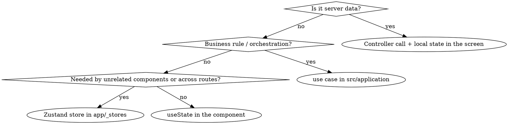

# State Management

## Overview

Zustand holds **client interaction state that outlives a component and is needed
by unrelated components**. Everything else stays local (`useState`/`useReducer`)
or belongs in the Application layer.

Stores live in `app/_stores/<name>.store.ts`. Reference implementation:
`app/_stores/locale.store.ts`.

## Decision



Server data (connections, executions, query results) is fetched through a
controller and held by the screen that owns it. Do not cache it in a store — a
store copy has no invalidation story and will drift from the Core API.

## Store pattern

```ts
import { create } from 'zustand';

interface PanelState {
  readonly expandedIds: readonly string[];
  readonly toggle: (id: string) => void;
}

export const usePanelStore = create<PanelState>()((set) => ({
  expandedIds: [],
  toggle: (id) =>
    set((state) => ({
      expandedIds: state.expandedIds.includes(id)
        ? state.expandedIds.filter((value) => value !== id)
        : [...state.expandedIds, id],
    })),
}));
```

Rules:

- `create<T>()(...)` — the curried form, so the state type is enforced.
- State fields are `readonly`; produce new arrays/objects instead of mutating.
- Subscribe with a selector (`useStore((s) => s.field)`), never the whole store —
  whole-store subscriptions re-render on every unrelated change.
- Actions live in the store next to the state they change.
- One store per concern, named `<concern>.store.ts`.
- Any file importing a store needs `'use client'`.
- Stores never import from `src/` beyond entity/adapter types, never call
  controllers, and never contain business rules.

## Persistence and SSR

Persisted stores must not change the first client render, or hydration breaks.
Follow `locale.store.ts`:

- `persist(..., { name, partialize, merge, skipHydration: true })`
- Validate persisted values in `merge` and fall back to the default when the
  stored value is unknown — persisted data is untrusted input.
- Rehydrate from an effect after mount (see
  `app/_i18n/locale-hydration.tsx`).

## Testing

```ts
afterEach(() => {
  window.localStorage.clear();
  useLocaleStore.setState({ locale: defaultLocale });
});
```

Reset store state after every test; module-scoped stores leak between tests.
`tests/unit/app/internationalization.test.ts` shows persistence, rehydration, and
corrupt-value tests.

## Common mistakes

| Mistake                                     | Fix                                   |
| ------------------------------------------- | ------------------------------------- |
| Store mirrors Core API data                 | Keep it in the screen that fetched it |
| Store contains normalization or validation  | Move to a use case                    |
| `const state = useStore()`                  | Select the field you need             |
| Store mutated directly (`state.items.push`) | Return new state from `set`           |
| Persisted store without `skipHydration`     | Hydration mismatch on first paint     |
| Store used from a server component          | Add `'use client'` or lift the state  |
